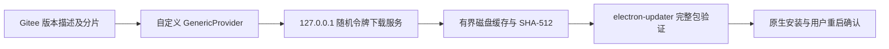

# ADR: Gitee 分片更新

当前实现已加入跨版本增量补丁，使用同一 Gitee 源。完整分片承担首次安装和回退。协议及发布步骤见 [自动更新](auto-update.md)。

原始决定：用户于 2026-10-13 选择分片方案。发布目标为 a1meon_admin/halframe-releases。

要求：单附件小于 100M；仅确认后下载；断网可重试；不改变完整安装包；保留 SHA-512 和原生签名/安装验证；下载与合并不要求用户操作。Mac 标准安装仍需要 Developer ID 签名资格。

决定：每个安装包拆为最多 64 MiB 的有序附件。标准 latest*.yml 保留完整包大小/哈希，并在 file 信息中附加 qingtuParts。使用 electron-updater 支持的 custom provider，继承 GenericProvider 读取版本信息，并仅对分片文件将下载 URL 改为带随机令牌的本机回环服务。服务从原发行目录获取分片，流式写盘，验证各片与完整包，随后供标准 updater 下载、缓存、验证和安装。禁用分片的差分下载；保留完整包校验与平台签名验证。

边界：回环服务不监听外网，拒绝其他路径/方法；分片 URL 限于当前发行目录，生产源为 HTTPS；每片和总包大小有上限；完整包和已校验分片可复用，损坏缓存必须重下；取消和断网不能产生可安装的半包；临时拼接文件校验后原子改名。最多一个包传输，缓存按当前包回收。不修改签名校验逻辑，不关闭系统保护。

替代方案：国内对象存储可用标准完整文件，但需要额外账号/存储，用户选择 Gitee 分片。降低 Electron 到不受支持版本不能作为体积方案。分片增加下载/发布协议维护，首版需安装支持此协议的新客户端；测试覆盖真实 HTTP、损坏、断网、重试、取消、路径隔离与标准 updater 对完整包的检验。

文件：desktop/chunk-download.cjs（校验、缓存、回环服务），desktop/chunk-provider.cjs（SDK 集成），scripts/prepare-chunk-release.cjs（分片与元数据），tests/chunk-update.test.cjs（真实 HTTP），desktop/chunk-smoke.cjs（真实 SDK）。
