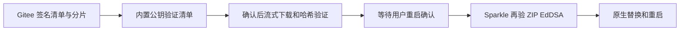

# ADR: Mac 免费签名与 Sparkle 更新

状态：用户于 2026-10-13 批准，替代原 Mac Squirrel 更新路线。Windows 保留已上线的 NSIS。

要求：不依赖付费 Apple 会员；启动检查、确认后下载、离线安静、手动检查、明确重启；Gitee 64 MiB 分片；完整包与发布者真实性验证；不改图片工作流。首次安装仍可能需要 macOS 用户确认。

决定：Mac 使用 Sparkle 2.9.6 和按由内向外顺序生成的 ad-hoc 代码签名。只将更新公钥放入应用。每版发布 Ed25519 签名的小型清单（版本、架构、完整 ZIP 哈希、分片哈希、Sparkle 原始 ZIP 签名）。自定义 Node 适配器在确认后流式下载和合并；先验证清单签名，再验证其认证的各片和完整包哈希。只有用户点击重启更新，才启动 Sparkle 的安装会话。Sparkle 使用官方 SPUUserDriver 桥接，重新验证 ZIP EdDSA、解压、替换及重启。

这样避免 Sparkle 在“下载完成但用户尚未确认重启”时自动在退出后安装。完整 ZIP 从随机令牌的 127.0.0.1 服务交给 Sparkle。该服务只在本机可访问；不开放网络接口；无需公网全量附件。通过 NSAllowsLocalNetworking 允许本地传输，不关闭全局 ATS 或 Gatekeeper。

替代：Sparkle 标准窗口会产生第二套确认界面且已暂存安装可能在退出后进行；自写脚本替换 app 缺少成熟安装恢复；继续 Squirrel 需要 Developer ID。选择自定义 SPUUserDriver，仅处理展示与用户选择，包验证与安装保留官方 SDK。

风险：免费签名不能公证、不能获得 Apple 开发者身份认可；首次启动与受管 Mac 限制由系统处理。桥接需 arm64/x64 原生构建和真实两版本测试。公钥轮换需要已有密钥认证，私钥丢失时可能需要手动重装；密钥仅本机受限目录并提示备份。旧版不包含 Sparkle，首次需要安装新基线。发布必须包含 Windows 元数据，避免 Windows latest 被 Mac 单平台发布遮断。
