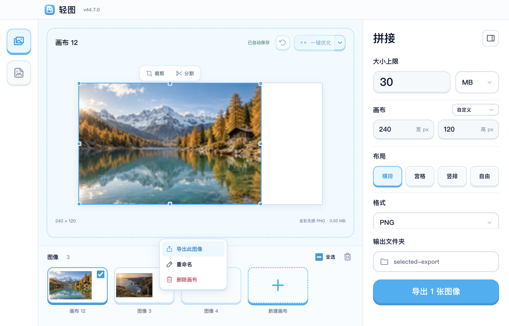
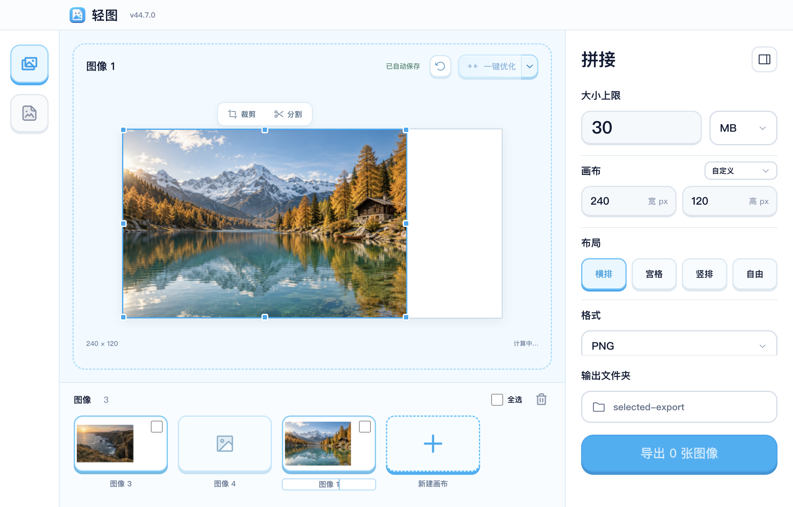

# 画布视图稳定与底部重命名（2026-10-16）

取消图片选择后，画布的屏幕位置与显示尺寸保持不变，只隐藏选中控件和画布外像素。根因是 selected 和 editing 同为空时，原来的相等判断误认为裁剪面板已经打开，导致视口为面板预留空间。修复要求实际存在选中图片才能进入裁剪视图。

底部画布卡片支持双击名称，或右键选择“重命名”。Enter 或移开焦点保存，Esc 取消；正常关闭窗口会提交尚未确认的输入。重命名其他卡片时先打开该画布，复用已有自动保存队列。标题、底部卡片、导出选择和实际文件名均沿用修改后的名称。

验证使用隔离的 Electron 项目与样例，未操作用户的项目或替换正在运行的应用。当前网页预览由本地服务自动更新。本轮仅提交源码，不发布新安装包。

隔离检查直接比较取消选择前后的 DOM 边界：位置 x=282.281、y=208，大小 443.438 × 307 屏幕像素，四项完全一致。原来的回归用例会缩成 273 × 189；实际项目几何未改变。参见 [边界报告](canvas-card-rename-validation/canvas-bounds.json)。

截图为 Electron 开发测试窗口，顶栏版本是测试运行时版本。

264 项单元测试与全部 22 项检查通过，包含构建、画布、裁剪、分割、布局恢复、优化、实际单张/多张导出、PNG 画质/体积上限和更新流程。重命名检查覆盖双击、右键、Enter、失焦、Esc、重载，以及实际输出“画布 12.png”和“我的成片.v1.2.png”。窗口关闭检查的五种情形全部通过，包含未确认名称提交，以及真实保存失败仍阻止关闭。参见 [检查记录](canvas-card-rename-validation/verification.json)、[重命名/导出/重载](canvas-card-rename-validation/rename-export-reload.json)、[关闭输入保存](canvas-card-rename-validation/close-typed-name.json)。

测试中出现过隔离窗口最小化导致重绘等待的问题，测试辅助代码只恢复自己的窗口后继续；另一次优化设置检查超时，顺序重试通过，未因此修改产品行为。
