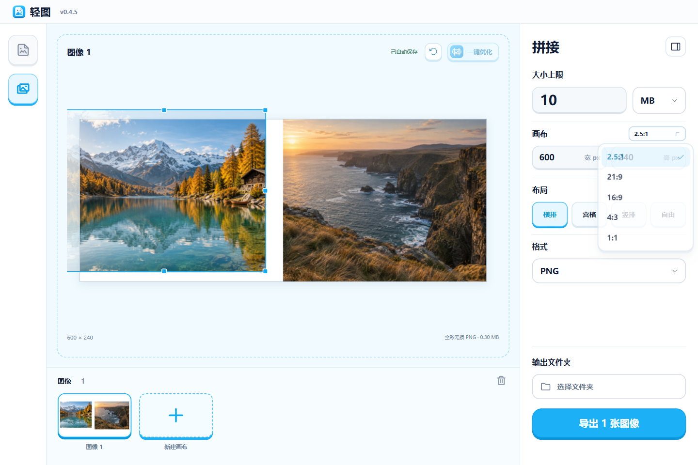
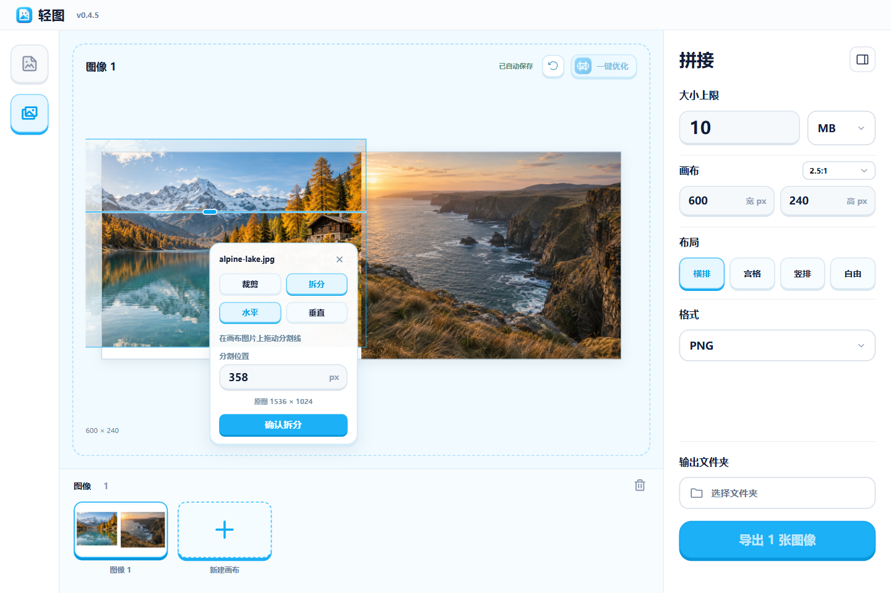
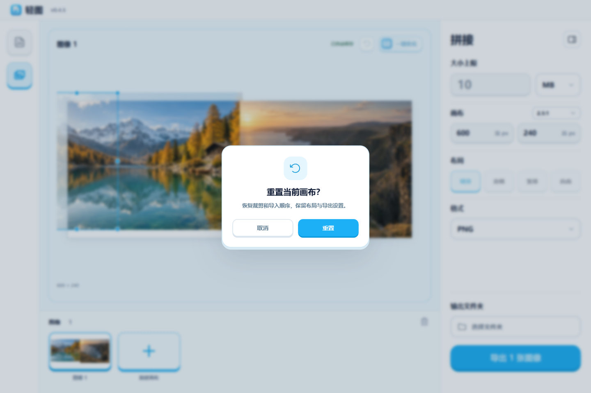
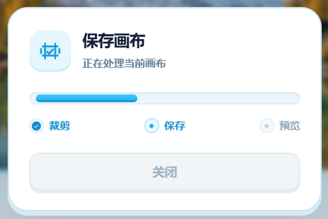

# 画布交互与布局恢复

后续导入贴合规则及验证见 [content-canvas.md](content-canvas.md)：每次导入重新贴合全部内容，各布局分别恢复画布与位置；手动拖动仍保持画布尺寸。本文保留当时的其他交互记录。

2026-10-14，Windows，Node 24.14.0，分支 `codex/stitch-and-quality`。本次在既有固定画布、全彩 PNG 和自动保存上更新交互，不发布安装包。

横排、宫格、竖排、自由分别自动保存最后的位置和尺寸，切回恢复；首次进入才自动排列，点击当前布局不重排。裁剪和图片顺序继续由整个项目共用。布局记忆保存完整原图的中心和缩放比例，因此跨布局裁剪、重置不会恢复旧裁剪；导入在各布局右侧追加，删除不会复活旧图片，拆分同步替换各布局的父图位置。空画布不产生虚假的图片位置记录。

画布预设使用精确比例下的最大合法整数尺寸，仍支持手动输入；更换预设不改变图片变换。

| 预设 | 像素 |
| --- | --- |
| 2.5:1 | 5995×2398 |
| 21:9 | 5999×2571 |
| 16:9 | 5984×3366 |
| 4:3 | 5996×4497 |
| 1:1 | 5999×5999 |

画布内正常显示，画布外以 22% 透明度显示，可选择、拖动。淡显层在显示侧扣除画布内部，不影响原图、实际透明度或导出；蓝框、分割线和画布边线也不进入 PNG。预设菜单放在“画布”标题右侧，不推低格式控件。桌面检查继续精确比较压缩/拼接的公共控件坐标。

编辑器选择“拆分”后，完整原图直接显示在当前画布里，忽略已有裁剪，保持已确认的中心和 x/y 原图缩放比例。分割线在画布图片上拖动，弹窗只保留方向、原图像素位置和确认；水平分上下，垂直分左右。未确认的拖动不编码、不保存；关闭取消时恢复原状态。确认沿用整数源窗口，不复制或重新编码原图，支持继续拆分及保存恢复。

优化改用自绘的裁边确认图标。裁剪、可靠保存与布局绘制完成后直接关窗，后台继续计算实际体积；失败时保留错误和可关闭的中性按钮。重置确认使用应用主按钮蓝色、取消为白底，处理中关闭为明确的浅灰禁用状态。

## 验证

198 项单元/引擎测试通过，覆盖独立布局恢复、当前布局不重排、全局裁剪/重置、导入/删除/拆分同步、空布局首次排列、预设边界、原子保存恢复和无效记忆拒绝。已有四种布局、尺寸比例、透明导出、原图副本、严格体积、批量导出及压缩回归继续通过。

运行：`npm test`、`npm run build`、`smoke:desktop`、`smoke:ui`、`smoke:canvas`、`smoke:split`、`smoke:recovery`、`smoke:optimization`、`smoke:png-budget`、`verify:quality`、`verify:png-budget`。UI smoke 仍保留真实吸附、选择框、拖动、缩放、批量、失败重试等断言；拖动起点改为恢复位置后实际可见的图片部分，不再假定切换布局会重排。保存失败检查会预期输出一次“测试：保存失败”，随后验证重试。

真实 Chrome 独立会话验证四种布局反复切换、画布预设、画布上拖线、取消与确认拆分、IndexedDB 刷新恢复、两份 Blob 的 SHA256 和实际下载。实际 PNG 为 **600×240，310,386 B**，上限 10,000,000 B。另从项目原始 JPEG 独立合成同尺寸参考，与下载 PNG 的解码 RGBA 逐字节比较，RGB/alpha 最大误差及 RMSE 均为 0，确认显示淡化、边框和分割线没有进入导出。

Electron 四张仓库照片派生的 4K 尺寸样片，实际鼠标拖线并递归拆分后导出 **5995×2398，20,983,625 B**，上限 40,000,000 B；四份原图不变。前台布局保存和自动关窗约 62 ms，后台人为额外延迟 1,500 ms 仍不阻塞该过程；这不是压缩耗时或所有图片的速度承诺。

实际导出位于本机 `output/playwright/browser-canvas-review.png` 和 `artifacts/split-speed/`，不将大图提交 Git。尺寸、字节、哈希、误差和检查记录见 [report.json](canvas-interaction-validation/report.json)。照片/纹理 PNG 回归仍为 RGB 最大误差 2、alpha 误差 0，渐变、文字、透明样片使用零编码误差结果；体积不足时的降分辨率损失在既有质量报告中单独披露。

截图为真实运行界面。Windows Electron 和浏览器已实测；Mac 实机、打包安装与签名更新本轮未验证。本轮未重新验证用户那张约 28 MB 原图。保留私有开发分支与既有公钥，不合并 main，不发布安装包。
