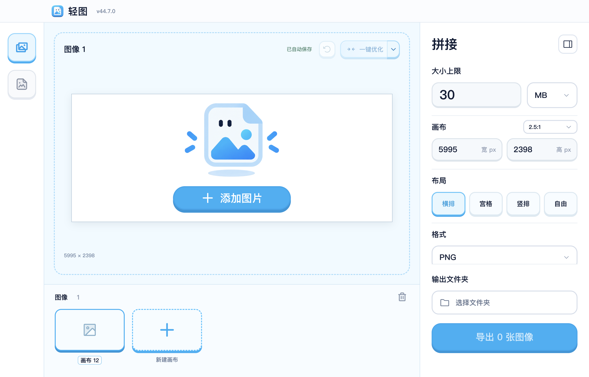

# 空画布居中、连续缩放与名称输入宽度（2026-10-17）

添加图片组合保持统一缩放并始终显示插图与加号。图片本身有大量透明留白，现仅通过 CSS 视窗框定可见内容，让可见插图、按钮和阴影的组合居中。按钮改为更紧凑的 200×40 基准尺寸，整体使用 232×218 基准框。源图片文件与画布数据不变。

原生复现窗口从 1101 缩至 1100 时，画布由 519px 跳增至 585px：响应布局减少侧栏和导航占位，中央区域反而变大。760px 的侧栏切换也会释放宽度。按最新反馈，边栏状态不变时窗口缩小期间保留显示比例上限，延续到响应布局的后续回调；自动或手动折叠/展开边栏、增大窗口或切换画布/编辑视图时重新适配，以便使用新的工作区宽度。约束只存在于显示状态，不修改导出尺寸或项目数据。

底部重命名通过同字体的隐藏文本测量自然宽度，仅加少量边框与内边距，输入时随内容增减，保持在卡片下方居中；很长的名字上限为卡片宽度，仍可水平编辑。示例“图”为 24px、“画布 12”为约 52px，卡片本身 152px。Enter、失焦和关闭保存、Escape 取消保持原流程。

按最新操作偏好，验证脚本已改为隐藏的原生离屏渲染，取消置顶并将窗口坐标放在所有显示器外，不显示、激活或聚焦原生窗口。键盘/页面焦点由 CDP 模拟。独立测试进程在 macOS 使用 accessory 策略，用户正在运行的软件和数据不受影响。详见 sidebar-responsive.md。

验证覆盖连续缩小跨过 1100/760 两个断点、可见图形与按钮中心、小按钮比例、文字宽度输入和保存，以及 12 种空画布组合、原有选择和关闭保存。记录见 validation.json。

工作台检查中曾把拼接后台结果混入压缩模块的 token 快照。该检查现同时验证压缩请求计数不增加和压缩结果 token 不变，独立于异步完成的其他模块结果。未放宽实际压缩请求和结果稳定性要求。

