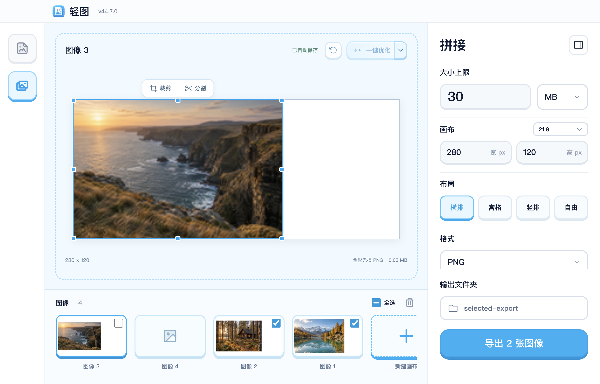
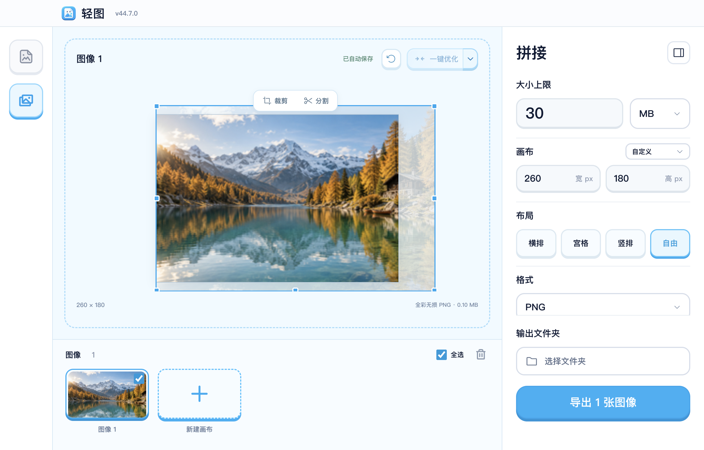
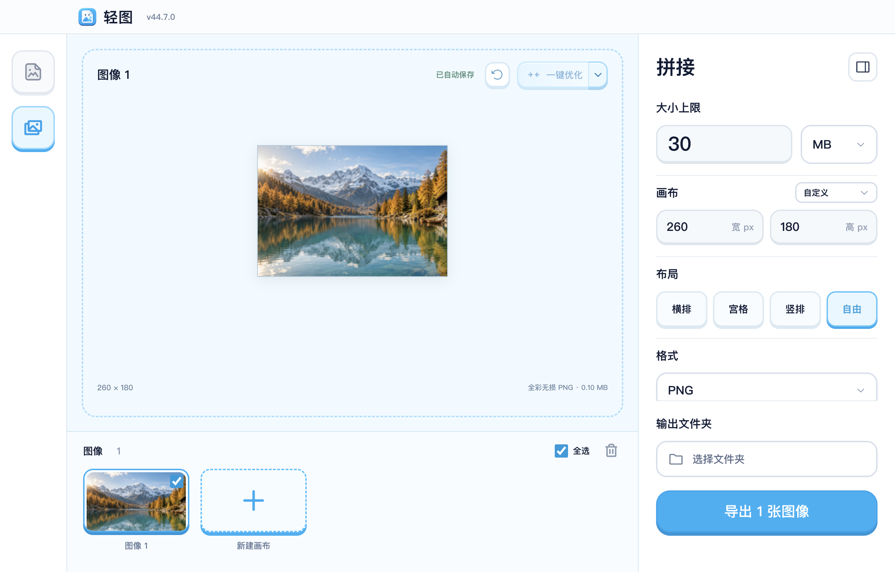

# 拼接选择与 Mac 关闭修复（2026-10-16）

## 行为

- 空画布没有导出复选框；没有可导出内容时也不显示“全选”。有内容的卡片在右上角显示独立复选框，去掉外层白色底框与阴影。
- 新建拼接画布的导出上限默认 30 MB（30,000,000 字节）。已有项目保持已保存的上限，压缩调整模块仍默认 10 MB。
- 点击画布或工作区空白处取消图片选择，关闭选中图的裁剪/分割控件。点击控件本身不会取消选择；取消选择不修改项目、导出范围或触发编码。
- 画布外只显示当前选中图片的半透明内容。取消选择后所有图片只在画布内显示；再次选中恢复越界预览，实际位置、尺寸及原图不变。

## 关闭阻塞的复现与修复

原生隔离测试将浏览器已观察到的故障固定复现：小图已经 complete 且 naturalWidth > 0，但 Image.decode() Promise 一直未结束。原版本生成缩略图时阻塞 repository.save，界面显示“保存中…”，native close → renderer flush 等待不结束。另一条路径是项目已保存，一键优化的 prepareLayoutPreview 仍等待 decode，关闭继续被 optimizeTask 阻塞。

修复将这两处统一改为图片 load/error/complete 检查，加载等待最多 10 秒，避免依赖合成器解码 Promise。保存和关闭依然等待实际导入、导出及编辑提交，真正的存储失败仍可见并阻止关闭；未加超时强制关闭或忽略保存失败。

原始失败证据：artifacts/window-close-red.log、artifacts/window-close-optimization-red.log（仅 waiting renderer，12 秒后失败）。修复后的 smoke:window-close 验证空画布、缩略图解码挂起和一键优化解码挂起，均经过 renderer flushed → closing；关闭后再次读取项目并核对原图字节和缩略图。

macOS 红色按钮关闭窗口后，应用仍可能保留在 Dock，这是正常平台行为；本次修复针对窗口本身一直无法关闭。未关闭或替换用户正在运行的轻图。

## 验证

262 项单元测试、构建及全部 22 项检查通过，包括实际的图片导入、单张/多张导出、裁剪、分割、缩放、布局记忆、自动保存恢复、PNG 画质与体积预算。关闭检查另外覆盖真实保存失败后不关闭、重试成功后关闭；实际点击隔离窗口的 macOS 红色按钮验证通过，关闭后读取项目并验证原图字节和缩略图。详见 [完整验证记录](canvas-selection-validation/verification.json)、[选择检查](canvas-selection-validation/selection-report.json) 和 [真实导出检查](canvas-selection-validation/export-report.json)。

截图来自隔离的 Electron 开发窗口，顶栏版本为测试运行时版本。本轮为源码修改，未发布新的安装包。
