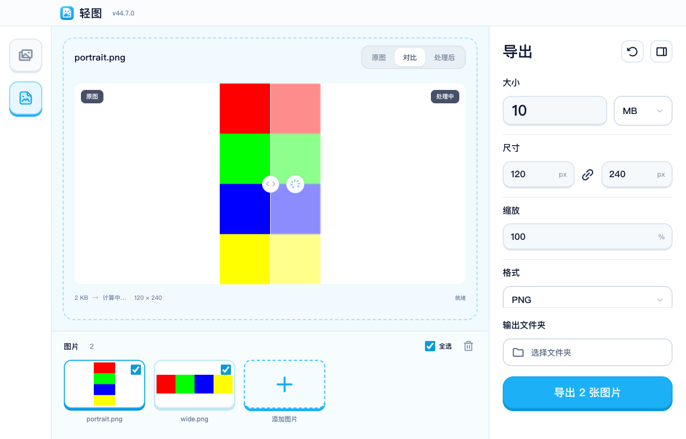
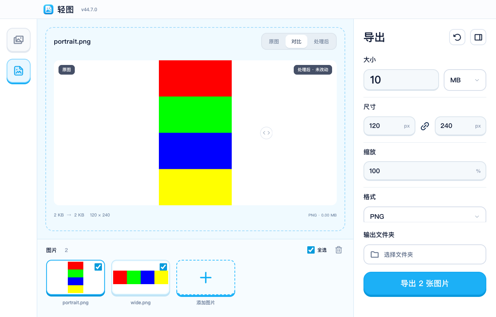

# 压缩缩略图与处理中占位（2026-10-17）

压缩卡片之前使用 cover，竖图和超宽图被裁掉上下或左右内容。现在仅给压缩卡片使用 contain，在固定卡片中完整等比显示，白色留白不进入导出图像；多选、名称和右键操作保持原样。

处理或解码真实结果时，预览右侧显示 45% 不透明度、轻微柔化的原图，以及 22px 转动图标。占位原图仍用整个预览框计算尺寸，再按分割线裁切，因此和左侧原图像素位置一致，不把一整张图重新缩进半个框。处理中标识与 aria-busy 保留，只有实际结果解码完成才切换成“处理后”；失败停止加载，不伪装完成。

转动图标定位在右侧仍可见的原图区域内，兼顾竖图的左右留白。位置随分割线、窗口尺寸和侧栏变化更新；如果分割线已越过图片，图标才使用右侧剩余区域的中心。对比拖动仍按 requestAnimationFrame 更新局部 CSS，不触发队列或应用状态更新。单独查看处理后时使用整图占位；查看原图时不叠加加载层。

离屏专项通过控制处理 Promise 暂停来验证真实等待状态，并使用竖图与宽图的红/绿/蓝/黄边缘色带，直接检查卡片截图像素，证明首尾色带没有被裁掉。覆盖对比线 50%/75%、处理后单图、原图、真实结果替换、切换图片和模拟处理失败。

274 项单元测试、生产构建、desktop/UI 和压缩队列回归通过。原有多选、重命名、导出范围、缓存与实际文件名检查仍通过；原生验证全程隐藏离屏，网页版 4173 端口继续可用。
