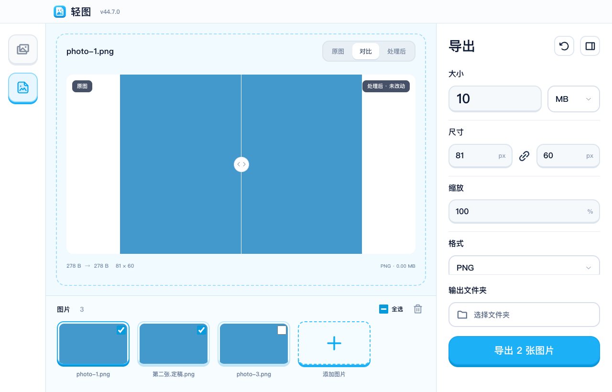
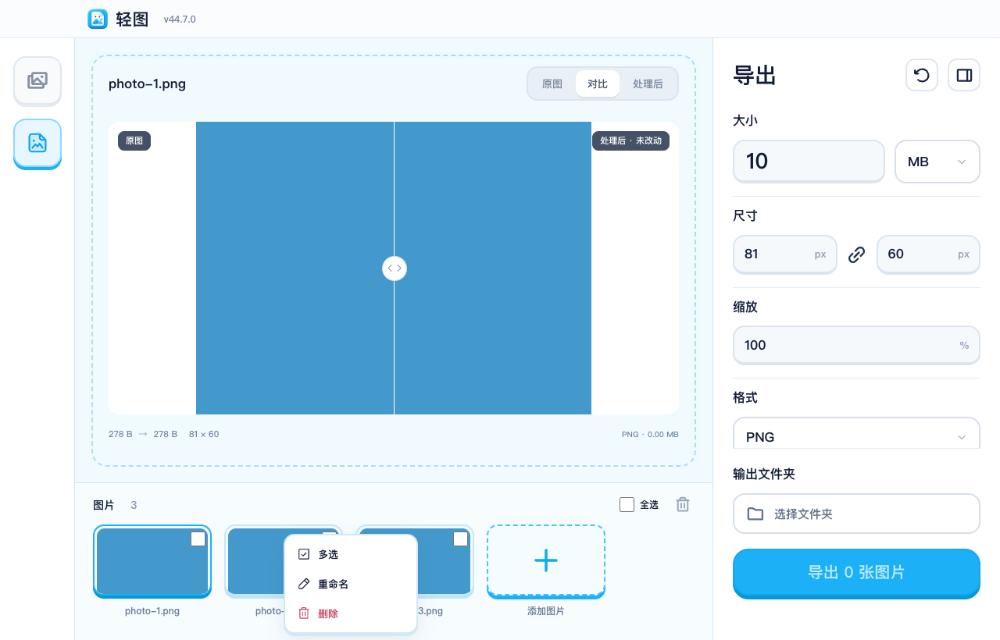
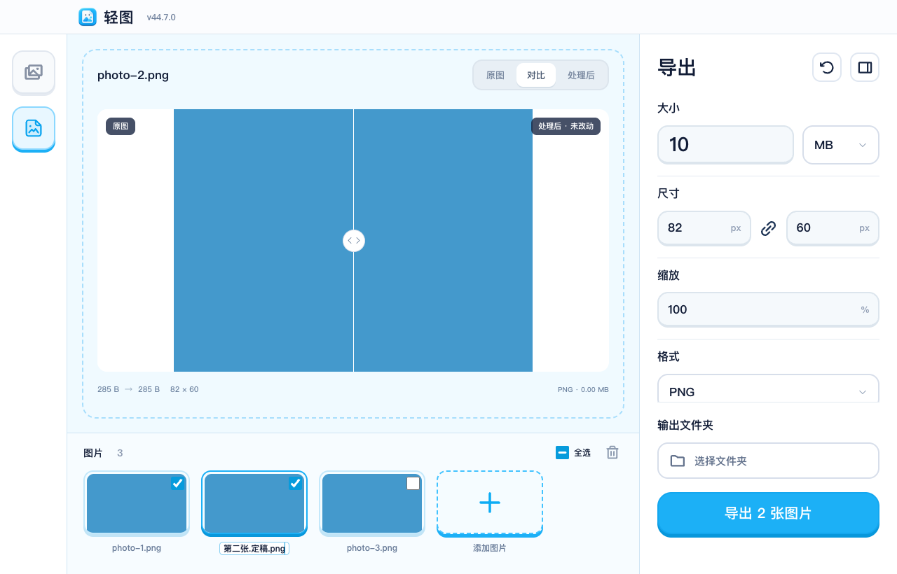

# 压缩图片队列多选、重命名和删除（2026-10-17）

压缩模块底部队列沿用拼接卡片样式：右侧复选框、全选、删除所选图片，勾选与当前预览互相独立。默认全部勾选；导出按钮数量与实际处理文件均以勾选为准，全部取消时禁用导出。右键菜单为“多选、重命名、删除”：多选从当前图片开始或追加到明确选择，删除已明确勾选的组或单独删除未勾选的右键目标。清空后新导入默认重新全选。

双击卡片下方名称或右键重命名可编辑；输入框沿文字宽度增长并限制在卡片内。Enter/失焦保存，Escape 取消；无效名字保留输入用于修正。导出、切换模块和正常关闭会等待未提交改名。压缩原有 -qingtu 后缀和实际输出格式规则保留，名字内的点号不误当作非图片扩展名而截断。

桌面 IPC 和本地网页版均新增验证名称的 rename 方法，只更新队列元信息以及已缓存、已固定导出结果的名称；处理缓存令牌和原始字节不变，也不触发重新压缩。不同参数的新处理结果继续使用改后名称。导出和删除期间锁定队列动作；删除只释放队列文件和结果，不删除源文件。共享卡片名与右键菜单新增可选参数，拼接行为保留默认值。

验证：274 项单元测试、生产构建、desktop/UI 回归和 5 种关闭保存路径通过。离屏专项检查真实文件输入、右键菜单、多选与全选、Enter/Escape、无效名称恢复、未按 Enter 时直接导出、模块切换、缓存不重压缩、实际勾选范围/导出文件名、批量/单个删除及源文件保留。网页版通过真实 import→rename→process→download 验证并清理测试文件。

