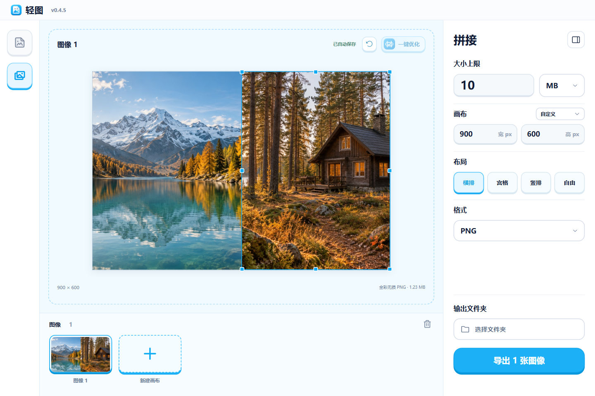
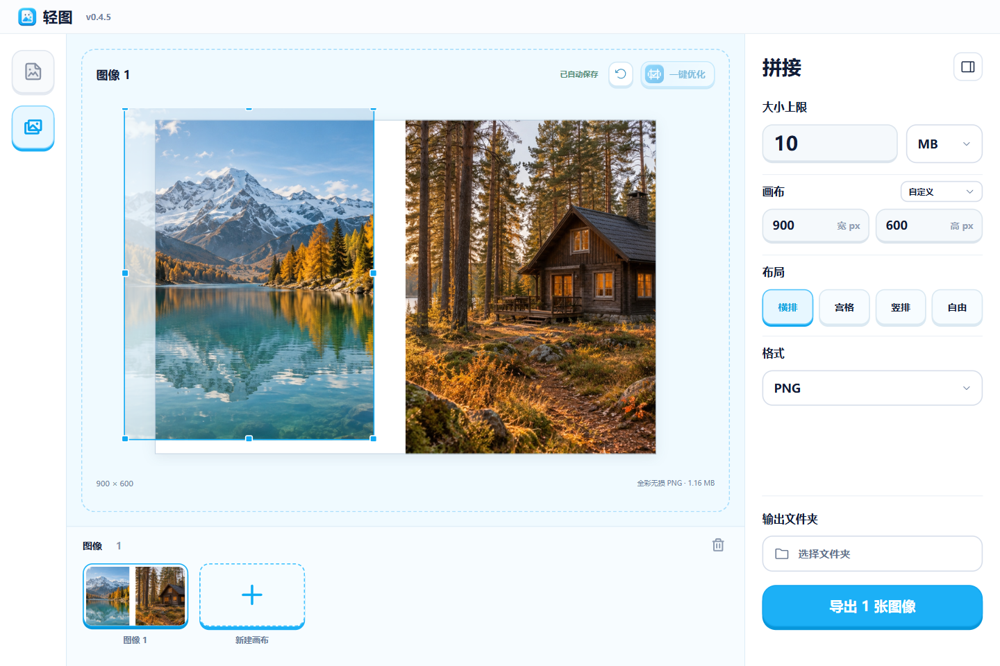
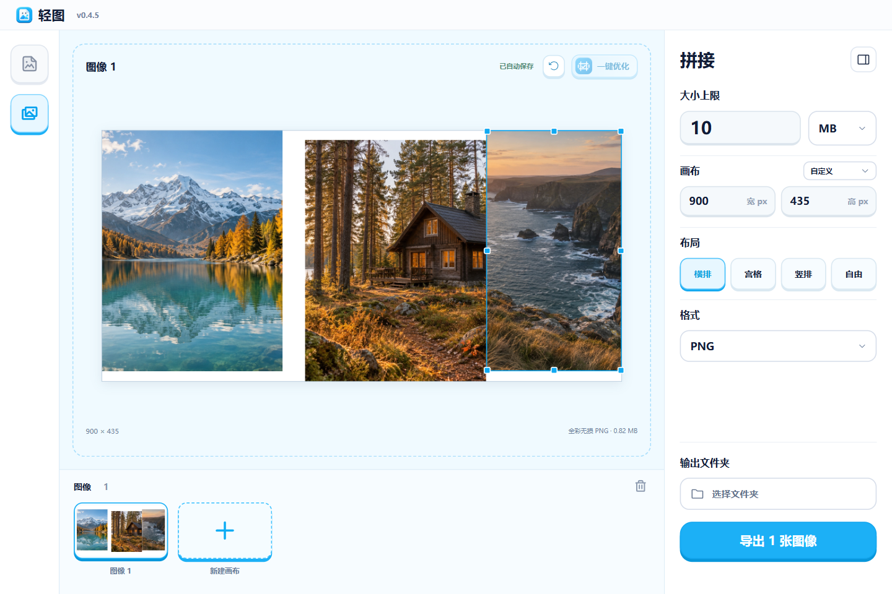
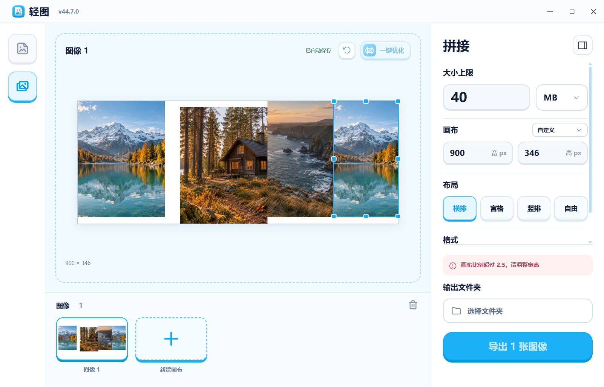

# 每次导入贴合画布

2026-10-14，Windows，Node 24.14.0，Electron 44.7.0，Chrome，分支 `codex/stitch-and-quality`。用户最终确认：保留 2.5 比例上限，画布不锁定为 2.5:1，**每次导入图片都重新贴合画布**。本记录覆盖早期固定画布文档中的导入尺寸规则。

每次导入先将新图按首张现有图片的高度等比缩放，沿最右侧追加，再计算全部图片的外接范围，整体平移、等比缩放到新的画布。保留原有相对位置、裁剪和内部空隙；先前拖到画布外的内容也会被纳入。默认长边为 5999 px，手动设置过尺寸后使用该布局最后设置的长边；比例严格为 2.5:1 时取 5:2 整数尺寸，默认 5995×2398。

手动移动或缩放图片不会改变画布，可将图片拉到画布外。越界部分淡显、仍可编辑，导出只保留画布区域；再次导入才重新贴合。手动输入宽高或选择预设也保留现有图片变换，并持续到下一次导入。

横排、宫格、竖排首次进入自动排列、贴合内容；用户已明确指定画布大小时，在指定画布内等比排列。自由首次保留现有位置。每种布局分别保存画布尺寸、长边设置和完整原图位置，切回恢复，点击当前布局不重排。每次导入同时按各布局自己的位置更新已访问的布局，避免切回后新图被旧画布遮掉；计算不解码其他项目的原图。原有项目打开时保持保存的数据，导入后才应用新规则。

限制仍为每边不超过 5999 px、长短边比不超过 2.5。完整内容超限时显示完整图片和明确提示，保存编辑状态，但阻止真实编码和导出；不偷偷裁剪、拉伸或补透明边。可明确选择合法预设、调整布局等。四张 3:4、3:4、9:16、9:16 图片未裁剪横排为 2.625，正确提示超限；选择 2.5:1 画布后仍可使用既有横排优化。

## 实现与验证

贴合计算在 `engine/canvas-fit.mjs`，导入入口在 `engine/canvas-import.mjs`；自动排列、布局尺寸记忆、持久化验证和界面分别复用现有模块。贴合不是渲染副作用。拖动和缩放继续使用 rAF 低分辨率反馈，提交后才保存、编码。画布记忆与原图副本一起通过既有事务/原子备份保存；新字段兼容旧清单。

205 项单元和引擎测试通过，新增 7 项覆盖多次导入、覆盖手动尺寸、等比与裁剪保留、内部空隙、负坐标、布局画布恢复、非法比例、严格 5:2 和实际透明合成。原子恢复测试增加布局画布数据检查。原有 UI smoke 保留实际交互断言，并先验证自动贴合，再明确设置旧场景需要的测试画布，没有删除旧行为检查来过关。

以下命令全部通过：`npm test`、`npm run build`、`npm run smoke:desktop`、`npm run smoke:ui`、`npm run smoke:canvas-fit`、`npm run smoke:canvas`、`npm run smoke:split`、`npm run smoke:recovery`、`npm run smoke:optimization`、`npm run smoke:png-budget`、`npm run verify:quality`、`npm run verify:png-budget`。原生 Electron 检查依次运行，避免共享 Chromium 缓存锁。

新增桌面检查使用仓库照片派生的 4K 尺寸样片：首图 4499×5999；手动改为 900×360 后再导入第二张，自动变为 900×600；实际鼠标拖出后仍为 900×600，拖动期间编码调用数不增加；第三次导入重新贴合为 900×434；首次宫格为 368×900，切回横排及刷新恢复原来的画布和图片位置。第四次导入验证比例超限、四张原图和未裁剪状态均保留、导出禁用。实际溢出裁切导出仍为 900×600、1,132,925 B。

Chrome 使用独立测试存储，不改用户项目，实际导入、拖动、切布局、刷新和下载；三份 IndexedDB Blob 的 SHA256 与原图内容 ID 一致。浏览器与桌面使用不同窗口尺寸，45×20 屏幕像素拖动对应的原图坐标略有不同，因此第三次贴合高度相差 1 px。

| 实际导出 | 尺寸 | 字节数 | 上限 | RGB 最大误差 / RMSE | alpha 最大误差 |
| --- | --- | ---: | ---: | --- | ---: |
| Chrome PNG | 900×435 | 819,441 | 10,000,000 | 0 / 0 | 0 |
| Electron PNG | 900×434 | 792,600 | 40,000,000 | 0 / 0 | 0 |

参考由不可变原图和已保存项目独立合成，在实际导出分辨率逐字节比较 RGBA；误差为零，确认导出未包含淡显、选中框或白色显示底。界面照片与实际 PNG 已视觉检查，保留原来的位置关系、清晰细节和内部透明空隙。此比较不声称把 4K 图片缩小后仍保留原始空间分辨率。实际文件保留在本机 `output/playwright/browser-content-fit.png` 和 `artifacts/content-canvas/content-fit-qingtu-2.png`，不把大图与项目原图提交 Git。

PNG 编码未作新改动。回归样片覆盖照片、纹理、渐变、文字与透明图片；照片/纹理最大 RGB 误差 2，RMSE 1.129 / 1.355，alpha 误差 0；渐变、文字、透明样片为零编码误差。严格体积回退验证仍会明确显示实际降低后的尺寸，原始观看尺寸下的缩放损失仍单独记录，不能称为原尺寸无损。

截图均来自实际运行；具体尺寸、字节、哈希和检查项见 [report.json](content-canvas-validation/report.json)。本轮验证仓库样片和可复现测试图，未重新验证用户约 28 MB 原图。Windows Electron 和浏览器已实测；Mac 实机、安装包安装、签名发布本轮未验证。不合并 main、不发布安装包、不更换签名公钥。浏览器预览继续运行于本机 4173 端口。
