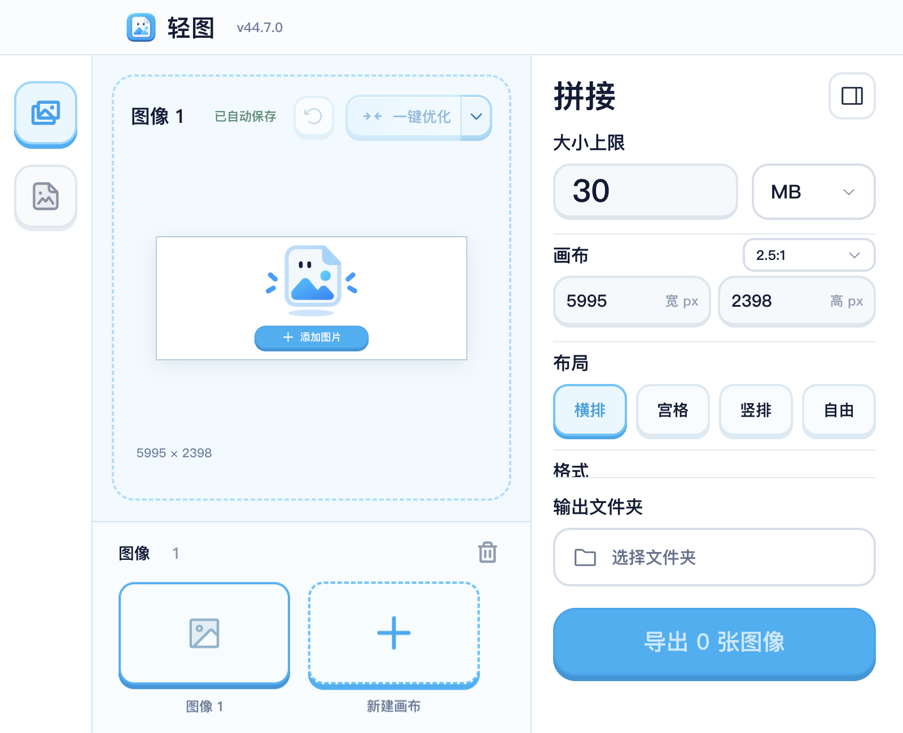

# 空画布添加图片整组缩放（2026-10-17，按最新反馈修正）

用户要求插图始终存在，“添加图片”整个区域随画布一起缩放。此前根据小窗口断点隐藏插图、固定按钮最小尺寸的实现已移除。

现在将插图、加号、文字、按钮、间距和内边距作为一个 232×218 的完整内容组。按实际显示画布的宽高计算同一个缩放系数，整体居中缩放，不设按钮独立最小尺寸，不隐藏任何元素。后续反馈进一步收小按钮、通过 CSS 框定可见插图并补偿透明边距，缩窗跨断点时保留比例上限；最新实现和记录见 canvas-layout-polish.md。保留实际画布像素和比例、导入行为及所有非空画布操作。

原生回归覆盖 800×650、1024×650、1280×820、760×650 四种页面尺寸，以及横向、方形、竖向三个画布比例，共 12 种组合。每种组合都检查插图和加号可见、插图/按钮比例一致、完整处于画布内、不相互遮挡，并命中检测按钮中间和底部。同一画布在不同窗口的按钮/画布宽度比例保持一致。随后实际导入照片并验证保存。窄屏按现有流程折叠导出侧栏以测试中央区域。

验证结果见 validation.json。截图顶栏为 Electron 测试宿主版本。

