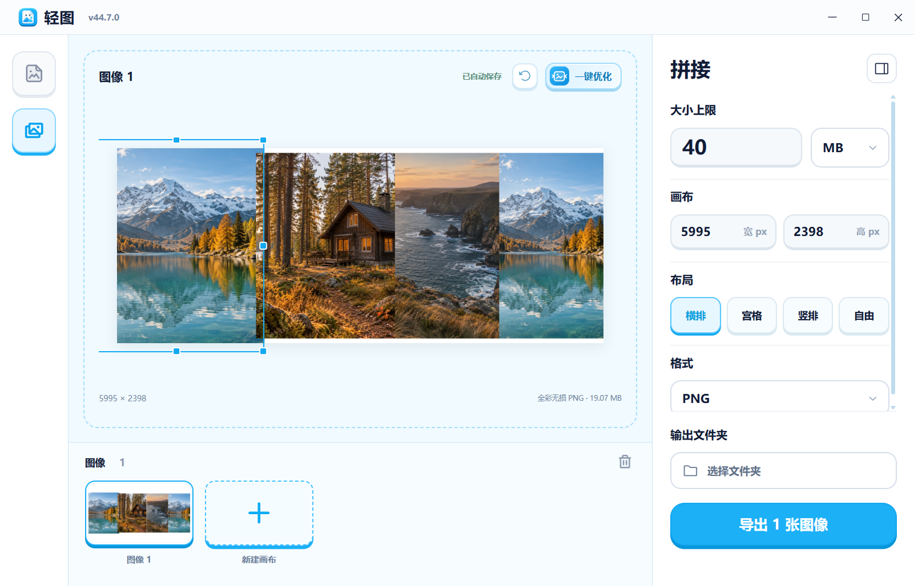
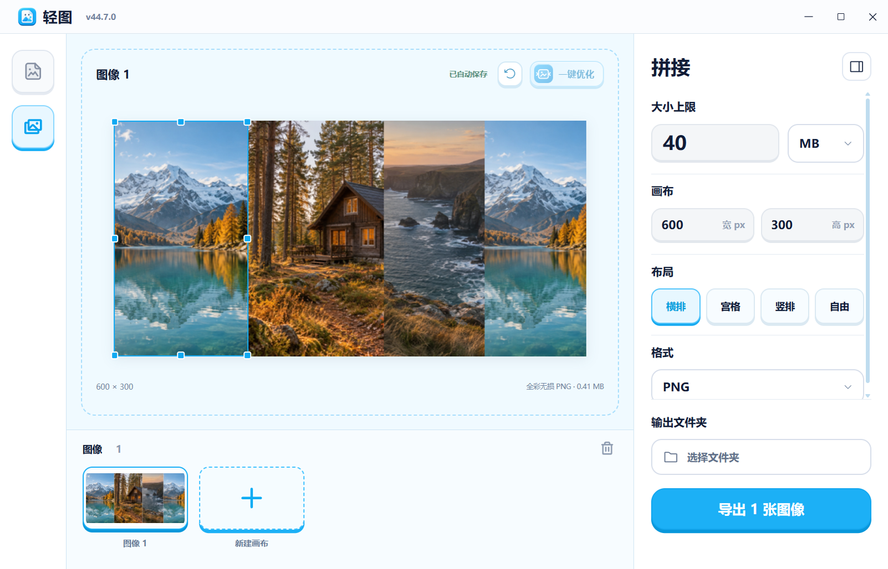
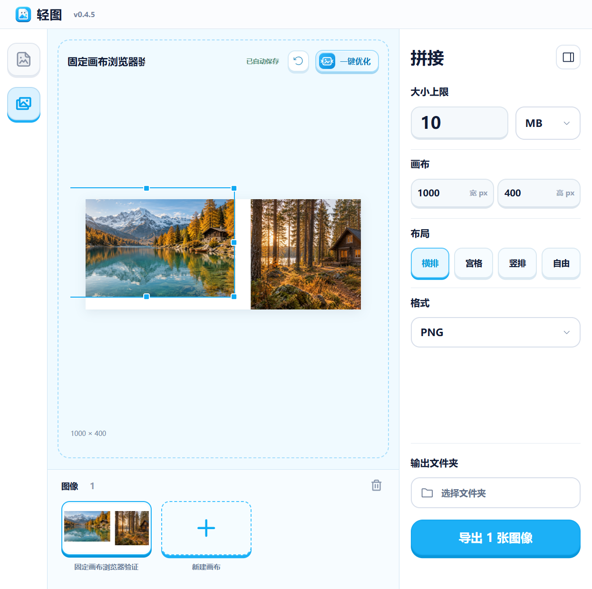

# 固定画布：2026-10-14 实现与验证

后续更新：首次无画布、一键优化前台完成后后台计算体积、单图原图拆分，见 [split-and-speed.md](split-and-speed.md)。本文默认尺寸、越界和 Shift 规则继续适用，旧“清空后自动建空画布/弹窗等待全部编码”规则已覆盖。

本轮覆盖此前的外接矩形画布、禁止越界裁切、自动 9:16 裁切及拖动自动布局换序规则。默认固定画布为 **5995×2398，严格 5:2**。用户分别设置宽高，每边最多 5999 px，长短边比最多 2.5；非法值提示并阻止编码/导出，保存后仍能恢复并修正。

横排、宫格、竖排是等比排列操作，将完整可见图片居中放进当前画布，允许透明空白。画布尺寸不随排列、移动、缩放或裁剪变化。宫格仍保持每行等高、各行同宽，无空格或空洞；非法行列可打开控制项修正。自由选项保留现有变换。

首张图片等比放进空画布、从左上角开始；后续图片以首张现有图片的高度等比缩放，沿最右侧追加，已有图片不动。所有布局直接拖动都会移动图片；八个手柄默认保持当前比例，按 Shift 可独立改变宽高。Alt+方向键仍显式换序，普通方向键移动，Enter/双击/右键编辑、Delete/右键删除保持可用。

用户最终更正“一键优化”为跟随**当前画布宽高比**。从完整原图重新计算，每张等百分比左右居中裁剪并横排铺满，保持画布尺寸；原图横排过窄、无需裁剪、非横排或已完成相同裁剪时禁用。默认 5:2 场景各侧 1/42；示例 2:1 场景各侧 5/42。

## 实现

- `canvas-limits.mjs`：默认尺寸与边长/比例验证。
- `canvas-fixed.mjs`：固定坐标、完整图排列、右侧追加。
- `canvas-transform.mjs`：八方向锚定缩放、默认等比与 Shift 独立尺寸。
- `canvas-clip.mjs` 与 `stitch-service.mjs`：将变换矩形与画布求交，按交集提取已缩放的源图像素。只导出画布内部；完全在画布外的图片无需解码，仍保留完整原图副本和编辑坐标。矩形导出、无额外外边距；PNG 保留透明空隙，JPG 合成白底。
- `canvas-migrate.mjs`：用明确的 `canvasMode:'fixed'` 区分旧派生缓存，按需迁移原有尺寸/可见裁剪/位置；无法恢复旧布局时保留图片和编辑控制，采用默认固定画布。保存仍使用桌面原子清单/备份与浏览器 IndexedDB Blob。
- `StitchCanvas.jsx`：requestAnimationFrame 只更新低分辨率层，文档级指针跟踪及关闭刷新；结束后保存并生成真实导出预览。选中框与手柄在图片上方，图像内容在画布边界截断。空项目显示实际画布但不编码空图。

## 检查结果

Windows / Node 24.14.0，本轮 **181/181** 测试通过。新增固定尺寸、四种模式、紧密行、导入追加、越界交集、Shift 变换、当前画布优化、手动/百分比裁剪、透明像素、原图副本和事务恢复检查；位置数据不能覆盖已批准的图片/资源标识或裁剪规则。旧布局测试用于验证历史清单的恢复行为。

已通过：

```text
npm test
npm run build
npm run smoke:desktop
npm run smoke:ui
npm run smoke:recovery
npm run smoke:optimization
npm run smoke:png-budget
npm run smoke:canvas
npm run verify:quality
npm run verify:png-budget
```

`smoke:canvas` 使用仓库照片派生的可复现 4K 尺寸样片（3072×4096 两张，2160×3840 两张），不是用户附件或相机原始 4K 照片。真实 Electron 鼠标检查默认等比、Shift 仅加宽、负坐标、无拖动编码、画布不变、边长/比例超限、2:1 优化、刷新恢复；原图副本与输入逐字节相同。结果及 SHA-256 见 [desktop.json](fixed-canvas-validation/desktop.json)。独立 Chrome 会话另验证 IndexedDB Blob 哈希与资源标识相同、拖动不编码、Shift 独立尺寸、刷新恢复与真实下载，结果见 [browser.json](fixed-canvas-validation/browser.json)。

`smoke:ui` 保留原压缩、共享区域坐标、单图编辑、确认取消、多项目/空画布计数、批量/单独导出、卡片拖动隔离与自动保存检查；把原“越界失败”更新为实际固定裁切，把直接拖动换序更新为移动和显式键盘换序。进度失败分支注入一次“测试：预览生成失败”，其预期 stderr 不代表检查失败。六进程 recovery 验证关闭前未松手的拖动/滑块、未应用 50 px 预填、源文件移动后恢复，实际输出 2400×2000、22,127 字节。optimization 三进程继续验证处理、导出、导入期间关闭协调。

## 可检查的导出文件

实际文件保留在本机 `artifacts/fixed-canvas/`，没有将大图或私有附件提交 Git。字节均为十进制实际文件大小；下表均是全彩 PNG，无填充凑大小。

| 文件 | 尺寸 | 实际字节 | 上限 |
| --- | --- | ---: | ---: |
| `fixed-right-append-qingtu.png` | 5995×2398 | 19,587,218 | 40,000,000 |
| `fixed-shift-clipped-qingtu.png` | 5995×2398 | 19,074,736 | 40,000,000 |
| `fixed-2-to-1-optimized-qingtu.png` | 600×300 | 405,869 | 40,000,000 |
| `browser-fixed.png` | 1000×400 | 875,759 | 10,000,000 |

浏览器导出有 46,149 个完全透明像素，白底仅为预览。坐标测试逐像素检查负坐标/四边交集，Shift 与手动裁剪结果对照显式源图 resize/extract/composite 基准，RGBA 相同；百分比裁剪非等比缩放对照也相同。视觉检查确认预览只展示画布内内容、无额外圆角、白色空白不遮盖源图、蓝框在相邻图上方；自定义 2:1 优化铺满画布。

PNG 质量策略本轮未改变。重新比较照片、纹理、渐变、文字边缘和透明样片：照片/纹理编码 RGB 最大误差均为 2、alpha 误差 0、RMSE 分别 1.12895 / 1.35465；渐变、文字、透明样片采用无损结果，误差为 0。降分辨率预算回退及其空间细节损失仍单独报告，见 [png-budget.md](png-budget.md)。1 KB 桌面检查实际压缩输出 25×10、719 字节，拼接输出 25×10、736 字节；设置尺寸及原图保持不变，界面明确显示“等比调整”。

## 实际运行截图与范围







原生 smoke 直接启动 Electron 脚本，顶栏的 v44.7.0 来自测试运行时 `app.getVersion()`；应用包版本仍为 0.4.5，浏览器截图可见。本轮未发布或变更产品版本。Mac 实机、安装包安装及正式签名更新未验证；没有合并 main、发布安装包或替换签名公钥。很低的 PNG 体积上限仍可能降低实际分辨率，这是此前已确认的规则；会显示实际尺寸，固定画布编辑尺寸与原图不变。
