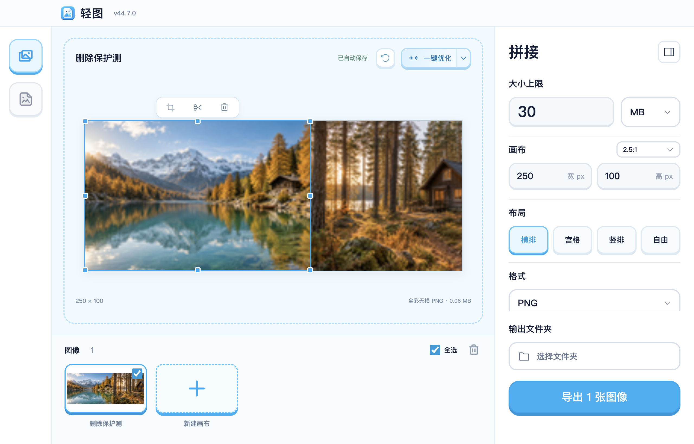

# 图片删除与自适应优化（2026-10-16）

选中拼接图片后，Delete / Backspace 直接删除当前选中图片。鼠标选择会将键盘焦点移到图片；工作台快捷键也处理焦点在其他普通控件上的情况。输入框、文本编辑、未启用的拼接模块和确认弹窗不接受删除快捷键。删除等待裁剪提交，通过现有保存队列持久化，并防止重复删除和跨画布误操作。

图片上方为裁剪、分割、删除三个 Phosphor 图标，按钮保留无障碍名称和原生悬浮提示。导出复选框与“全选”移除额外的外圈焦点框。

旧提示“原图横排比例不足 2.0159…，无法靠左右裁剪铺满画布”的数值，是减去特殊裁剪图片占用后，其余图片需要满足的宽高比。旧算法无论用户如何缩放图片，都从原始尺寸计算，只支持左右裁剪。原图比例比目标窄时，左右裁剪只会更窄，因此拒绝优化。

现在普通图片较宽时保持等百分比左右裁剪，较窄时改为等百分比上下居中裁剪。特殊图片继续精确应用各自的顶部百分比和左右像素设置；固定画布尺寸、原图字节和导出预算不变。显示和实际导出都支持垂直百分比裁剪，最后在输出栅格上取整，两侧相差不超过一个输出像素。全部图片都指定特殊裁剪且结果比例不匹配、特殊图单独已超过画布或裁剪剩余不足一个原图像素时，继续说明具体冲突，避免静默改写用户参数。

## 验证

- 新增回归用例在修改前复现：较窄原图优化禁用，混合特殊裁剪报原始比例错误，图片失去 DOM 焦点后 Delete 不删除。
- 267 项单元测试通过；真实保存、重新读取、导出像素与独立居中裁剪基准逐字节一致。
- 新增 `smoke:image-actions` 通过：Delete / Backspace、输入框保护、真实鼠标移除旧输入焦点、弹窗保护、图标删除、切换模块、空白取消选择、较窄图片优化及实际 250×100 导出。
- 其余桌面、裁剪、分割、自动保存和质量检查记录于 validation.json。
- 测试截图顶栏为 Electron 测试宿主版本；网页版显示应用版本 0.4.8。此修改尚未包含在此前已发布的安装包中。

