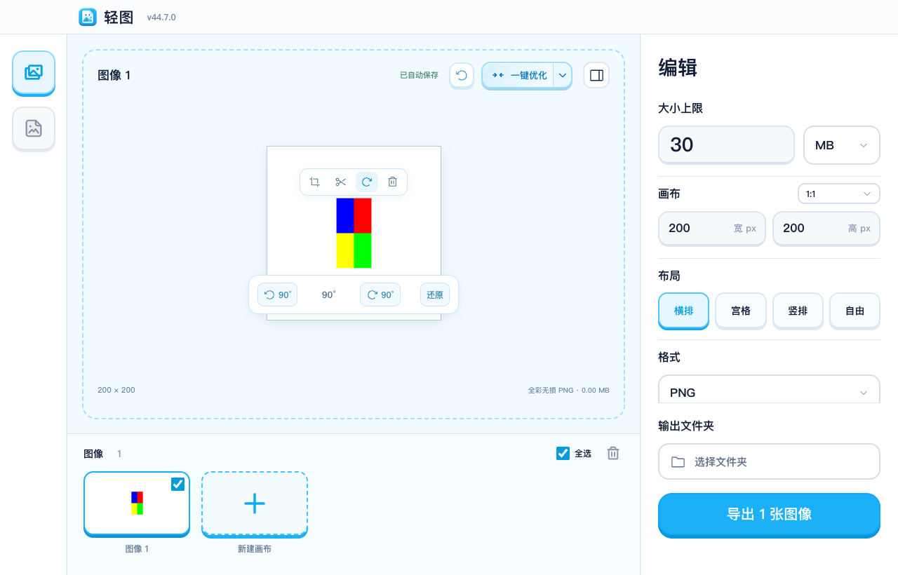

> 最新补充：支持小数角度输入与 0.1° 微调滑块，详见 [精确旋转与滚动平移](precise-rotation-and-navigation.md)。以下保留整 90° 源坐标兼容实现的说明。

# 图像编辑与旋转（2026-10-17）

首个默认模块由“图像拼接”改为“图像编辑”，内部模块标识和已有项目不迁移，图像压缩仍为第二项。选中图片后的工具顺序为裁剪、分割、旋转、删除，全部保留图标与悬浮提示。旋转打开紧凑面板，提供向左 90°、当前角度、向右 90°、还原方向；按面板实际高度留空间，避免沿用较高的裁剪占位。

旋转保持当前图片中心、画布与导出设置以及其他图片不变。项目记录规范的 0/90/180/270°，同步交换显示尺寸、原始分割窗口坐标、四边裁剪及关联轴、历史导入尺寸和各布局保存的图片矩形。原始资产仍使用同一份字节；旋转面板的“还原”只还原该图方向，现有画布裁剪/缩放/顺序重置按原职责保留当前方向。

即时源预览只在浏览器中转置已有的有界像素，不重复缩放；重新打开时从原始资产预览按保存角度重建。导出先归一化 EXIF，再以独立 raw 阶段旋转原始像素，按映射后的原图窗口和裁剪处理。编码缓存包含旋转角度，避免方图旋转后误复用旧画面。预览尺寸可随 90° 旋转转置，像素总量仍有界。

卡片图片的 grid 默认最小高度曾导致 142px 方形缩略图溢出 91px 卡片，旋转后的竖图被截掉。现将图片的最小尺寸设为 0，使现有 contain 规则真正受卡片可用高度约束；压缩卡片的完整等比显示保持一致。

验证包含真实预览/缩略图/200×200 PNG 导出像素、左右旋转和方向还原、保存重开、EXIF 与非对称裁剪、旋转后的分割窗口、方图缓存、其他布局记忆、原始字节。278 项单元测试、构建、desktop/UI、裁剪、分割、图像操作、5 种关闭保存路径和压缩加载预览回归均通过。所有原生检查保持隐藏离屏，不抢占系统焦点。

