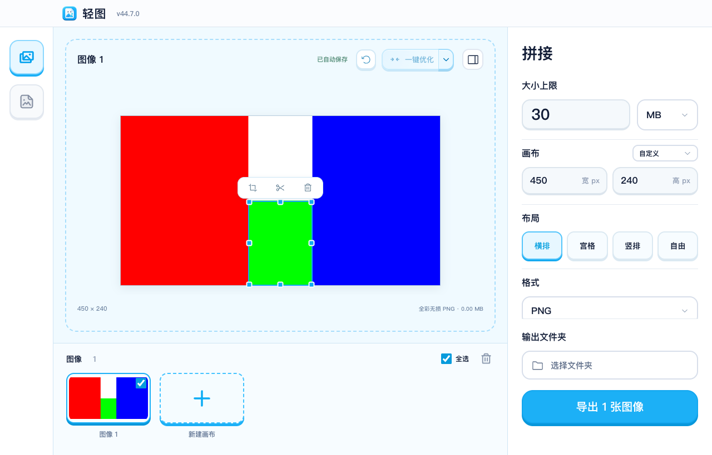
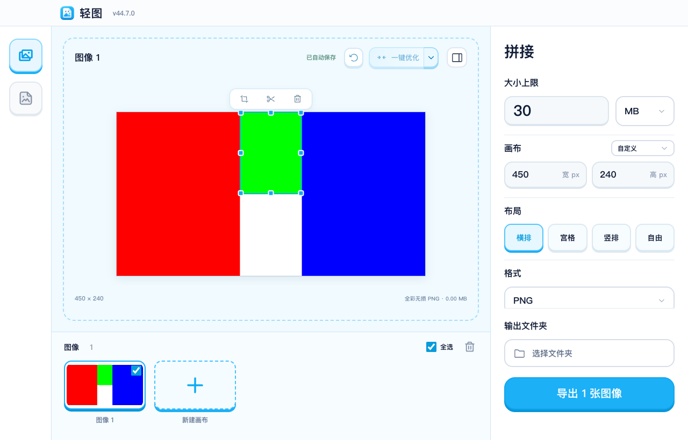

# 缩小中间图片后可移动位置（2026-10-17）

横排、竖排和宫格原来把图片拖动都当成换序。拖动后仍落在同一张图片区域，或没有换序目标时，松手会直接结束，不保存 x/y；因此从左上角缩小的中间图片停在底部，向上拖动又回到底部。这不是持续吸附产生的结果。

现在拖到另一张图片的实际矩形上继续换序；在同一区域或空白区域拖动则保存新位置，使用现有边缘/中心吸附。空白区域不再通过“最近图片”强行换序。布局类型、其他图片、画布和导出尺寸不因位置移动改变；源图片和初始顺序保留，松手后才保存和生成预览。

离屏回归使用三张 180×240 的红、绿、蓝图：中间图片从左上角缩至 90×120，先保留 y=120，再拖至 y=0、40、120、0。检查真实鼠标拖动、松手后的已保存坐标、其他图位置、重新打开，以及拖到第三张图时仍可换序。实际 PNG 导出检查上方为绿色、下方为空透明像素，避免只验证画面上的临时样式。

验证完成：272 项单元测试、生产构建、原生 desktop/UI、内容画布适配、缩放回归和专项目标场景均通过。所有原生测试保持隐藏离屏运行，网页版 4173 端口继续可用。
