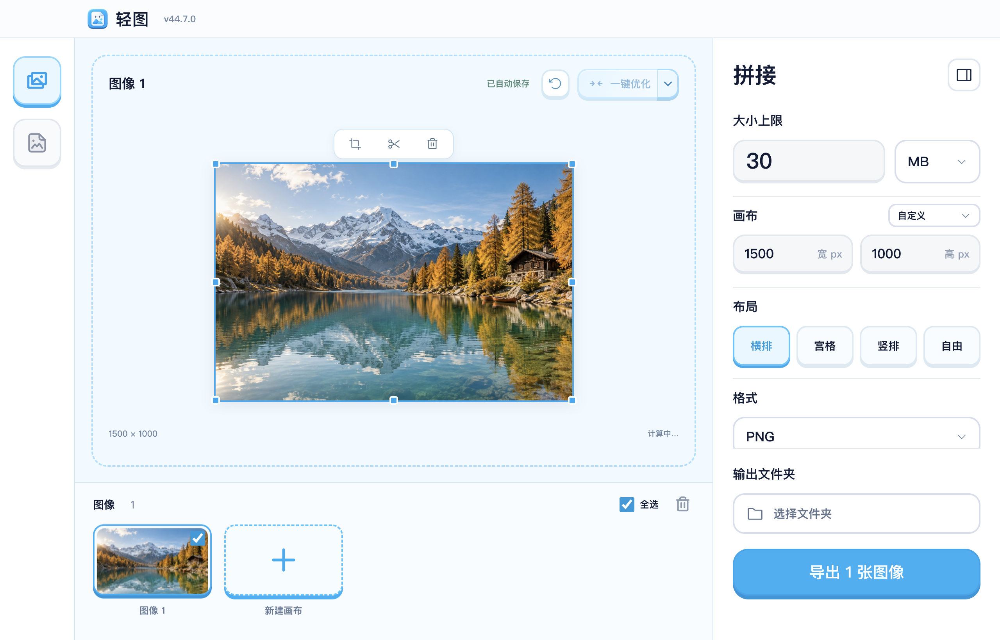

# 导入首帧清晰度（2026-10-17）

原因是拼接图片导入与重新打开时，源图层被压到 480×360，再放大到画布。清晰的实际合成预览只有在后台完整合成与编码后才出现，因而形成先糊后清晰的等待。实际合成预览此前也只有 1200×800。

源图层及实际结果预览现在都使用最大 1600×1200 的等比图像，从首次显示起覆盖常用 Retina 画布的物理像素。保留 EXIF 方向、透明度、小图不放大和原图副本。底部画布卡片仍为 160px，预览图不写入项目清单；完整导出像素和编码预算不受预览上限影响。

回归用例在修改前复现 480px 的导入层和 1200px 的实际结果预览。新增细线测试验证 1500×1000 图像的一像素条纹在首次导入及重新读取时逐字节保留，并验证大图上限、竖图与 EXIF 旋转、小图不放大及实际合成预览。

原生拖放检查人为阻塞完整合成，确认首帧已显示 1536×1024 图像，显示区 460.5×307 CSS px、DPR 2，不依赖完整编码先结束。放行后台后实际结果预览为 1500×1000，重新打开的源图层仍为 1536px。浏览器接口实际返回同样清晰的导入层，样例请求约 119ms（单次测量，不作性能保证）。

270 项单元测试和构建通过；拖放、完整工作台、桌面运行与关闭保存检查结果见 validation.json。截图右下角仍为“计算中”，中央图片已经清晰。顶栏版本来自 Electron 测试宿主。

