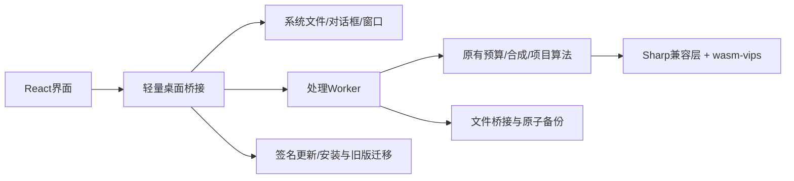

# 轻量桌面版规范（2026-10-19）

目标：保留图像编辑与压缩调整的现有功能、项目和原图、实际导出质量/字节上限及更新确认流程，将 Windows/Mac 安装包由约120–146MB缩至十几MB量级。用户已选择轻量优先，接受 macOS13.3+、Windows10/11 + WebView2，缺少WebView2时安装联网补装。实际体积以最终构建为准，不用小下载器掩盖庞大的应用运行环境。

架构候选：Neutralinojs6.10.0系统WebView + wasm-vips0.0.19图像引擎；保留React界面和现有engine纯算法。Node/Electron不进入轻量发布包。wasm-vips与现有Sharp均使用libvips8.18.7。通过Sharp兼容适配层复用图像预算、合成、EXIF、旋转、裁剪和缓存逻辑，通过原生文件桥接复用项目存储/备份。处理运行在Web Worker中。

尺寸验证：单平台Neutralino二进制2.45–2.98MB；完整wasm-vips压缩包4,693,147字节（所有模块解包12,981,395字节）。WKWebView无窗口探针启用crossOriginIsolated/SharedArrayBuffer，在159ms内完成2×2 PNG编码/解码；此为可行性验证，不代表完整应用或性能结论。

约束：保留运行中的用户应用/队列和原签名种子；测试始终隐藏且在所有显示器之外，不激活窗口。原图和旧项目格式可读，保存保留原子替换和备份。源仓库origin为a1meon_admin/qingtu，发行版仓库为halframe-releases。发布前检查实占空间；不足则完整备份/验证最早版本后仅清理所需版本。v0.4.7/v0.4.8现存，已知合计814,398,065字节/1GB限额；上传时重新验证。每附件<100MB。签名密钥不进入Git、安装包或发行附件。

## ADR：使用系统WebView和WASM图像运行时

Electron自带浏览器是体积主要来源；仅排除资源不能达到十几MB。Node侧车虽保留Sharp，但另带约121MB原始运行时，压缩后仍明显偏大。采用系统WebView+WASM去掉两套浏览器/JS运行时；代价是更高系统下限、需验证WebKit与WebView2行为，以及迁移原生桥接、文件持久化和更新。用户已接受系统要求。桌面壳选择预构建跨平台Neutralino，避免在本机无Rust/WindowsSDK时引入另一个交叉编译链。保留旧Electron构建为开发/回归基准，不作为轻量发布产物。

