# 固定高度人物拼接与图片旁编辑

2026-10-14，Windows，Node 24.14.0，Electron 44.7.0，Chrome。用户确认：固定的是画布高度，图片保持比例缩放，宽度增长至高度的 2.5 倍后封顶，超出画布的内容裁掉；每张图支持四边裁剪与关联开关；直接拖动图片换序。此规则覆盖之前按图片外接范围改变画布高度的实现。

默认高度为 2398 px，自动宽度随横排内容变化，最大 5995×2398。图片默认等比缩放，画布高度不变，封顶后继续放大保留完整越界位置，显示淡化并在导出时裁到画布内。所有布局提供四角及四边共八个手柄，Shift 允许独立调整宽高；不会将其他图片缩小来满足上限。手动预设与宽高保留指定画布；继续导入按画布高度追加并适配自动宽度。每边 5999 px、长短边比 2.5 上限继续校验，不用透明补边隐藏非法布局。

选中图片，上方显示“裁剪／分割”。裁剪直接拖动图片的四条边或四个角，或在图片下方设置原图像素；2026-10-15 增加当前边的裁剪滑块，可回拖恢复内容。下方按“左／联动／右”和“上／联动／下”排列，左右默认联动，上下默认独立，旧图片明确保存的设置保留。仅当前操作的方向组高亮：开启联动时两侧同时高亮，关闭后只高亮选中边，另一组恢复中性色但记住其联动设置。裁剪编辑框在图片下方居中，窗口边缘保留可见性。四边值可以同时保留，两个关联状态分别保存。裁正面全身的头部时，在上下不联动状态拖动上边即可；拖动中实时保留横排显示高度，按裁后比例调整宽度，其他图片衔接，不自动识别或处理其他图片。

横排、竖排、宫格中直接拖图换序，目标位置有轻量虚框；自由布局仍是带吸附的位置移动。横排换序保留每张图的尺寸、裁剪和缩放，真正导入顺序独立记录，重置不会把编辑后的顺序当作原始顺序。各布局仍分别记住画布与完整原图姿态；实际二维命中检测支持已保存位置偏离名义布局的情况。

双击、右键编辑打开同一套图片旁控件，移除了拖动弹窗、完成按钮与重复模式切换。未改动的左右各 50 px 预填不应用，直接拖动从实际裁剪开始；首次切到上下边只清除尚未应用的左右预填。拖动中固定视图缩放、画布原点和控件位置，只更新低分辨率预览，实时衔接横排并更新自动宽度，松手才自动保存和编码。向外拖可恢复已裁内容，Escape 或指针取消恢复本次拖动前的状态；正常关闭会完成未松手的最新裁剪。平时点击外部或 Escape 收起控件。隐藏模块的零尺寸通知不会再把画布压成一个点。关联开关仅变更设置时，复用已有编码结果，不重新读取原图。

两张图按已合成的“正脸＋侧脸”和“正面全身＋背面全身”导入。若只想裁正面全身，可先将全身合成图垂直分为两张，再单独裁正面那张的上边；测试验证两个身体片段共用原始合成图，背面片段不接收正面的裁剪。一键优化仅横排启用，按完整原图重新计算并替换已有裁剪，因此应在单图细调前使用；所选图片和默认裁剪以文末最新规则为准。

“分割”在完整原图上显示可拖动的分割线，忽略已存在的裁剪，保留先前确认的原图中心及缩放比例；下方靠右显示“取消／确认”。水平线分上下，垂直线分左右，数值使用原图像素。取消恢复原裁剪与位置，确认才生成两个整数源窗口，共用一份不可变原图，不复制或重新编码大图，可继续分割。拆分线、手柄、淡显层和白色显示底都不进入导出。

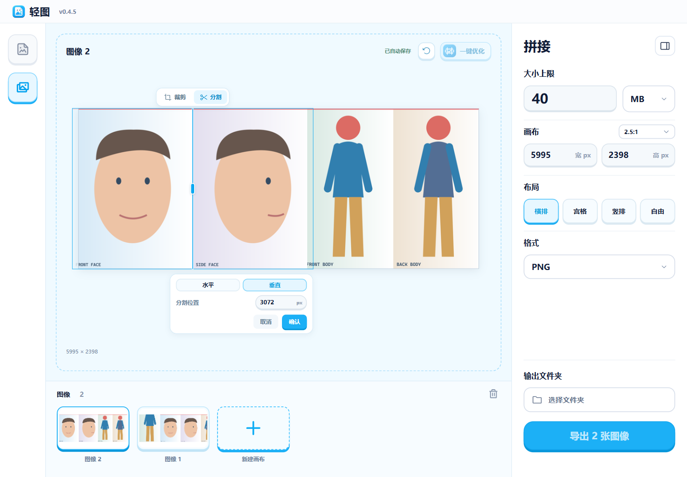

## 验证

**221 项单元和引擎测试通过**。新增覆盖两张合成图/四张独立图、画布高度与宽度上限、等比宽度缩放、去头的单独上边裁剪、四边共同保留、关联开关、拖动后保留尺寸与裁剪、两张合成图分出正面身体后单独裁剪、原子保存恢复及不重编码的关联设置。旧对称及百分比项目继续可读；打开百分比编辑不会因数值显示取整修改已保存裁剪。

以下全部通过：`npm test`、`npm run build`、`smoke:desktop`、`smoke:ui`、`smoke:canvas-fit`、`smoke:canvas-resize`、`smoke:canvas`、`smoke:split`、`smoke:recovery`、`smoke:optimization`、`smoke:png-budget`、`verify:quality`、`verify:png-budget`。原生进程依次运行。UI smoke 保留原有公共控件坐标、压缩、源副本、拖放安全、项目批量导出、失败重试、重置/删除确认、自由吸附和更新关闭协调检查；将已被用户替换的弹窗拖动/对称二选一检查改为真正图片旁控件、四边关联裁剪和直接拖动换序检查。预期保存失败场景仍输出一次测试错误并验证恢复。

桌面图片导入检查以 4K 仓库照片验证固定高度：180×240 → 360×240 → 四图封顶 600×240，原图字节不变，未自动增加裁剪；真实拖动换序、切布局及刷新恢复通过。宽度缩放检查验证画布 180×240 → 300×240 → 150×240，继续放大到图片宽 660 时画布封顶为 600×240，源图不会被缩回去；手动尺寸仍保持 500×240。自由布局保留八个缩放手柄及原有 Shift 独立尺寸行为。实际输出分别为 332,593 B 与 166,020 B，均低于 10,000,000 B。

Chrome 使用独立测试存储，未修改用户原有项目。可复现的 4K 人物**示意图**由 `node scripts/create-character-fixtures.mjs` 创建：两张 3072×4096、两张 2160×3840，以及两张对应的横向合成原图。完整流程包含四边值 80/850/120/40、关联与解除、去头后换序、宽度放大、分割取消和确认、恢复与批量导出。上方红色头部标记位于原图 750 px 以内，裁上方 850 px 后检查对应源区域，标记像素数量为零。此验证没有使用或声称识别用户的真实人物照片。

| 实际 PNG | 尺寸 | 字节 | 上限 | RGB 最大误差 / RMSE | alpha 最大误差 |
| --- | --- | ---: | ---: | --- | ---: |
| 四图裁剪、换序、放大 | 5995×2398 | 435,910 | 40,000,000 | 0 / 0 | 0 |
| 两张合成图优化 | 5995×2398 | 489,519 | 40,000,000 | 0 / 0 | 0 |
| 四图批量导出 | 5995×2398 | 435,910 | 40,000,000 | 0 / 0 | 0 |

参考由原始示意图与已保存项目独立合成，在实际输出分辨率逐字节比较解码 RGBA；单独导出与批量导出字节一致。界面及实际文件已视觉检查：正面身体的头部标记消失，选中框、分割线、控制条、白色预览底和越界淡显均未进入文件。原始 4K 图缩放至输出时的空间细节变化不包含在零编码误差的声明内。

PNG 编码算法未降低画质标准。照片、纹理最大 RGB 误差仍为 2，alpha 误差 0，RMSE 分别约 1.129 / 1.355；渐变、文字与透明样片为零编码误差。严格体积回退及原尺寸查看时的降分辨率损失仍单独验证、披露。没有为凑大小填充字节。

详细记录见 [report.json](portrait-workflow-validation/report.json)。本机可检查文件：`output/playwright/portrait-four.png`、`output/playwright/portrait-batch-0.png`、`output/playwright/portrait-batch-1.png`；大图和用户项目清单不提交 Git。数据结构、裁剪计算、原图合成、布局/换序与界面仍分层，浏览器和 Electron 共用真实引擎；原图 Blob/桌面副本、原子备份和关闭/更新刷新保存机制保留。

Windows Electron 和浏览器已实测；本轮未重新验证用户约 28 MB 原图，没有 Mac 实机、安装包安装或签名发布验证。不合并 main，不发布安装包，不更换签名公钥。浏览器预览继续运行在本机 4173 端口。

## 四边拖动与联动补验（2026-10-14）

本次裁剪交互调整通过 225 项测试、构建、Windows UI 与关闭恢复检查；保留了前述固定高度版本的原始验证记录。新测试覆盖四边源像素换算、关联与独立裁剪、恢复裁剪、非等比原有变换、拆分源窗口、边界至少保留 1 像素。UI 检查验证两组联动位置、上下默认关闭、双方选中状态、真实鼠标裁剪、未松手不编码和不保存；关闭恢复检查改为退出前仍握住真实裁剪边，重新打开恢复左右各 20 px。

Chrome 独立测试项目逐项完成上边单独裁剪、左右联动拖动、右边数值、下边拖动、向外恢复、上下联动高亮、Escape 取消、刷新恢复和实际 PNG 导出。测试原图为可复现的 2160×3840 人物示意图，不是用户照片。最终裁剪上边 850 px、下边 50 px，输出 **353×480、20,687 字节**，低于 10,000,000 字节；以原始示意图独立裁剪缩放后的实际输出尺寸比较，RGB/alpha 最大误差与 RMSE 均为 0。详细记录见 [crop-edges-report.json](portrait-workflow-validation/crop-edges-report.json)。

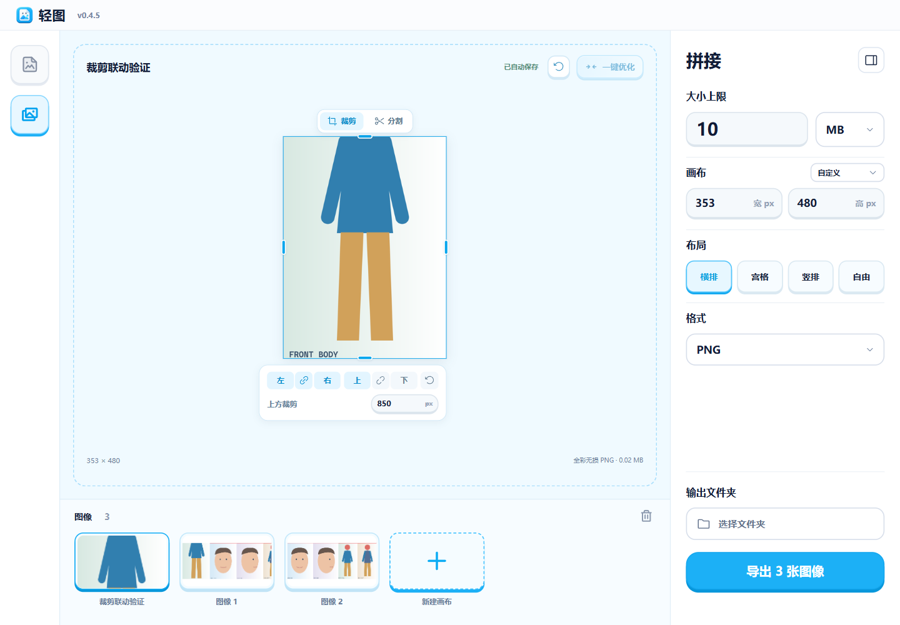

## 拖动后的选中框对齐修复（2026-10-14）

修复斜向换序后的边框偏移：拖动时直接写入的临时位置没有全部还原，React 又不会重写数值未变的样式，导致图片已归位而边框仍残留拖动偏移。现在线框、图片及画布外淡显层都先清除临时坐标，再提交移动、缩放或换序；无效拖动和取消也走同一套还原。

Chrome 实测从纵向偏移约 30.99 CSS px 修复为 0。横排、竖排、宫格斜向换序、原位放下、自由移动、取消移动和缩放，以及随后打开裁剪框，实际图片与边框四项坐标差均为 0。Windows `smoke:ui` 添加对应斜向拖动、吸附和缩放断言；构建、该检查与未松手关闭恢复检查全部通过，拖动期间仍不编码。记录见 [selection-frame-report.json](portrait-workflow-validation/selection-frame-report.json)。

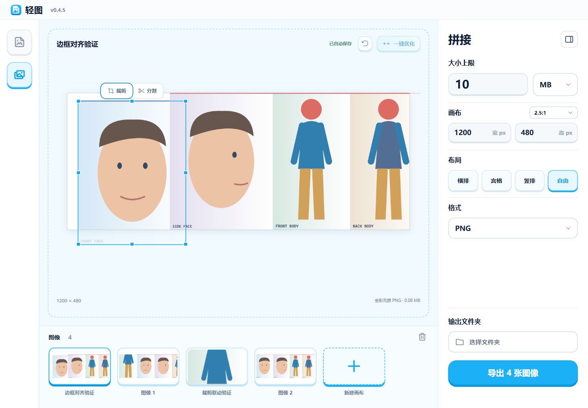

## 裁剪方向选中态与编辑框居中（2026-10-14）

将联动设置与当前操作方向分开：点上／下不再选中左右，只有当前方向组高亮；当前组联动时两侧同时高亮，切换方向仍分别记住两组联动设置。裁剪编辑框以所选图片中心定位在下方，靠近窗口边缘时保留可见性。未编辑图片重新打开后调整上边，不会把未应用的左右 50 px 预填带入。

构建与 Windows UI 检查通过，新增当前方向高亮、两组联动记忆、不触发编码及下方居中断言。Chrome 独立测试验证上／下与左／右来回切换、两组均联动时只突出当前组、人物图居中、边缘可见性及重新打开后的单独上边裁剪。记录见 [crop-axis-report.json](portrait-workflow-validation/crop-axis-report.json)，本页裁剪截图已更新。

## 四角裁剪、实时画布与缩放吸附（2026-10-14）

用户确认的新规则已经实现：裁剪提供四边和四角手柄，角点分别遵守左右、上下联动；横排在每一帧保持图片显示高度、重新衔接其他图片，实时更新自动画布宽度、设置栏和预览角落的尺寸显示。高度、5999 px 边界和 2.5:1 上限保留，手动画布尺寸保持不变。原始图片与越界内容完整保留。

四种布局都有八个缩放手柄，默认等比，按住 Shift 独立调整宽高。自动宽度在缩放期间也同步更新，封顶后图片继续放大到画布外。拖动期间固定视图缩放和画布原点，避免画布自适配改变鼠标坐标。缩放、裁剪都默认吸附画布边缘及其他图片的边缘、中心线；裁剪另吸附完整原图边界。使用 8 CSS px 吸附范围、准确的蓝色细辅助线；只让移动边参与，避免图片自己的中心线把缩放拉回原尺寸。数值和键盘仍可精确调整原图像素。

拖动只更新低分辨率图层和编辑模型，每帧合并过时指针事件，不发起保存、原图合成或编码任务。松手提交相同模型；Escape／指针取消恢复编辑和画布。忽略拖动中的悬停事件，防止原生窗口重新布局时无按键的鼠标事件干扰手势。正常退出或更新重启会完成最新手势及保存，裁剪控件仍位于图片下方居中。另修正了小高度窗口下预设标题的间距，使两模块格式控件保持对齐。

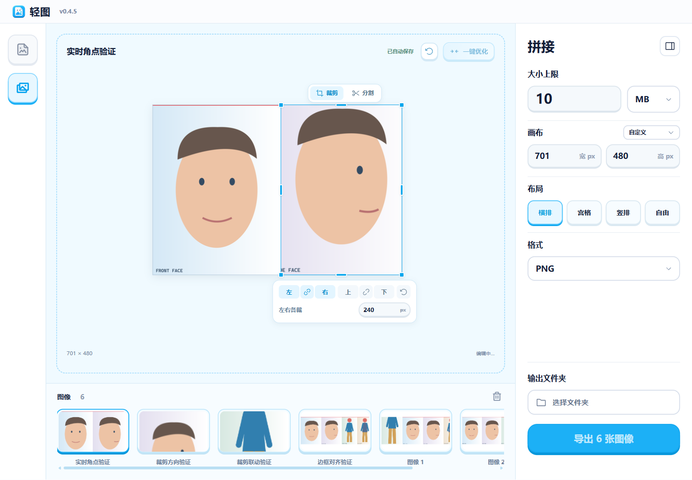

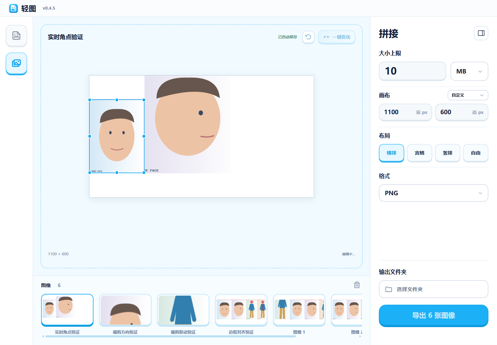

本轮通过 **231 项测试**、`npm run build`，并在 Windows 依次通过 `smoke:desktop`、`smoke:ui`、`smoke:crop`、`smoke:canvas-resize`、`smoke:canvas-fit`、`smoke:canvas`、`smoke:split`、`smoke:recovery`、`smoke:optimization`、`smoke:png-budget`；`verify:quality`、`verify:png-budget` 也通过。旧定点命中检查改为在图片可见区域避开八个手柄取点，继续验证正常图层与画布外淡显层分别可编辑；没有移除原功能断言。

新增原生 `smoke:crop` 连续实际拖动四个角：每次按住时，画布 **360×240 → 300×240**，图片显示高度不变，松手后的画布与握住时一致；取消则回到 360×240。手动画布 330×240 中，右边吸附到画布边界，左右解除联动后左裁剪保持 0，右裁剪精确为 512 个原图像素。原图副本字节不变，拖动中无保存或编码。详细记录见 [live-transform-report.json](portrait-workflow-validation/live-transform-report.json)。

Chrome 独立测试存储使用可复现角色示意图，逐一真实拖动八个缩放手柄，验证默认等比、图片／边框四项坐标相差不足 0.05 CSS px、手动画布固定，以及握住时不编码；另验证横排 Shift 仅调宽和 Escape 还原缩放。记录见 [eight-handles-report.json](portrait-workflow-validation/eight-handles-report.json)。关闭恢复增加未松手缩放阶段，重新打开与握住时的尺寸一致（DOM 小数换算误差小于 0.01 源像素）；随后未松手裁剪及移动原始文件后恢复、实际导出继续通过。

| 可检查的实际导出 | 尺寸 | 实际字节 / 上限 | RGB 最大误差 / RMSE | alpha 最大误差 |
| --- | --- | ---: | --- | ---: |
| [照片右边吸附裁剪 PNG](portrait-workflow-validation/corner-snap-export.png) | 330×240 | 190,722 / 10,000,000 | 0 / 0 | 0 |

以仓库两张 3072×4096 照片原图独立提取、Lanczos3 缩放并矩形合成参考，在输出原始分辨率逐通道比较；没有导出界面线框、白色显示底或外边距。使用相同 JPEG 缩放解码路径，避免把解码器快速缩放的细微差异算作编码损失。像素记录见 [corner-pixels.json](portrait-workflow-validation/corner-pixels.json)。本轮没有重新验证用户约 28 MB 的原图，也没有 Mac 实机或安装包发布验证。

## 小窗口画布适配（2026-10-15）

原先只要导入图片，预览便固定扣除 200 CSS px 给编辑控件；1024×650 窗口的工作区仅约 226 px 高，普通查看时画布因此只有约 26 px 高。现在仅为可见控件预留空间：普通查看保留上方工具及缩放手柄位置，打开裁剪或分割时再为下方操作栏留位。外层预览、底部项目卡片和右侧设置的位置保持一致；调整的只是显示缩放，不改变保存的画布或导出像素，也不触发拼接编码。裁剪和缩放手势同时冻结显示缩放及偏移，避免指针映射变化。

在独立 Chrome 测试存储中，以四张可复现角色示意图、1200×480 画布真实检查：

| 页面尺寸 | 修改前普通查看的画布高度 | 修改后 | 裁剪模式 |
| --- | ---: | ---: | ---: |
| 1440×1000 | 338 CSS px | 344 CSS px | 344 CSS px |
| 1280×820 | 176 CSS px | 280 CSS px | 216 CSS px |
| 1024×650 | 26 CSS px | 158 CSS px | 66 CSS px |
| 900×650 | 26 CSS px | 154 CSS px | 66 CSS px |

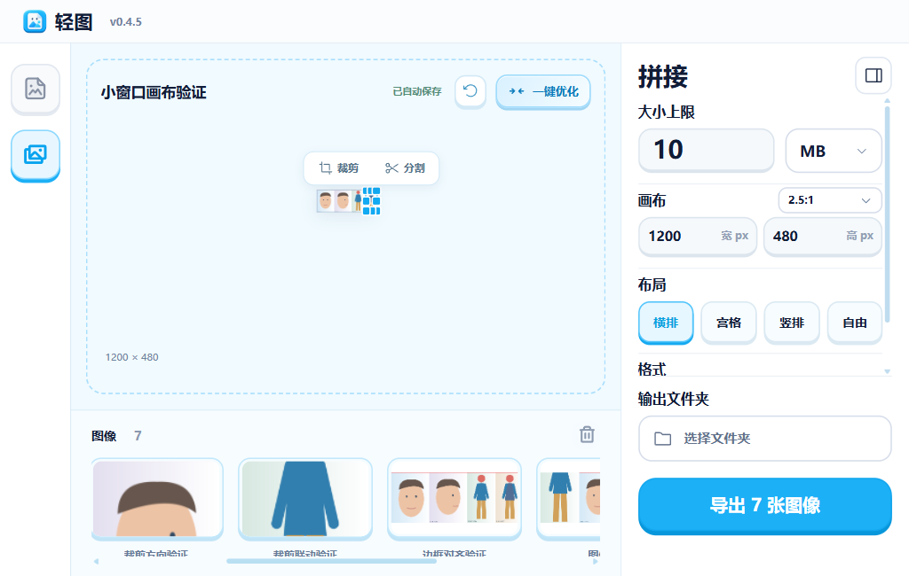

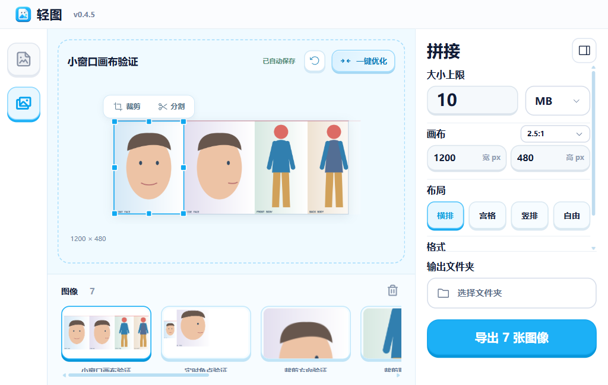

以上窗口中的画布、工具、裁剪与分割面板均位于工作区内；恢复到 1440×1000 后画布显示位置和大小与首次一致。整个窗口及未修改编辑器切换过程产生 **0 次编码请求**，画布设置始终为 1200×480。原始记录见 [small-window-report.json](portrait-workflow-validation/small-window-report.json)。原生 `smoke:ui` 新增 1024×650 实际视口检查，继续保留原有模块位置、保存和导出断言；吸附测试改为按实际 CSS 像素距离命中，避免显示比例改变后固定百分比拖动落在吸附范围外。

本轮 **234 项测试**、构建、Windows `smoke:desktop`、`smoke:ui`、`smoke:crop`、`smoke:canvas-resize`、`smoke:canvas-fit`、`smoke:canvas`、`smoke:split`、`smoke:recovery`、`smoke:optimization`、`smoke:png-budget` 及 `verify:quality`、`verify:png-budget` 全部通过。实际照片裁剪输出仍为 330×240、190,722 B，低于 10,000,000 B；全尺寸拼接导出及原图不变检查继续通过。测试中磁盘空间不足导致的一次导出失败，在仅清理重复测试导出后重跑通过。Mac 原生窗口及安装包本轮未验证，未发布安装包。

## 裁剪滑块与第三张默认裁剪（2026-10-15）

保留直接拖动四边、四角和像素输入，并在裁剪边选项下方增加蓝色滑块。滑块控制当前边的原图像素裁剪量，联动开启时同步调整相对边；往回拖到 0 可恢复源内容，避免裁剪手柄落在可视区域外后无法缩回。拖住期间按动画帧更新，固定显示缩放及面板位置，不保存、不运行高分辨率编码；松手提交并自动保存。上下仍默认不联动。

一键优化的新规则从完整原图计算并替换旧裁剪：当前顺序第三张顶部裁原高度的 25%（取整到源像素）、左右各 60 px、底部 0，不再叠加其他裁剪。其他图片按同一个百分比左右居中裁剪，等高铺满当前画布。默认四图样例中，第三张 2160×3840 裁为 2040×2880，其他三张每侧约裁 6.5657%；默认画布仍为 5995×2398。两张图沿用原规则。换序后以新的第三张计算；原图太小或无法靠其余图片左右裁剪铺满时禁用并说明原因，不偷偷增加第三张裁剪、拉伸或补边。

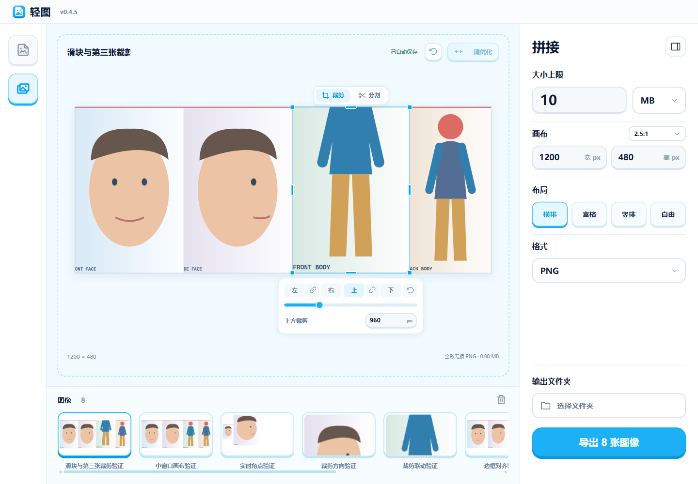

本轮 **235 项测试**、构建及所有现有 Windows 桌面检查通过：`smoke:desktop`、`smoke:ui`、`smoke:crop`、`smoke:canvas-resize`、`smoke:canvas-fit`、`smoke:canvas`、`smoke:split`、`smoke:recovery`、`smoke:optimization`、`smoke:png-budget`、`verify:quality`、`verify:png-budget`。更新原有“每张裁剪相同百分比”断言为第三张精确源裁剪、其余相同比例及铺满断言，保留尺寸、来源、幂等、保存恢复和透明 PNG 检查。实际 Windows 滑块从 0 拖到大裁剪后再回 0，画布及四边恢复，握住期间没有保存或编码；原来的四角拖动与边缘吸附仍通过。

浏览器独立测试项目采用可复现角色示意图，验证第三张裁剪、上下独立、滑块恢复及刷新恢复；右键单画布真正导出 [PNG 文件](portrait-workflow-validation/third-optimized-export.png)。尺寸 **1200×480**、实际 **81,905 B / 10,000,000 B**，全彩 PNG，RGB 最大误差、RMSE、alpha 最大误差均为 **0**（对原图提取缩放合成参考）。文件无边框、手柄、显示白底或填充。本轮实测示意图及仓库照片，未验证用户个人原图；Mac 实机和安装包未验证，未发布。记录见 [slider-third-report.json](portrait-workflow-validation/slider-third-report.json)。

## 自由画布越界图片找回（2026-10-15）

已复现图片在自由布局中移到右侧，再将画布由 1200×480 调成 240×240 后完全消失：项目保留原始坐标，预览却只按新画布缩放，图片落到工作区之外。现在遇到屏外图片时，工作区右下提供“显示全部”，将实际画布与所有图片外接范围纳入预览；点击“聚焦画布”恢复日常的大画布视图。越界图片仍淡显，可直接拖回并吸附到画布边缘。这两个查看操作不修改项目、图片坐标、裁剪、尺寸或导出设置，也不触发保存或编码。

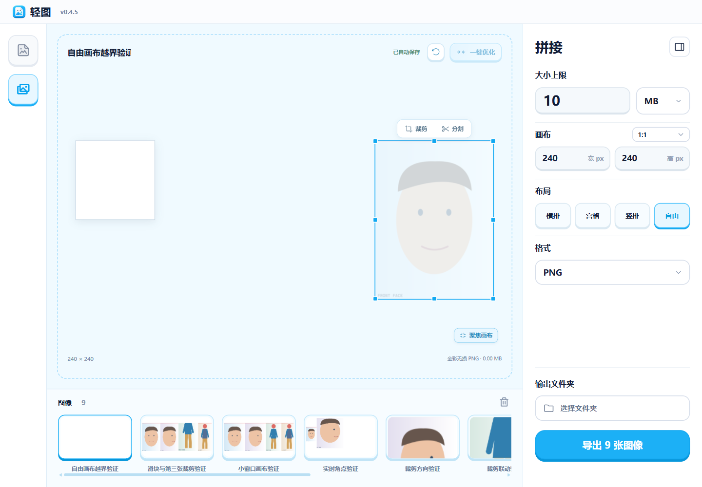

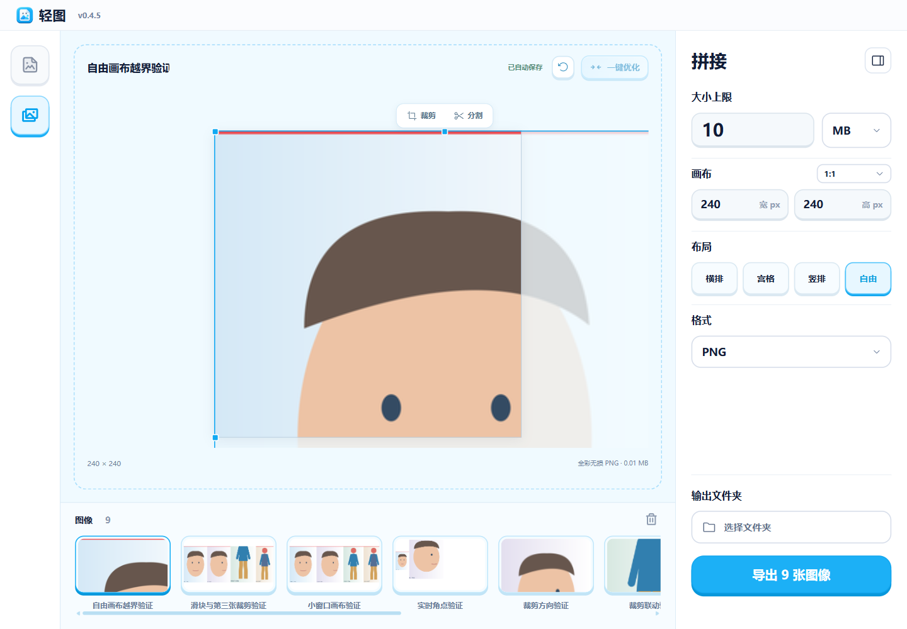

新增 `smoke:offscreen` 在 Windows 原生窗口实际完成：拖图到 x≈450、将画布由 600×240 改成 120×120、确认图片不可达、显示全部、恢复普通视图、重新打开后再次找回，并从淡显图层拖回 x=0。期间视图切换的保存和编码次数均为 0；按住拖动时也不保存或编码，选框与图层一致，松手才保存。图片仍为原 180×240 显示尺寸，原始图片副本字节不变，实际导出为 **120×120、30,127 B / 10,000,000 B**。

Chrome 独立测试存储以可复现示意图执行同样流程，240×240 的 [实际 PNG 导出](portrait-workflow-validation/offscreen-recovered-export.png) 为 **7,964 B / 10,000,000 B**。按完整原图独立缩放、提取画布交集后逐像素比较，RGB 最大误差、RMSE、alpha 最大误差均为 **0**，没有把越界淡显、选框或“显示全部”的预览范围写入导出。完整记录见 [offscreen-report.json](portrait-workflow-validation/offscreen-report.json)。

新增单元检查覆盖左右上下越界、负坐标、多图同时纳入视野、小窗口及普通视图保持原有显示大小。本轮 237 项测试及构建通过；Windows 依次运行 `smoke:offscreen`、`smoke:ui`、`smoke:desktop`、`smoke:crop`、`smoke:canvas-resize`、`smoke:canvas-fit`、`smoke:canvas`、`smoke:split`、`smoke:recovery`、`smoke:optimization`、`smoke:png-budget`、`verify:quality`、`verify:png-budget`。本轮样片来自仓库照片和可复现示意图，Mac 实机及安装包未验证，未发布。

## 可设置的优化裁剪，默认左右各 100 px（2026-10-15）

默认参数更新为第三张顶部 25%、左右各 100 个原图像素，底部 0。一键优化旁的下拉提供“顶部 %”和“左右各 px”，每个画布独立自动保存。修改参数不会立即改变图片，点击一键优化才按完整原图重新计算；已就绪预览在参数保存时直接复用。主按钮因已优化而禁用时，下拉仍可打开。空值、负值、小数像素及顶部 100% 会提示且不保存；合法参数若无法保留至少一个源像素或填满画布，会说明原因并禁用优化。已有 60 px 编辑保持原样，直到再次执行优化。

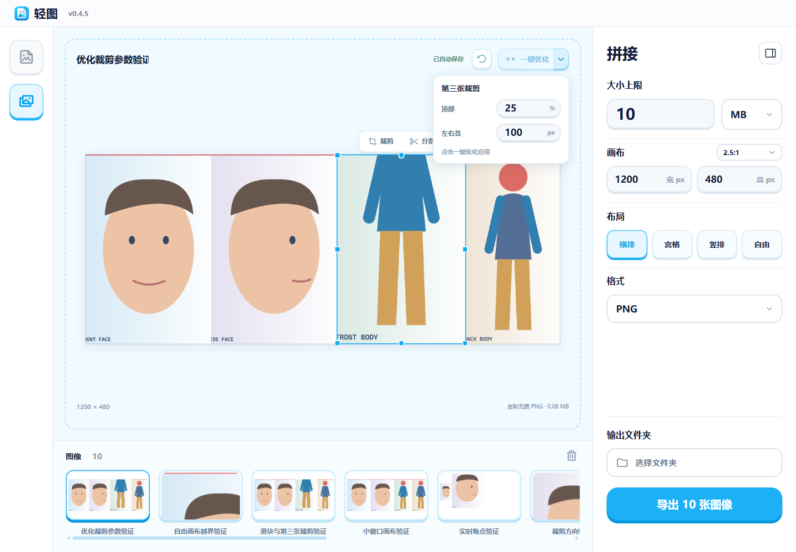

Windows 新增 `smoke:optimization-settings`：实际修改为顶部 20%、左右各 150 px，保存后裁剪和位置未变，未发起新编码；点击后第三张精确裁剪为顶部 768 px、左右各 150 px。重新打开仍为 20%/150 px；输入顶部 100% 被阻止，改回 25%/100 px 并点击后得到顶部 960 px、左右各 100 px。保持原图副本，实际照片导出 **600×240、338,644 B / 10,000,000 B**。单元测试另覆盖零裁剪、小数百分比、多个项目独立保存及异常保存恢复。

Chrome 独立测试项目采用可复现示意图，也验证了改参数不重排、点击才应用、刷新恢复与默认值。实际 [PNG 导出](portrait-workflow-validation/optimization-settings-export.png) 为 **1200×480、82,471 B / 10,000,000 B**，全彩 PNG，RGB 最大误差、RMSE、alpha 最大误差均为 **0**（对原始图片按保存的裁剪与位置合成参考）。详见 [optimization-settings-report.json](portrait-workflow-validation/optimization-settings-report.json)。没有测试用户个人原图。

本轮 **241 项测试**、构建及 Windows `smoke:optimization-settings`、`smoke:ui`、`smoke:desktop`、`smoke:crop`、`smoke:offscreen`、`smoke:canvas-resize`、`smoke:canvas-fit`、`smoke:canvas`、`smoke:split`、`smoke:recovery`、`smoke:optimization`、`smoke:png-budget`、`verify:quality`、`verify:png-budget` 全部通过。Mac 原生窗口及安装包未验证，未发布。

## 重置恢复导入大小（2026-10-15）

修复重置只清除裁剪和顺序、却保留拖动放大的问题。新导入图片持久记录当时的显示宽高，后续改变画布高度、缩放、Shift 拉伸和裁剪都不会覆盖这份基准。自由布局恢复该宽高并保持当前可见图片的中心；横排、宫格、竖排按原始顺序重新衔接排列。同步重置各个已访问布局的记忆，避免切回后出现旧放大状态。保留手动画布与导出设置，自动画布宽度仍按内容及上限更新。

旧图没有尺寸记录时，按用户确认的当前画布高度等比恢复，不把当前放大状态当成原始值。拆分图片按源窗口比例继承导入基准，连续拆分与单图删除也维护对应记录；旧拆分图以完整源高度为尺度恢复，避免每个片段都被放大到整幅高度。原始文件不变。重置继续使用确认弹窗，取消不作修改。

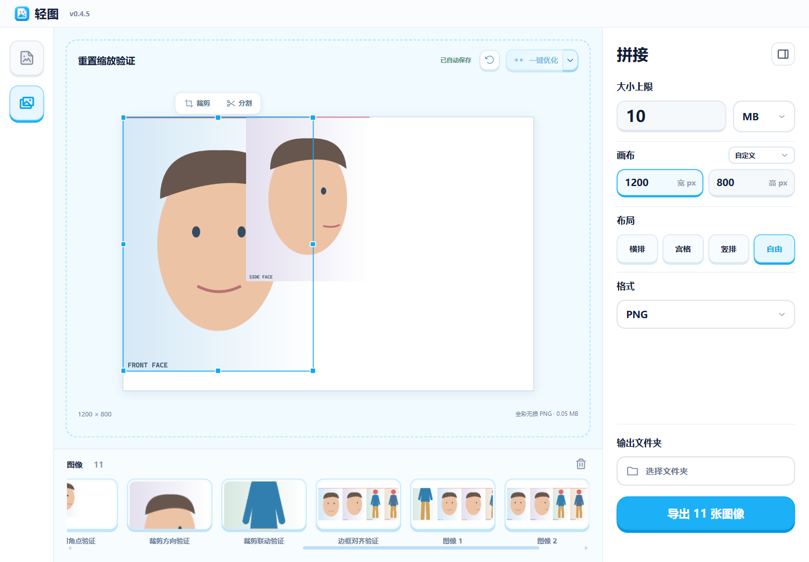

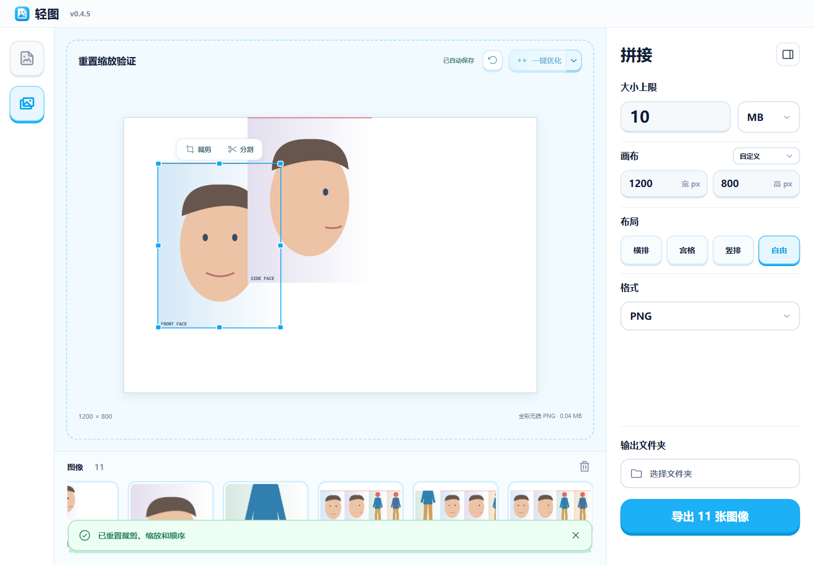

Windows 原生 `smoke:reset-zoom` 实际拖大并移动一张图，由约 288×384 恢复为导入时的 **180×240**；中心、手动画布和导出设置保留。取消、布局切换与保存重开检查均通过。实际导出 **600×480、6,483 B / 10,000,000 B**。

Chrome 独立测试项目使用可复现示意图：导入时为 **360×480**，将画布高度改到 800，再拖大至约 **558×744**，确认重置恢复 360×480 并保留当前中心，IndexedDB 刷新后保持。实际 [PNG 导出](portrait-workflow-validation/reset-zoom-export.png) 为 **1200×800、43,241 B / 10,000,000 B**。按原图独立缩放并合成参考逐像素比较，RGB 最大误差、RMSE 和 alpha 最大误差均为 **0**，全彩透明 PNG，未包含显示白底或选框。详见 [验证记录](portrait-workflow-validation/reset-zoom-report.json)。

新增测试覆盖导入基准不被后续导入覆盖、四边裁剪及拉伸后恢复、自由布局中心、自动横排衔接及宽度收缩、手动画布保持、旧图和旧拆分回退、连续拆分与删除、各布局记忆，以及正常保存和异常备份恢复。没有使用用户个人原图；Mac 原生窗口及安装包未验证，未发布。

本轮 **249 项测试**、构建及 Windows `smoke:reset-zoom`、`smoke:ui`、`smoke:desktop`、`smoke:recovery`、`smoke:optimization`、`smoke:optimization-settings`、`smoke:crop`、`smoke:offscreen`、`smoke:canvas-resize`、`smoke:canvas-fit`、`smoke:canvas`、`smoke:split`、`smoke:png-budget`、`verify:quality`、`verify:png-budget` 全部通过。分割导出曾因磁盘空间不足失败；清理工作区内重复生成的测试导出后重跑通过，未删除用户原文件或项目。质量检查继续覆盖照片、纹理、渐变、文字和透明图片，本次没有修改压缩算法。

## 调整尺寸后可再次优化（2026-10-15）

修复已优化图片放大或缩小后“一键优化”仍为禁用的问题。旧判断只比较源裁剪量，忽略了图片的实际位置和宽高；现在按钮与执行共用同一判断，同时比较裁剪和目标横排矩形。尺寸或位置需要重新整理时可点击，裁剪与排列完全匹配时仍禁用。判断只计算几何数据，不读取原图、不保存、不编码。非法画布、非横排和不可行裁剪保持原有提示。

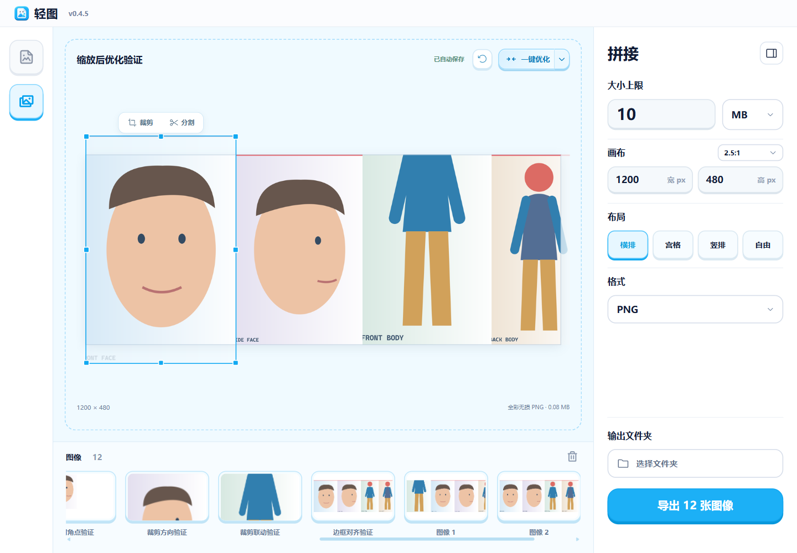

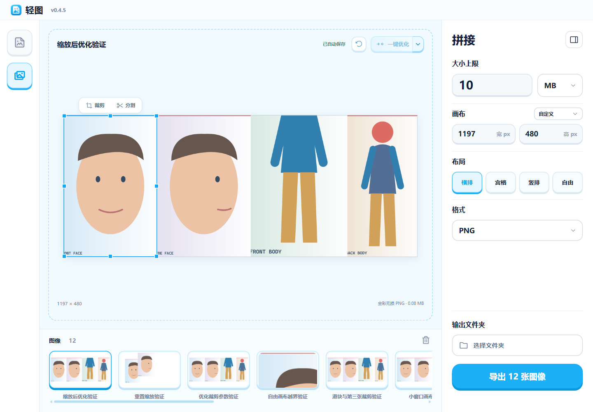

新增回归用例先在旧代码上复现失败，再验证两张预组合图和四张独立图、自动和手动画布、放大、缩小、Shift 拉伸与移动，以及无关设置不重复优化。Windows `smoke:optimization-settings` 实际拖动完成三种缩放，再点击优化，验证重新铺满、完成后禁用、原图与导入尺寸基准不变、画布和导出参数不被优化改写。放大后重开项目，按钮仍可点击。

浏览器使用可复现示意图执行同样的三次缩放与重新优化，输出画布依次为 1200×480、1152×480、1197×480；每次优化使用操作前当前尺寸。最终 [PNG 导出](portrait-workflow-validation/resize-reoptimized-export.png) 为 **1197×480、82,368 B / 10,000,000 B**，全彩 PNG；与原图合成参考的 RGB 最大差、RMSE、alpha 最大差均为 **0**。Windows 照片导出为 **597×240、336,945 B / 10,000,000 B**。详见 [验证记录](portrait-workflow-validation/resize-optimize-report.json)。本轮未验证用户个人原图、Mac 原生窗口或安装包，未发布。

本轮 **250 项测试**、构建及 Windows `smoke:optimization-settings`、`smoke:ui`、`smoke:desktop`、`smoke:reset-zoom`、`smoke:crop`、`smoke:offscreen`、`smoke:canvas-resize`、`smoke:canvas-fit`、`smoke:recovery`、`smoke:optimization`、`smoke:png-budget`、`smoke:canvas`、`smoke:split`、`verify:quality`、`verify:png-budget` 全部通过。4K 拼接、拆分与原图副本检查保持通过；本次没有修改编码算法或发布流程。

## 中央新建画布与可选优化图片（2026-10-15）

本节取代前文的“无画布只保留底部卡片”和“默认顶部 25%”规则。没有画布时，中央显示与添加图片相同风格的蓝色“新建画布”按钮，底部新建卡片继续可用；点击才创建。清空画布后及重新打开时仍显示中央新建入口。已经创建的空画布继续显示“添加图片”。

一键优化的“特殊裁剪”默认选择当前第 3 张，顶部 15%、左右各 100 原图像素、底部 0。下拉可以选择任一当前图片，也可以“不选择”；不选择或该序号尚未添加时，每张图都使用统一左右裁剪，不应用特殊顶部裁剪。序号随当前顺序解释。其他图片按共享比例左右裁剪，保持等高铺满当前画布；无法实现时显示原因。

序号和裁剪数值随每个画布独立保存，重新打开继续保留，包括“不选择”。老项目已保存的百分比继续有效，缺失的序号默认第 3 张；本轮不自动改写已有裁剪。改设置只保存参数，点击一键优化才应用。选择“不选择”会禁用对应裁剪字段；若先前填写了无效数值，恢复最后保存的有效值后再切换，避免留下无法编辑的错误。

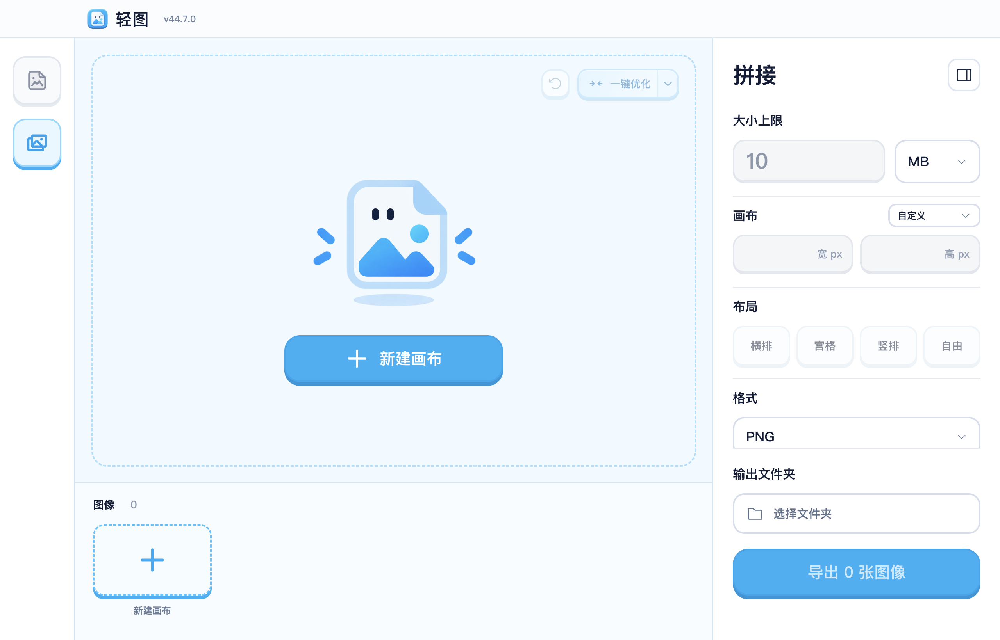

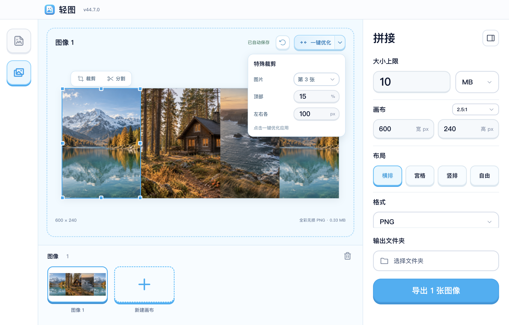

本轮在 Apple Silicon Mac 上通过 **254 项测试**、构建及 `smoke:optimization-settings`、`smoke:ui`、`smoke:desktop`、`smoke:reset-zoom`、`smoke:crop`、`smoke:offscreen`、`smoke:canvas-resize`、`smoke:canvas-fit`、`smoke:canvas`、`smoke:split`、`smoke:recovery`、`smoke:optimization`、`smoke:png-budget`、`verify:quality`、`verify:png-budget`。新增原生检查实际选择第 4 张，确认顶部 20% 精确为 768 px、左右各 150 px；不选择时没有特殊顶部裁剪，重开仍保持；默认第 3 张顶部精确为 576 px。验证无效输入后切换“不选择”、缺失序号恢复、长列表滚动与 Escape，以及修改设置不裁剪、不重复编码。中央按钮实际创建画布，清空后及重开仍可见。

照片样例经三种缩放再优化后，实际 [PNG 导出](portrait-workflow-validation/selectable-crop-export.png) 为 **598×240、334,178 B / 10,000,000 B**；源文件逐字节不变。见 [原生验证记录](portrait-workflow-validation/selectable-crop-report.json)。界面截图来自开发版 Electron；本轮未重新制作安装包或发布，已发布的 0.4.6 仍对应发布时的代码。

## 指定图像与多选导出（2026-10-15）

底部每张“图像”画布卡片左上角新增导出勾选框，点击缩略图继续切换编辑。可以只选一张，也可以同时选择多张，右侧“导出 X 张图像”只统计并导出勾选的非空画布，各自保留原有的尺寸、格式和体积上限。全选框支持部分勾选状态，再次点击可全选或取消全选；没有勾选时禁用导出，不会回退为导出全部。

默认仍勾选全部非空画布。手动缩小范围后，新画布不会自动加入；空画布不可勾选，删除的画布不计入数量。导出勾选与当前编辑画布独立，切换画布或压缩/拼接模块保留选择，不触发项目保存或图片编码；重开应用恢复默认全选。导出期间锁定勾选范围，快捷键与主按钮使用同一选择，右键“导出此图像”仍直接导出该画布。未勾选画布的尺寸错误不会阻挡其他已勾选的合法画布；保存失败继续阻止导出。

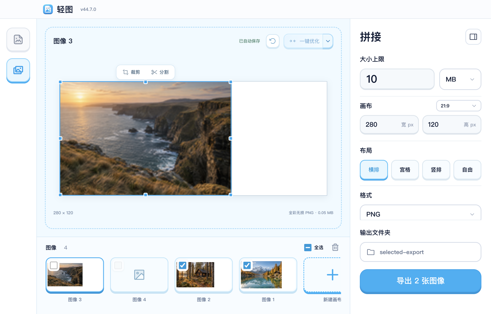

本轮 Apple Silicon Mac 上 **255 项测试**、构建、14 项桌面检查（含新增 `smoke:selected-export` 和原有 UI、优化设置、重置、裁剪、越界找回、画布调整、拆分、恢复及 PNG 预算检查）与两项画质/预算验证通过。新增流程实际用空格键勾选一张，再用导出快捷键生成 **240×120、51,965 B** PNG；勾选两张后只生成对应的 240×120 与 **260×120、60,529 B** 文件，均小于各自 10,000,000 B 上限。还验证空画布跳过、全选/清空、部分勾选、切换模块、导出期间锁定、未勾选画布尺寸错误不阻塞，以及删除唯一勾选项后保持零导出。对已有正常预览切换勾选前后，项目文件未变、编码调用数未增加；原图逐字节不变。见 [验证记录](portrait-workflow-validation/selected-export-report.json)。

桌面测试同步等待新建卡片保存与真实页面重载，确保选中预期图片后再检查边框像素；macOS 测试窗口主动激活，截图仅对 `UnknownVizError` 做最多三次帧间重试。本轮没有重新制作或发布安装包。
