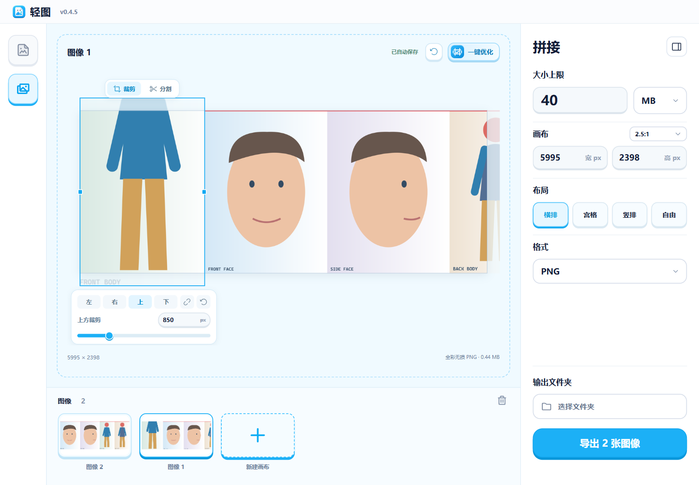
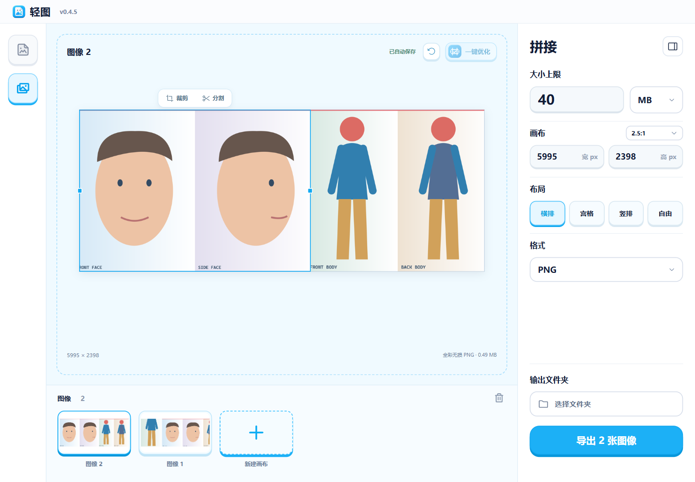

# 固定高度人物拼接与图片旁编辑

2026-10-14，Windows，Node 24.14.0，Electron 44.7.0，Chrome。用户确认：固定的是画布高度，图片保持比例缩放，宽度增长至高度的 2.5 倍后封顶，超出画布的内容裁掉；每张图支持四边裁剪与关联开关；直接拖动图片换序。此规则覆盖之前按图片外接范围改变画布高度的实现。

默认高度为 2398 px，自动宽度随横排内容变化，最大 5995×2398。图片放大仍保留原比例，画布高度不变，封顶后继续放大保留完整越界位置，显示淡化并在导出时裁到画布内。横排只保留左右两个宽度手柄，垂直中心保持；不会将其他图片缩小来满足上限。手动预设与宽高保留指定画布；继续导入按画布高度追加并适配自动宽度。每边 5999 px、长短边比 2.5 上限继续校验，不用透明补边隐藏非法布局。

选中图片，上方显示“裁剪／分割”。裁剪直接拖动图片的四条边，或在图片下方设置原图像素；滑块已移除。下方按“左／联动／右”和“上／联动／下”排列，左右默认联动，上下默认独立，旧图片明确保存的设置保留。开启联动时，该组两侧按钮同时高亮；关闭后单独裁选中边。四边值可以同时保留，两个关联状态分别保存。裁正面全身的头部时，在上下不联动状态拖动上边即可；松手后保留横排显示高度，按裁后比例调整宽度，其他图片衔接，不自动识别或处理其他图片。

横排、竖排、宫格中直接拖图换序，目标位置有轻量虚框；自由布局仍是带吸附的位置移动。横排换序保留每张图的尺寸、裁剪和缩放，真正导入顺序独立记录，重置不会把编辑后的顺序当作原始顺序。各布局仍分别记住画布与完整原图姿态；实际二维命中检测支持已保存位置偏离名义布局的情况。

双击、右键编辑打开同一套图片旁控件，移除了拖动弹窗、完成按钮与重复模式切换。未改动的左右各 50 px 预填不应用，直接拖动从实际裁剪开始；首次切到上下边只清除尚未应用的左右预填。拖动中固定原图比例和控件位置，只更新低分辨率预览，松手才重排并自动保存。向外拖可恢复已裁内容，Escape 或指针取消恢复本次拖动前的状态；正常关闭会完成未松手的最新裁剪。平时点击外部或 Escape 收起控件。隐藏模块的零尺寸通知不会再把画布压成一个点。关联开关仅变更设置时，复用已有编码结果，不重新读取原图。

两张图按已合成的“正脸＋侧脸”和“正面全身＋背面全身”导入。若只想裁正面全身，可先将全身合成图垂直分为两张，再单独裁正面那张的上边；测试验证两个身体片段共用原始合成图，背面片段不接收正面的裁剪。原有一键优化仍仅横排启用，按完整原图对每张当前图片进行同百分比左右裁剪，替换已有裁剪，因此应在单图细调前使用。

“分割”在完整原图上显示可拖动的分割线，忽略已存在的裁剪，保留先前确认的原图中心及缩放比例；下方靠右显示“取消／确认”。水平线分上下，垂直线分左右，数值使用原图像素。取消恢复原裁剪与位置，确认才生成两个整数源窗口，共用一份不可变原图，不复制或重新编码大图，可继续分割。拆分线、手柄、淡显层和白色显示底都不进入导出。

## 验证

**221 项单元和引擎测试通过**。新增覆盖两张合成图/四张独立图、画布高度与宽度上限、等比宽度缩放、去头的单独上边裁剪、四边共同保留、关联开关、拖动后保留尺寸与裁剪、两张合成图分出正面身体后单独裁剪、原子保存恢复及不重编码的关联设置。旧对称及百分比项目继续可读；打开百分比编辑不会因数值显示取整修改已保存裁剪。

以下全部通过：`npm test`、`npm run build`、`smoke:desktop`、`smoke:ui`、`smoke:canvas-fit`、`smoke:canvas-resize`、`smoke:canvas`、`smoke:split`、`smoke:recovery`、`smoke:optimization`、`smoke:png-budget`、`verify:quality`、`verify:png-budget`。原生进程依次运行。UI smoke 保留原有公共控件坐标、压缩、源副本、拖放安全、项目批量导出、失败重试、重置/删除确认、自由吸附和更新关闭协调检查；将已被用户替换的弹窗拖动/对称二选一检查改为真正图片旁控件、四边关联裁剪和直接拖动换序检查。预期保存失败场景仍输出一次测试错误并验证恢复。

桌面图片导入检查以 4K 仓库照片验证固定高度：180×240 → 360×240 → 四图封顶 600×240，原图字节不变，未自动增加裁剪；真实拖动换序、切布局及刷新恢复通过。宽度缩放检查验证画布 180×240 → 300×240 → 150×240，继续放大到图片宽 660 时画布封顶为 600×240，源图不会被缩回去；手动尺寸仍保持 500×240。自由布局保留八个缩放手柄及原有 Shift 独立尺寸行为。实际输出分别为 332,593 B 与 166,020 B，均低于 10,000,000 B。

Chrome 使用独立测试存储，未修改用户原有项目。可复现的 4K 人物**示意图**由 `node scripts/create-character-fixtures.mjs` 创建：两张 3072×4096、两张 2160×3840，以及两张对应的横向合成原图。完整流程包含四边值 80/850/120/40、关联与解除、去头后换序、宽度放大、分割取消和确认、恢复与批量导出。上方红色头部标记位于原图 750 px 以内，裁上方 850 px 后检查对应源区域，标记像素数量为零。此验证没有使用或声称识别用户的真实人物照片。

| 实际 PNG | 尺寸 | 字节 | 上限 | RGB 最大误差 / RMSE | alpha 最大误差 |
| --- | --- | ---: | ---: | --- | ---: |
| 四图裁剪、换序、放大 | 5995×2398 | 435,910 | 40,000,000 | 0 / 0 | 0 |
| 两张合成图优化 | 5995×2398 | 489,519 | 40,000,000 | 0 / 0 | 0 |
| 四图批量导出 | 5995×2398 | 435,910 | 40,000,000 | 0 / 0 | 0 |

参考由原始示意图与已保存项目独立合成，在实际输出分辨率逐字节比较解码 RGBA；单独导出与批量导出字节一致。界面及实际文件已视觉检查：正面身体的头部标记消失，选中框、分割线、控制条、白色预览底和越界淡显均未进入文件。原始 4K 图缩放至输出时的空间细节变化不包含在零编码误差的声明内。

PNG 编码算法未降低画质标准。照片、纹理最大 RGB 误差仍为 2，alpha 误差 0，RMSE 分别约 1.129 / 1.355；渐变、文字与透明样片为零编码误差。严格体积回退及原尺寸查看时的降分辨率损失仍单独验证、披露。没有为凑大小填充字节。

详细记录见 [report.json](portrait-workflow-validation/report.json)。本机可检查文件：`output/playwright/portrait-four.png`、`output/playwright/portrait-batch-0.png`、`output/playwright/portrait-batch-1.png`；大图和用户项目清单不提交 Git。数据结构、裁剪计算、原图合成、布局/换序与界面仍分层，浏览器和 Electron 共用真实引擎；原图 Blob/桌面副本、原子备份和关闭/更新刷新保存机制保留。

Windows Electron 和浏览器已实测；本轮未重新验证用户约 28 MB 原图，没有 Mac 实机、安装包安装或签名发布验证。不合并 main，不发布安装包，不更换签名公钥。浏览器预览继续运行在本机 4173 端口。

## 四边拖动与联动补验（2026-10-14）

本次裁剪交互调整通过 225 项测试、构建、Windows UI 与关闭恢复检查；保留了前述固定高度版本的原始验证记录。新测试覆盖四边源像素换算、关联与独立裁剪、恢复裁剪、非等比原有变换、拆分源窗口、边界至少保留 1 像素。UI 检查验证两组联动位置、上下默认关闭、双方选中状态、真实鼠标裁剪、未松手不编码和不保存；关闭恢复检查改为退出前仍握住真实裁剪边，重新打开恢复左右各 20 px。

Chrome 独立测试项目逐项完成上边单独裁剪、左右联动拖动、右边数值、下边拖动、向外恢复、上下联动高亮、Escape 取消、刷新恢复和实际 PNG 导出。测试原图为可复现的 2160×3840 人物示意图，不是用户照片。最终裁剪上边 850 px、下边 50 px，输出 **353×480、20,687 字节**，低于 10,000,000 字节；以原始示意图独立裁剪缩放后的实际输出尺寸比较，RGB/alpha 最大误差与 RMSE 均为 0。详细记录见 [crop-edges-report.json](portrait-workflow-validation/crop-edges-report.json)。

