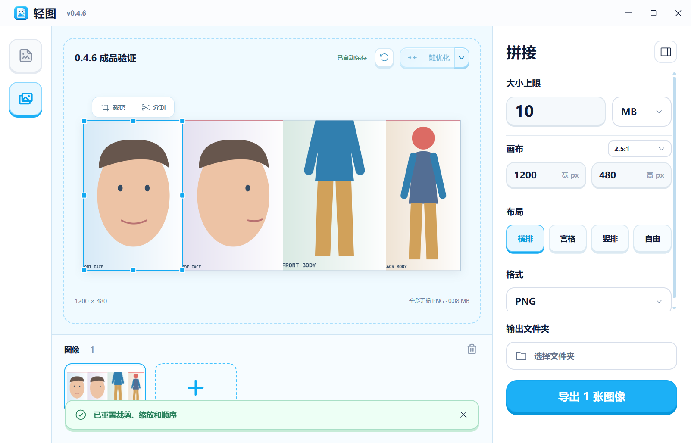

# 轻图 0.4.6 联合发行准备

状态（2026-10-15）：用户要求 Mac 与 Windows 一起发行。Windows x64 安装包已生成并验证；Mac arm64/x64 尚未构建，尚未向公开发行仓库上传或改动最新正式版。现有正式版仍为 0.4.5。

## 更新内容

- 图像拼接工作台：横排、宫格、竖排、自由布局，拖动换序、八个缩放手柄、吸附、四边与四角裁剪、画布上分割。
- 多个画布独立自动保存，保管原图副本，关闭重开后恢复；支持分别及批量导出。
- 优化裁剪可设置第三张顶部比例与左右像素，默认顶部 25%、左右各 100 px。调整图片大小后可以再次一键优化；重置恢复导入时的显示尺寸与真正导入顺序。
- 全彩高保真 PNG、十进制实际字节上限。未修改且已符合上限的原文件保持不变，紧预算必要时等比调整分辨率并报告实际尺寸。
- 自由画布越界图像可通过“显示全部”找回；布局分别记忆，预览与图片操作保持流畅。

## 已完成的 Windows 检查

- `npm test`：250 项通过；`npm run pack:win` 完成构建、NSIS、更新元数据和分片。
- 实际运行打包后的 `轻图.exe`，使用 D 盘独立资料目录，验证版本 0.4.6、四图导入、放大后再优化、重置导入尺寸、自动保存与刷新恢复、渲染进程隔离。
- 从实际 `app.asar` 加载 Sharp 与处理引擎：拼接输出 1200×480、82,471 B；照片 PNG 输出 1200×800、1,622,380 B；1,000,000 B 上限输出 999×666、986,217 B，实际尺寸随结果返回；符合预算的原始 JPG 输出字节一致。
- 真实 NsisUpdater 从隔离的本地 HTTP 服务下载两片，完成整包 SHA-512 校验，未执行安装或替换用户现有应用。`smoke:update` 的离线、下载确认和重启确认流程通过。
- 打包的主进程、preload、重置/优化引擎和更新公钥与源码逐字节匹配。包内没有原图项目、缓存、私钥或 `.env`。

完整记录：[report.json](release-0.4.6-validation/report.json)。

## 本地产物

目录：`D:\qingtu-builds\qingtu-0.4.6-win-x64\release`。工作区 `release/` 是该目录的本地 junction，不进入 Git。

| 文件 | 字节 |
| --- | ---: |
| Qingtu-0.4.6-win-x64.exe | 123,024,045 |
| Qingtu-0.4.6-win-x64.exe.part01 | 67,108,864 |
| Qingtu-0.4.6-win-x64.exe.part02 | 55,915,181 |

整包 SHA-256：`fda8db4a71012d67e6019736565d8b80fe4314170df154f487a198c1666d5999`。

`release/gitee-publish/` 包含两片、`latest.yml`、初次安装 CMD 和 SHA-256 清单，单附件均小于 100 MB。安装器沿用已有未配置 Windows 代码签名证书的构建设置。

## Mac 与联合发行条件

不需要付费 Apple Developer ID 证书；沿用既有 ad-hoc 应用签名。原生 Sparkle 桥接由 macOS `xcrun/clang++` 构建，更新 ZIP 与清单另外使用原来的 Ed25519 私钥签名。

本机未找到 `.cache/sparkle-signing/update-seed.txt` 或已记录的备份 `~/Library/Application Support/Qingtu Release Signing/sparkle-update-seed.txt`，没有配置原 Mac 的连接，也没有找到可用的同项目 macOS CI。公钥未修改，不生成替代私钥。

待原 Mac 或现有 macOS CI 可用后，使用同一源码版本分别执行 `npm run pack:mac` 与 `npm run pack:mac:intel`，验证签名、原生运行及分片。然后一次上传 Windows、Mac 两种架构的完整发行附件，匿名验证下载和更新器，最后改为正式版。当前客户端以同一个 Gitee latest API 定位发行目录，不能先用缺少 Mac 签名清单的 Windows 单平台正式版替换它。

Gitee Git 推送认证可用，但当前发布页面尚未登录；网页登录需在已打开的 Gitee 窗口完成，不在聊天中提供密码或令牌。尚未验证 Mac 0.4.6、用户现有安装上的安装覆盖，以及上传后的远程匿名下载。
