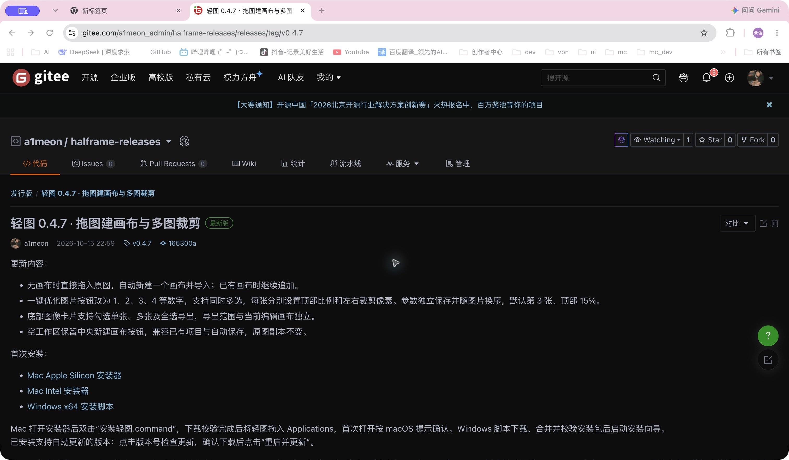

# 轻图 0.4.7 · Mac / Windows

状态（2026-10-15）：Windows x64、Mac Apple Silicon、Mac Intel 已联合发布为 [Gitee 最新正式版 0.4.7](https://gitee.com/a1meon_admin/halframe-releases/releases/tag/v0.4.7)。发布源码 debbfb899a51ab1b86a8bfbbdadf60211e5a680b（codex/stitch-and-quality），未合并 main。

## 更新内容

- 没有画布时，直接拖入原图会自动新建一个画布并导入；已有画布时继续追加，导入期间重复拖放不产生副本。
- 一键优化显示与实际图片数量对应的数字按钮，支持多选和每图独立设置顶部比例、左右像素；参数随图片换序并独立保存，默认第 3 张、顶部 15%、左右各 100 px。
- 底部图像卡片可独立勾选导出，支持指定单张、多张及全选，编辑焦点与导出范围独立。
- 空工作区保留中央新建画布按钮，原图副本不变，兼容已有自动保存项目。

## 发布约束与验证

262 项自动测试、构建、16 项桌面检查和两项画质/预算验证通过。拖图实际从零画布创建并导出，按钮显示 1/2/3/4，多选独立裁剪及一张/多张真实导出通过。

沿用现有 Ed25519 私钥、Mac ad-hoc 应用签名和 Gitee 分片更新。单个上传附件小于 100 MB；先核对 Gitee 的 1 GB 总附件限额和实际包体积，按用户授权从最早版本起备份校验并清理必要的旧版，再上传全部附件。保留用户正在运行的旧版应用与图片队列。Windows 安装器原生安装与 Intel Mac 原生运行仍需对应实机验证。

三个平台包内关键源码和编译资源逐字节一致，更新源均指向 v0.4.7，未包含私钥、用户项目或测试脚本。两个 Mac 应用通过 codesign 深度严格验证，ZIP 通过官方 Sparkle 签名验证；两个初装 DMG 挂载后核对安装脚本与可执行权限。实际 Apple Silicon 可执行文件加载包内 Sharp 和 Sparkle 桥接，输出 1001×667 PNG，998,430 字节 ≤ 1,000,000 字节，符合预算的 JPG 原件逐字节保留。打包源码的 UI、拖图建画布及图片导出检查通过，真实 NsisUpdater 完成本地分片下载和整包 SHA-512 校验，未触发安装。

| 包 | 字节 | 分片数 |
| --- | ---: | ---: |
| Windows x64 NSIS | 123,025,021 | 2 |
| Mac Apple Silicon ZIP | 138,185,745 | 3 |
| Mac Intel ZIP | 145,939,161 | 3 |

已上传附件共 15 个、407,197,206 字节；单片不超过 64 MiB。0.4.3 的 7 个附件与 0.4.5 的 15 个附件均已匿名重新下载、校验并备份到 release/archive-v043 和 release/archive-v045，合计 529,521,630 字节；已按最早顺序删除这两个线上发行版，保留 0.4.6。清理及上传后附件总量为 814,387,470 字节，低于页面标明的 1G 限额。

7 个小附件与本地逐字节一致；两个 Mac 更新器匿名下载全部分片并通过签名清单、分片哈希、整包 SHA-512 和官方 Sparkle ZIP 签名校验。真实 Windows NsisUpdater 匿名下载并验证完整安装包，未执行安装。三个平台的 0.4.7 当前版本检查均未自动下载。验证后取消预览标记，Gitee 页面确认“最新版”及全部 15 个附件。

Gitee 最新发行版 API 从当前网络返回 HTTP 403（Rate Limit Exceeded），因此这次未能验证 API 自动发现最新版本；直接版本更新源及实际下载验证通过。Intel Mac 原生执行和 Windows 原生安装仍需对应实机验证。详细见 [本地构建记录](release-0.4.7-validation/local-verification.json) 和 [远程发布验证记录](release-0.4.7-validation/published-verification.json)。

