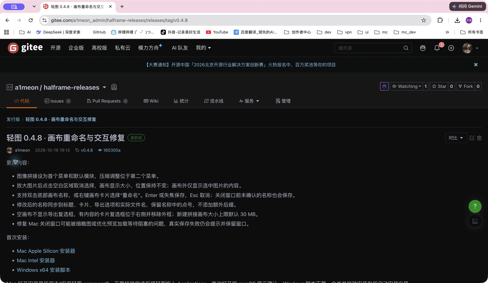

# 轻图 0.4.8 · Windows / Mac

状态（2026-10-16）：Windows x64、Mac Apple Silicon 和 Mac Intel 已联合发布为 [Gitee 最新正式版 0.4.8](https://gitee.com/a1meon_admin/halframe-releases/releases/tag/v0.4.8)。源码：27cf26bfcb65c9a11ae677e00904a4442c549bd7（codex/stitch-and-quality），保留当前分支，未合并 main。

## 更新内容

- 图像拼接为首个菜单和默认启动模块，压缩调整位于第二个菜单。
- 点击空白区域取消选择后，画布的显示大小和位置保持不变；仅选中图片显示画布外的内容。
- 底部画布卡片可双击名称或通过右键“重命名”编辑。Enter/失焦保存，Esc 取消；正常关闭窗口会提交尚未确认的名称。
- 名称同步到标题、卡片、导出选项和实际文件名，保留点号，不附加 -qingtu。
- 空画布隐藏导出复选框，有内容的卡片复选框位于右侧并去掉外框；新建拼接画布默认大小上限 30 MB，已有设置保留。
- 修复 Mac 关闭窗口可能等待缩略图或优化预览解码而阻塞的问题，真实保存失败仍提示并保留窗口。

## 验证与安装

沿用原有 Sparkle Ed25519 私钥和 ad-hoc 应用签名。三平台包内编译资源与引擎源码逐字节一致，更新源指向 0.4.8，不含私钥、用户项目或测试脚本。两个 Mac 应用通过 codesign 深度严格验证，ZIP 通过官方 Sparkle 签名校验，两个初装 DMG 挂载后核对安装脚本和执行权限。Apple Silicon 成品实际加载 Sharp 和 Sparkle 桥接，输出 1001×667 PNG、998,430 字节 ≤ 1,000,000 字节，符合预算的 JPEG 原件逐字节保留。

| 平台包 | 字节 | 分片数 |
| --- | ---: | ---: |
| Windows x64 NSIS | 123,026,973 | 2 |
| Mac Apple Silicon ZIP | 138,186,587 | 3 |
| Mac Intel ZIP | 145,939,999 | 3 |

Gitee 单个附件 100 MB、仓库总附件 1 GB。新包白名单包含 15 个附件，共 407,200,859 字节，每个分片不超过 64 MiB。上传前线上 0.4.6 和 0.4.7 共 814,387,470 字节，空间不足。最早的 0.4.6 共 15 个附件、407,190,264 字节，已匿名重新下载并与既有发布文件逐字节和校验表核对，备份于 release/archive-v046，同时保留原始发行版元数据。已按用户授权仅清理 0.4.6，保留 0.4.7；清理并上传后的附件总量为 814,398,065 字节，低于 1 GB 限额。

安装方式沿用已批准的分片下载流程：Mac 选择对应架构的 Installer.dmg，打开“安装轻图.command”，下载并校验后将轻图拖入 Applications；Windows 使用 Install-Qingtu-0.4.8-Windows.cmd，校验后启动 NSIS 安装向导。现有支持更新的轻图可点击版本号检查，确认下载后选择“重启并更新”。Intel Mac 原生执行和 Windows 原生安装仍需对应实机验证。用户正在运行的旧版应用与队列未被替换或关闭。

264 项单元测试、构建及全部 22 项检查通过；成品源码的界面、实际重命名/导出、取消选中时的画布边界和五种原生关闭情形通过，真实 Windows NsisUpdater 完成本地分片下载与整包校验，未执行安装。详见 [本地验证记录](release-0.4.8-validation/local-verification.json)。

成品 UI 测试曾遇到 macOS 窗口失焦及旧画面状态造成的自动化失败。测试脚本使用 Chromium 的 [活动页面焦点模拟](https://raw.githubusercontent.com/ChromeDevTools/devtools-protocol/master/pdl/domains/Emulation.pdl) 并等待绘制后的稳定状态，重跑源码及成品的原有断言均通过，未改变安装包内的产品逻辑。

## 线上发布验证

15 个附件全部上传完成；7 个小附件匿名下载后与本地逐字节一致。两个 Mac 更新器匿名下载全部分片，验证签名清单、每片哈希、整包 SHA-512 和官方 Sparkle ZIP 签名。真实 Windows NsisUpdater 匿名下载完整 123,026,973 字节 NSIS 安装器，整包哈希一致，未触发安装。验证后取消预览标记，Gitee 页面和 API 均确认 0.4.8 是最新正式版，线上仅保留 0.4.7 与 0.4.8。

本次 Gitee 最新发行版 API 已恢复 HTTP 200。使用实际更新源解析逻辑，0.4.7 的两个 Mac 架构均发现 0.4.8，等待用户确认才下载；0.4.8 的两个 Mac 架构和真实 Windows 更新 SDK 均未重复下载。详见 [线上验证记录](release-0.4.8-validation/published-verification.json)。

