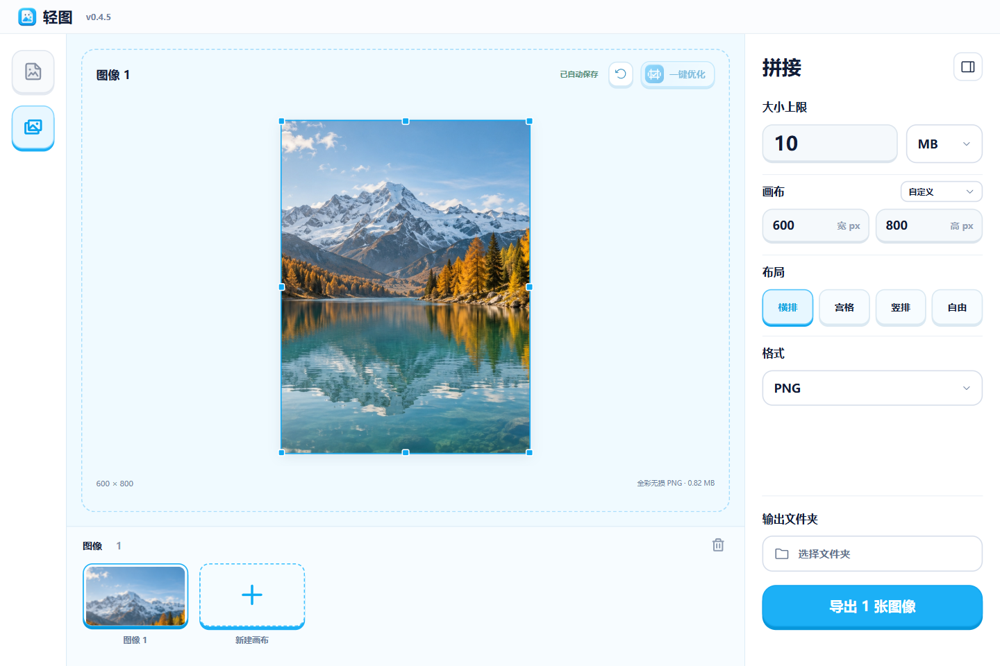

# 图片缩放后重新贴合画布

2026-10-14，Windows Electron 44.7.0、Chrome，Node 24.14.0。用户再次确认：**保留 2.5:1 比例上限，不锁定画布比例；自动贴合的画布随图片缩放更新，手动预设或输入宽高后保持尺寸。** 每次导入仍按 [content-canvas.md](content-canvas.md) 重新贴合。

自动画布在图片缩放结束时，按所有图片的实际外接范围扩大或收缩，保留当前图片尺寸、相对位置、裁剪和内部空隙。不会把刚缩小的图片重新放大到之前设置的长边。该操作只平移坐标原点，不额外拉伸、裁剪或补边。手动选择预设或输入宽高后，缩放图片保持指定画布；纯移动始终允许将图片拖出画布，越界部分淡显且只导出画布内区域。

缩放手势中继续使用 rAF 更新低分辨率图层，不更改画布，不保存、不编码；松开后才一次提交画布和图片坐标，避免拖动中改变预览缩放。点击、取消手势不会触发贴合。正常关闭的手势提交沿用同一入口。每种布局记住自己的画布与图片变换，切换和重开恢复；不会因缩放重新排列其他布局。旧项目没有自动尺寸标记时仍按手动画布处理，直到导入后进入自动贴合。

每边最多 5999 px、长短边比最多 2.5 的校验保留。缩放后的完整内容超限时，保留编辑数据并提示调整、阻止导出，不通过缩小其他图片、自动裁切或补透明边掩盖冲突。

实现分为共享边界计算、缩放操作提交与界面手势类型；导入仍可统一调整分辨率，手动缩放后的贴合保持实际像素尺寸。新增 5 项引擎测试，覆盖放大再缩小、多图相对位置与裁剪、Shift 宽高比例、手动画布、越界移动、布局记忆、非法尺寸比例，以及真实 PNG 合成的四边透明度。

**210 项测试及构建通过**。实际运行通过：`smoke:desktop`、`smoke:ui`、`smoke:canvas-fit`、新增 `smoke:canvas-resize`、`smoke:canvas`、`smoke:split`、`smoke:recovery`、`smoke:optimization`、`smoke:png-budget`、`verify:quality`、`verify:png-budget`。UI smoke 保留全部原有操作检查；保存失败场景预期输出一次测试错误，再验证恢复。

新桌面检查使用仓库照片派生的 4K 尺寸原图，实际鼠标操作验证：初始 450×600，放大后 600×800，再缩小为 300×400；拖动期间编码次数不变；切布局及刷新恢复；16:9 预设保持 5984×3366；手动尺寸保持 800×400；原图字节及裁剪、导入顺序不变。真实 Chrome 独立测试存储得到相同结果，并验证 Shift 调为 450×400 后，默认等比缩小为 225×200。没有修改用户原有项目。

两端实际导出均为 **PNG 300×400，232,400 B**，上限 10,000,000 B。解码后每个像素 alpha 均为 255，确认没有遗留透明外边距。另以不可变原始 JPEG 和保存的图片位置独立合成同尺寸参考，实际下载及桌面文件的 RGB 最大误差、alpha 最大误差和 RMSE 均为 **0**，SHA256 均为 `58b7492721c5da9825fd4909ffbcf919defa54a80c8041fc97ea1ae4980efc8e`。PNG 与真实界面已视觉检查，四边贴合且没有 UI 边框或淡显。误差比较以实际输出尺寸为基准，不声称缩小后保留原始 4K 空间细节。

实际文件在本机 `output/playwright/browser-resize-fit.png`、`artifacts/resize-canvas/resize-fit-qingtu.png`；大图和用户清单不提交 Git。尺寸、字节及检查记录见 [report.json](resize-canvas-validation/report.json)。照片、纹理、渐变、文字与透明样片的既有 PNG 高保真、体积回退验证继续通过；本轮未修改编码算法，也未重新验证用户约 28 MB 原图。

截图来自实际运行。Windows 和浏览器已实测，Mac 实机、打包安装、签名发布本轮未验证。不合并 main，不发布安装包，不改变签名公钥。4173 浏览器预览保持运行。
