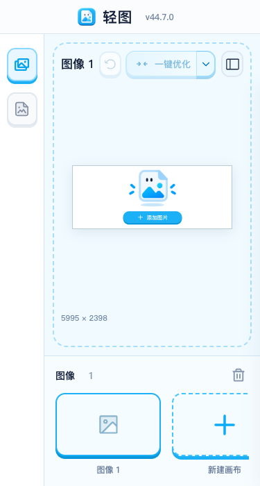
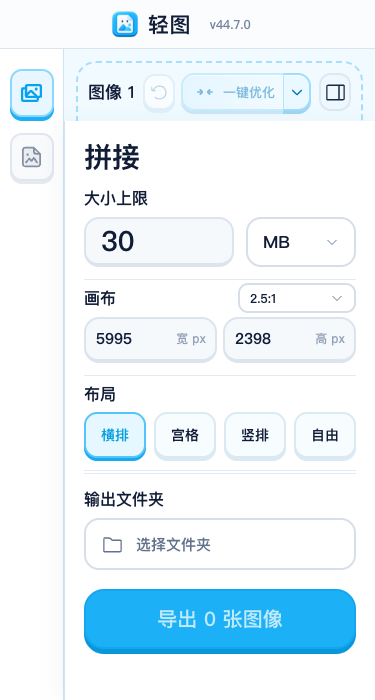
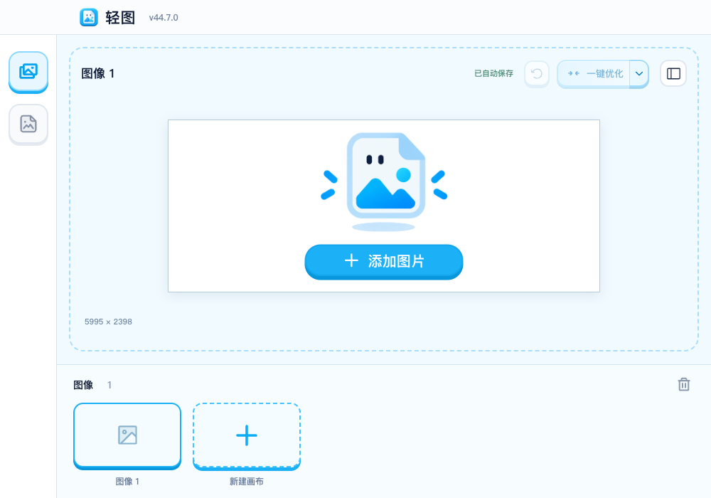
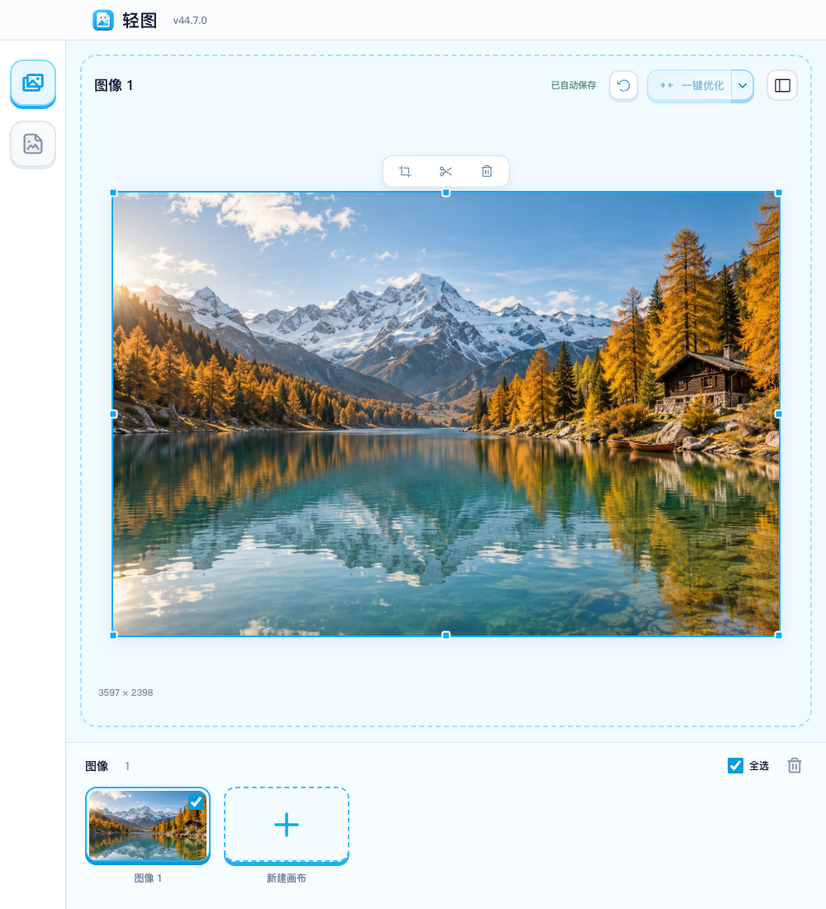

# 窄窗口边栏与离屏验证（2026-10-17）

原有窄窗口规则把导出边栏改为浮层，却保留展开状态，因此浮层遮住画布右侧，看起来像画布向右移动。现在进入 760px 以下时自动收起，初始窄窗口也默认收起；未手动操作时，放大超过 760px 自动恢复展开。用户一旦手动选择展开或收起，之后窗口缩放始终保留该选择。画布继续在可用工作区居中；按最新反馈，自动或手动收起/展开边栏时都重新适配可用宽度，让画布、图像和添加图片组合一起使用释放的空间。边栏状态不变时，普通缩小仍保留缩放上限。

图像拼接只保留一个边栏按钮，始终位于“一键优化”右侧。两种状态使用同一位置和点击范围，图标在按钮内居中。窄窗口重新展开的边栏从工具栏下方开始，按钮仍可直接点击。侧栏标题不再显示收起按钮。

尺寸观察器的回调可能晚于边栏状态切换，因此缩放历史现在使用渲染时的当前窗口尺寸，避免延迟回调重新施加旧比例上限。离屏复现中，760px 窗口下收起边栏后画布由受限的 246px 正确适配为 616px；包含图片的画布也验证了同比例适配，保存的画布尺寸、位置和导出设置不变。

自动化验证改用 Electron 原生离屏渲染（offscreen:true），保持窗口隐藏、透明且坐标在所有显示器之外。测试不显示或激活原生窗口，键盘焦点使用 CDP 模拟；应用正常运行配置不变。该方式取代此前“移到屏幕边缘”的做法。

验证：272 项单元测试、生产构建、desktop/UI 回归、连续缩放和 5 种关闭保存路径均通过。针对性检查覆盖 900、800、761、760、600、375px，核对自动收起与放大恢复、手动展开/收起跨越断点时保留、画布中心、图标中心、按钮位置及真实鼠标展开/收起。证据见同目录 sidebar-responsive-validation。

