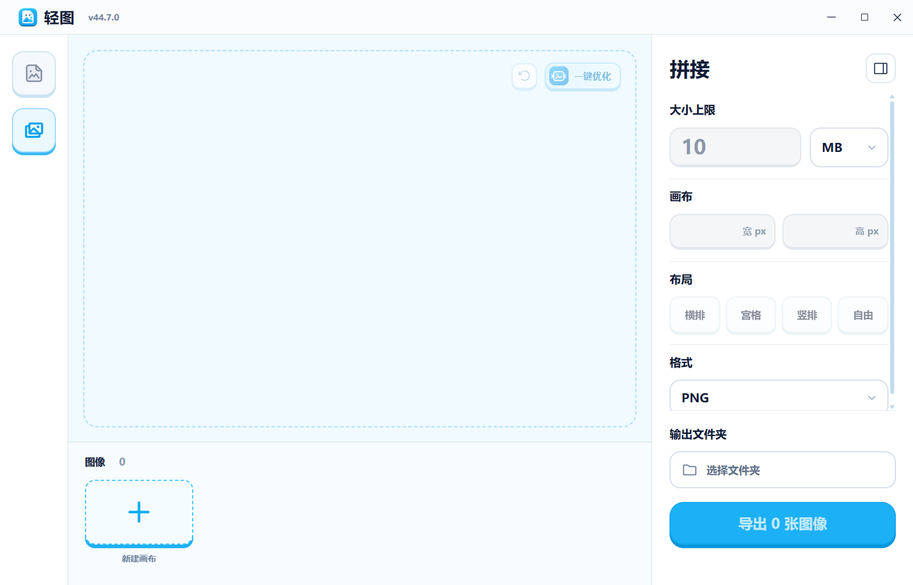
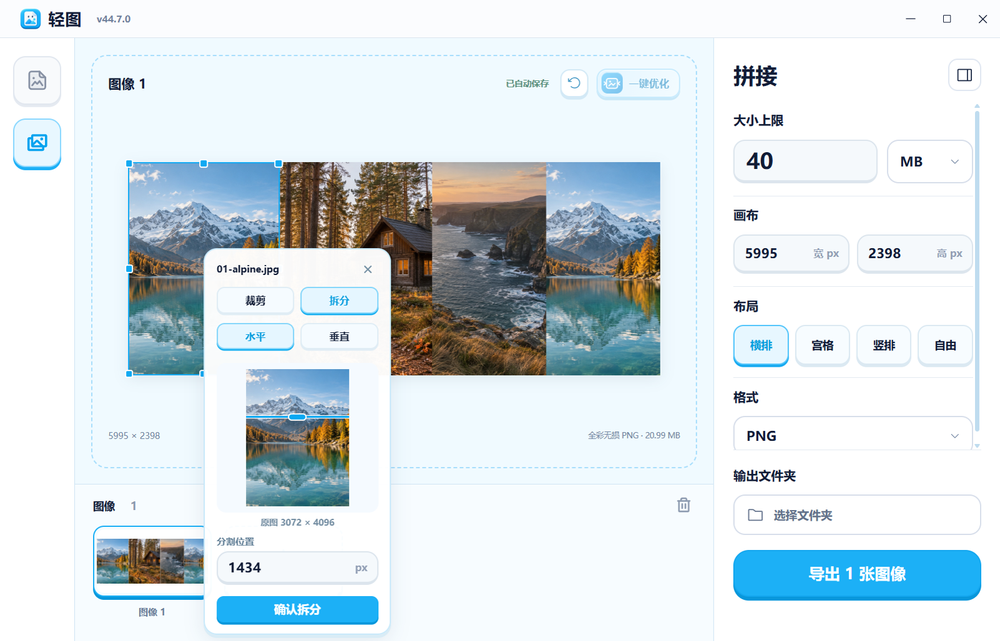
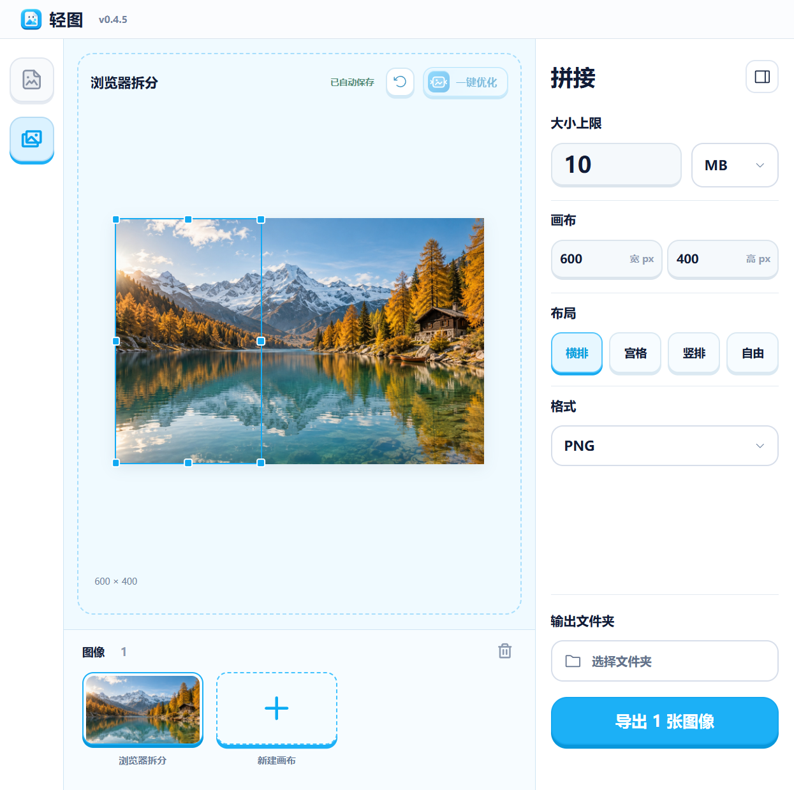

# 优化提速、无默认画布、原图拆分

2026-10-14，Windows / Node 24.14.0，延续 `codex/stitch-and-quality`。用户确认：布局保存和清晰预览就绪后结束优化弹窗，体积后台计算；首次没有画布；拆分从完整原图进行、忽略已有裁剪，保持中心和原图缩放比例；水平分上下，垂直分左右。

## 优化与性能

一键优化现在只等待真实裁剪计算、原子自动保存、选中项目预览图解码与新布局绘制，不等待完整 PNG 编码。进度 100% 表示布局已保存且可编辑，提示“体积后台计算”；后台得到结果后再显示真实 MB、实际尺寸。导出仍等待真实编码，并以最终文件字节检查上限。正常关闭会等待已经开始的后台 API、拆分保存、导入和真实导出；未开始的预览定时器在关闭刷新时取消。

大幅面拼接先尝试 level 3 自适应过滤的全彩无损 PNG；满足上限即使用，像素及 alpha 不变。平坦/简单内容继续使用较小的强压缩无损结果，超限时沿用已验证的高保真与等比降分辨率搜索。这里降低的是无损压缩的计算量，不是颜色质量。文件可能比最高压缩等级略大，但没有添加填充；低体积上限的后台搜索仍可能较慢。普通压缩模块原有“满足上限且不改尺寸/格式就保留原文件”规则不变。

处理签名包含原图 SHA 标识、源区域、位置、裁剪、画布与导出设置，排除仅展示用名称、时间和缩略图。相同预览可生成独立导出 token，共用经过校验的同一编码结果；更改图片或设置会重新计算。缓存仍受已有预览字节限制，最多保留四个项目的结果元数据，不常驻其他项目原图，不会用新预览丢弃真实导出。

同机实测使用仓库照片派生的四张可复现 4K 尺寸样片（两张 3072×4096，两张 2160×3840），5995×2398、40 MB 上限，不代表任意图片或任意上限的速度：

| 项目 | 实际耗时 | 文件字节 |
| --- | ---: | ---: |
| 最高等级 PNG 编码单次（此前布局弹窗需等待） | 7,729.87 ms | 19,454,004 |
| 快速全彩无损 PNG 编码单次 | 724.81 ms | 20,987,693 |
| 当前完整合成、编码及真实导出预览 | 1,359.56 ms | 20,987,693 |
| 同一结果生成独立导出 token | 0.31 ms | 同一字节 |
| Electron 一键优化前台布局、保存、绘制 | 62.72 ms | 体积后台计算 |

两种编码均实际解码，与同一原始合成 RGBA 逐字节相同，像素/alpha 最大误差和 RMSE 均为 0。预设 level 1 另测约 559.55 ms、31,855,599 B，体积明显更大，因此选用 level 3。完整数据、哈希及浏览器验证见 [report.json](split-speed-validation/report.json)。前台检查给后台引擎额外加了 1,500 ms 延迟，用于证明确实没有等待编码；表中的真实编码/完整渲染性能来自无此延迟的独立 benchmark。

## 无默认画布

全新存储不创建项目或画布，底部只有“新建画布”。用户主动新建后采用 5995×2398 默认尺寸。删除最后一个或确认删除全部后仍保持零项目，重启/刷新也不会自动创建。存在已保存项目时继续正常恢复，不为展示空状态删除用户数据。无画布时导入快捷键或拖入提示先新建。

## 拆分

浮动编辑窗新增裁剪/拆分切换。拆分预览显示完整原图，分割线默认居中；水平横线分为上下两张，垂直竖线分为左右两张。拖动线或输入原图像素可调整，两侧至少各保留 1 像素。拖动只更新小图和分割线，不编码、不保存；确认后才替换为两张独立图片，关闭未确认内容不改变项目，切换功能不应用未修改的 50 px 裁剪预填。

拆分忽略当前裁剪，先按原图 x/y 缩放比例和中心恢复完整内容，再分为两部分；原有 Shift 独立缩放保留，因此恢复后可能占用更大范围或越界，仍只导出固定画布内内容。每个子图用整数、EXIF 已定向的原图区域表示，共用一份不可变原图副本/IndexedDB Blob，不复制、压缩或修改源文件。再次拆分针对当前子图的完整内容；支持后续移动、缩放、裁剪、保存恢复。两张新 ID 在真正导入顺序中替换父图 ID，画布/导出设置及其他图片保持不变；重置恢复裁剪和顺序，不合并子图。

500 MB 项目上限按唯一原图资源计算，拆分不重复计入同一副本；100 张图片上限仍包含子图。源窗口、原图完整尺寸和文件字节由共享引擎校验；桌面、浏览器使用相同布局和合成代码，已有 API/IPC 白名单与私有文件访问规则不放宽。

## 验证

190 项单元/引擎检查通过，新增前台不调用编码、独立导出 token 的字节复用、快速 PNG 全 RGBA 相同、两方向原图窗口、已有裁剪恢复、递归拆分、非法分割拒绝、单副本保存恢复及 EXIF 定向像素检查。

已运行并通过：`npm test`、`npm run build`、`smoke:desktop`、`smoke:ui`、`smoke:recovery`、`smoke:optimization`、`smoke:png-budget`、`smoke:canvas`、`smoke:split`、`verify:quality`、`verify:png-budget`。

`smoke:split` 用真实 Electron 鼠标拖动分割线，确认前项目仍有四张，确认后五张，再垂直拆分后六张；四份原图资源始终只有四个文件，原始字节不变，刷新后源窗口、位置及真正导入顺序一致。浏览器独立 Chrome 会话用实际 IndexedDB Blob 验证：37 px 手动裁剪被拆分明确忽略，1536×1024 原图竖向在 614 px 拆成 614×1024 / 922×1024，仍只有一份 Blob；刷新及真实导出通过。删除后刷新保持零画布。

UI 检查保留原压缩功能、界面位置一致、右键、确认取消、多项目批量及单独导出、卡片拖动隔离、像素尺寸与实际字节上限。新优化错误分支注入一次“测试：保存失败”，验证失败不报告完成、关闭为中性颜色、重试后保存恢复；该预期 stderr 不代表测试失败。关闭检查覆盖未松手手势、滑块、后台预览，以及导入/导出忙时重复快捷键。所有实机运行在 Windows；Mac 实机、安装包安装和签名更新未验证。

实际输出保留本机 `artifacts/split-speed/`，大图不提交 Git：

| 文件 | 尺寸 | 字节 | 上限 |
| --- | --- | ---: | ---: |
| `图像 1-qingtu-2.png`，4K 原图递归拆分后 | 5995×2398 | 20,983,625 | 40,000,000 |
| `browser-split.png` | 600×400 | 503,907 | 10,000,000 |

常规 PNG 五类样片回归：照片/纹理 RGB max=2、alpha max=0、RMSE=1.12895/1.35465，渐变/文字/透明样片采用零误差无损结果；1 KB 桌面压缩 25×10 / 719 B、拼接 25×10 / 736 B，均在实际字节上限内。没有重新声称本轮验证了用户那张 28 MB 原图。

原生 smoke 直接运行 Electron 脚本，顶栏 v44.7.0 为测试运行时版本；应用包版本仍为 0.4.5。只提交功能分支，不合并 main，不发布安装包，不改变嵌入签名公钥。
