# 拼接与 PNG 高保真：开发验证记录

开发分支 `codex/stitch-and-quality`，基线 `70144d5` / 0.4.5；Node 24.14.0，Windows。本次完成源码开发与下述验证，没有合并 main 或发布安装包。

## 最新固定画布规则（覆盖下文历史布局规则）

2026-10-14 用户将画布改为固定大小，默认严格 5995×2398；所有模式可移动与缩放，Shift 可改变比例，越界内容只导出画布内部分。横排/竖排/宫格为一键排列，新增图片右侧追加。一键优化跟随当前画布宽高比，保持画布大小。实现、截图和验证见 [fixed-canvas.md](fixed-canvas.md)。下文的外接矩形自由画布、禁止越界裁切、拖动自动布局换序、5999 默认长边以及仅 9:16 自动裁切属于此前产品要求，已被这次确认覆盖。

## 最新编辑窗与优化工具

159 项测试及实际截图见 [stitch-editor-feedback.md](stitch-editor-feedback.md)：无需优化按钮禁用、标题拖动、点击外部关闭、X 居中、新图标与真实进度条，以及处理中/失败关闭按钮的中性颜色。

## 最新 PNG 体积规则

2026-10-14 用户确认：优先保留细节，必要时等比降低分辨率，并明确显示实际尺寸。此前的固定分辨率超限提示已被替换；更新后的 156 项测试、实际附件 10 MB 导出、完整指标和平台检查见 [png-budget.md](png-budget.md)。下文的固定尺寸拒绝描述属于此前验证记录。

## 2026-10-14 卡片拖动修复、右键、确认与优化进度

两个工具按钮使用独立背景，仅保留重置和最右侧的一键优化；优化采用自绘裁剪拼图图标，压缩导航重绘为折角图片。原有蓝色、立体反馈、工具提示与公共区域位置保持。

卡片的原生图片拖动可能提供一份低分辨率缩略图 File。旧全局 drop 导入没有识别内部来源，会把这份 PNG 当作新原图导入目标项目。现在缩略图和卡片禁止原生拖动，根节点也阻止内部预览拖动，并在文件导入时拒绝带内部标记的 File。真实外部文件导入保留。异步导入记录所属项目，避免加载/切换期间把结果写入别的项目；忙碌时的重复导入/导出不会覆盖原任务的关闭等待记录。

Windows UI 用真实鼠标将图像 1 卡片拖到图像 2，再模拟浏览器将缩略图转换为 PNG File 的拖入。两份保存清单的图片 ID、资源 SHA 标识、顺序及原图尺寸完全不变，模拟文件没有触发导入。浏览器现有项目仍为四张 4K 原图及一张 1536×1024 海岸原图，没有修剪或覆盖这些用户数据。

图片右键提供编辑/删除，卡片右键提供单独导出/删除。卡片不显示复选框或单独垃圾桶；列表右上角垃圾桶删除全部。重置、单个画布删除、全部删除均须在应用弹窗确认，取消不改变保存内容。确认清空后生成一张新空画布，重新加载仍为空；外部源文件保留。主按钮“导出 X 张图像”默认导出全部非空项目，空画布跳过且不计入 X，选中空画布也能导出其他项目。

优化弹窗报告真实的准备、裁剪、保存、预览阶段。未知处理时长使用活动进度条，不伪造时间百分比；只有引擎返回尺寸/字节/画质验证后的结果才显示完成。出错保留已完成阶段并明确提示。成功结果缓存按实际当前项目引用复用，关闭弹窗及重复优化不再次编码。正常退出等待优化或真实批量导出完成。

浏览器真实点击“导出 2 张图像”保存两份文件：`拼图 1-qingtu-8.png` 为 5995×2398、19,451,130 字节（上限 40 MB），`拼图 2-qingtu-3.png` 为 1600×1067、3,083,785 字节（上限 10 MB）。完整字节数、SHA-256、桌面结果见 [本轮验证 JSON](stitch-validation/toolbar-validation.json)。

本轮 147/147 测试通过，包含内部 File 拖动拒绝、外部文件接受、自动保存到真实编码的阶段顺序、保存失败不开始编码、重复结果复用、非空导出计数。Windows UI 实测右键编辑/删除、单项目导出/删除、空画布计数、默认全部导出、确认取消、全部删除后的重开；原有手势、画布限制、像素与压缩检查保留。`smoke:optimization` 三个独立 Electron 进程另外验证优化中关闭、导出中重复快捷键再关闭、导入中重复快捷键再关闭：真实文件仍完整保存，原图、顺序与裁剪可恢复。生成进度截图的 UI 检查对真实编码响应加入 900 ms 测试延迟，以便捕捉进行中状态，不代表性能测量。

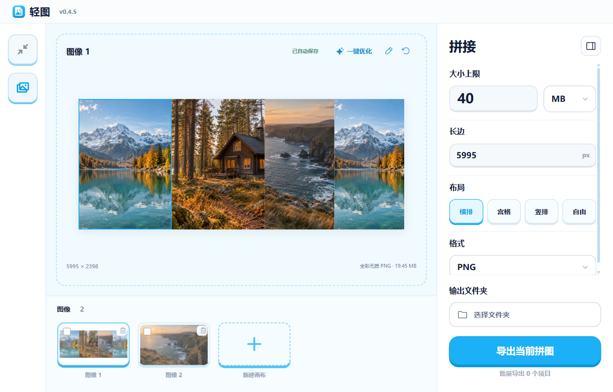

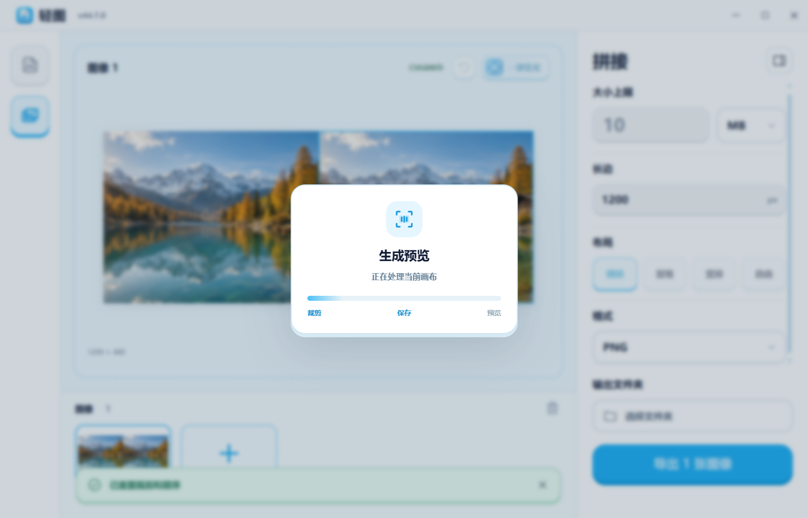

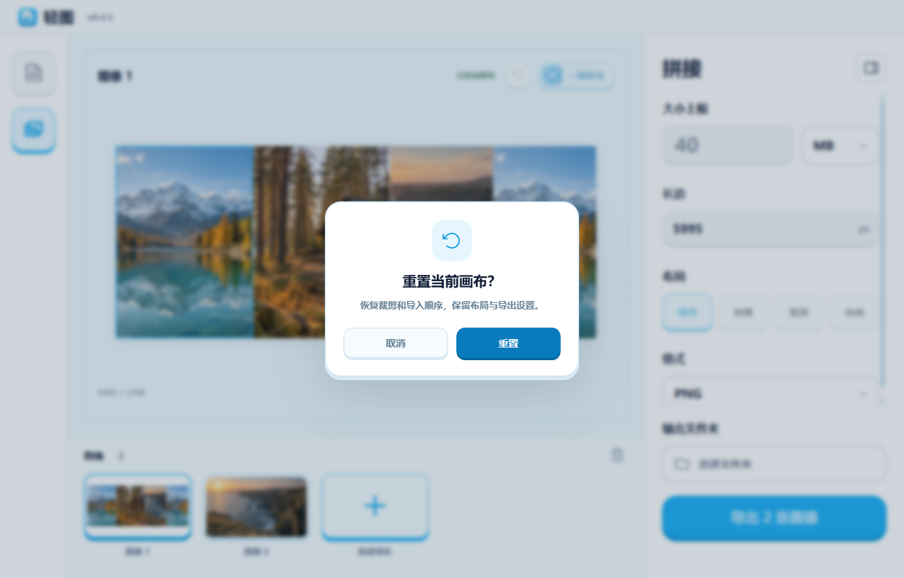

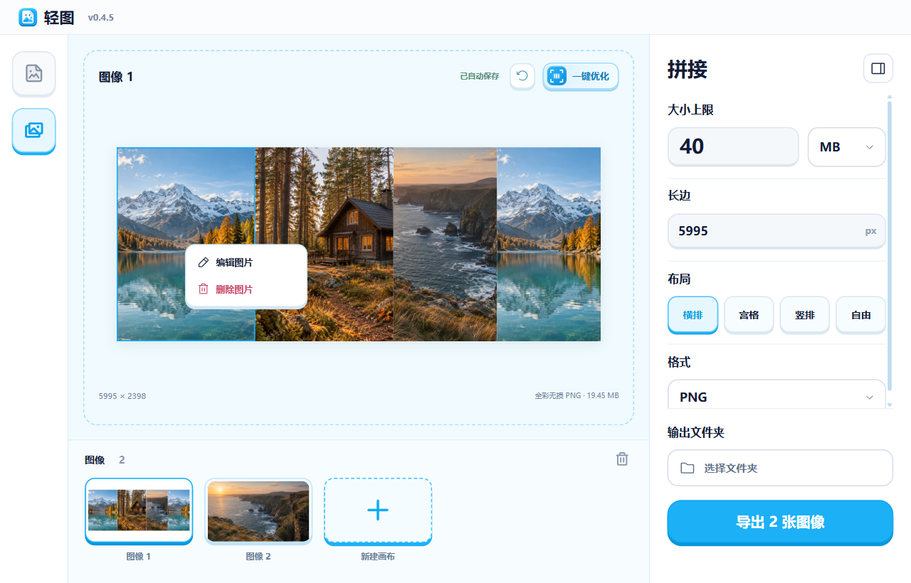

## 2026-10-14 工具栏、鼠标位置编辑与真正导入顺序

画布右上角只保留各自有背景的重置和一键优化，优化在右侧，使用自绘裁剪拼图图标和浅蓝组合按钮；单图编辑改从双击或右键进入。布局第二项为宫格；两个格式菜单只有 JPG、PNG，默认 PNG，旧 Auto 项目在预览/导出前转为 PNG。右下角显示十进制 MB，悬停可看精确字节数；压缩导航采用与应用图标呼应的自绘折角图片。

双击编辑浮层以真实鼠标坐标打开，仅在将越出窗口时避让。未编辑图片每侧预填 50 原图像素，不会修改画面、启动编码或保存；修改数值/滑块或点完成后才应用。X、Escape、模块切换、应用正常退出均不应用未修改的预填。已有手动、自动、百分比裁剪保持原状态，切换模块隐藏浮层。

右上角重置一次清除显式裁剪并恢复真正导入顺序，保留布局与导出设置；自由画布恢复完整图片时保留原图缩放和中心。新项目用稳定图片 ID 记录导入顺序，换序不修改基准，删除仅移除对应 ID。旧多图项目没有记录时明确提示缺少顺序，不按文件名或当前顺序推断。用户提供的旧“图像 1”顺序 01 → 02 → 03 → 04 已写入浏览器项目，真实点击重置验证相同顺序及裁剪清空，重开后仍保留。单图旧项目的顺序没有歧义。

最新真实导出 `artifacts/browser-exports/拼图 1-qingtu-7.png` 为全彩无损 PNG，5995×2398，19,451,130 字节，上限 40,000,000；原图副本不变，按用户给出的真实导入顺序排列。可审查记录见 [本轮验证 JSON](stitch-validation/toolbar-validation.json)。

前一轮从 137 项基线增至 142 项测试全部通过，新增导入/换序/删除/重置、未知旧顺序禁止推断、自由重置中心和缩放、鼠标位置及边界避让、顺序原子保存/异常恢复验证。Windows desktop/UI/六进程 recovery 检查通过；UI 用真实鼠标双击验证位置，用实际项目文件确认关闭不应用预填、完成应用 50 px、重置顺序和设置保留，以及两页坐标一致。没有变更编码器质量下限；此前实测画质与提速记录继续适用。

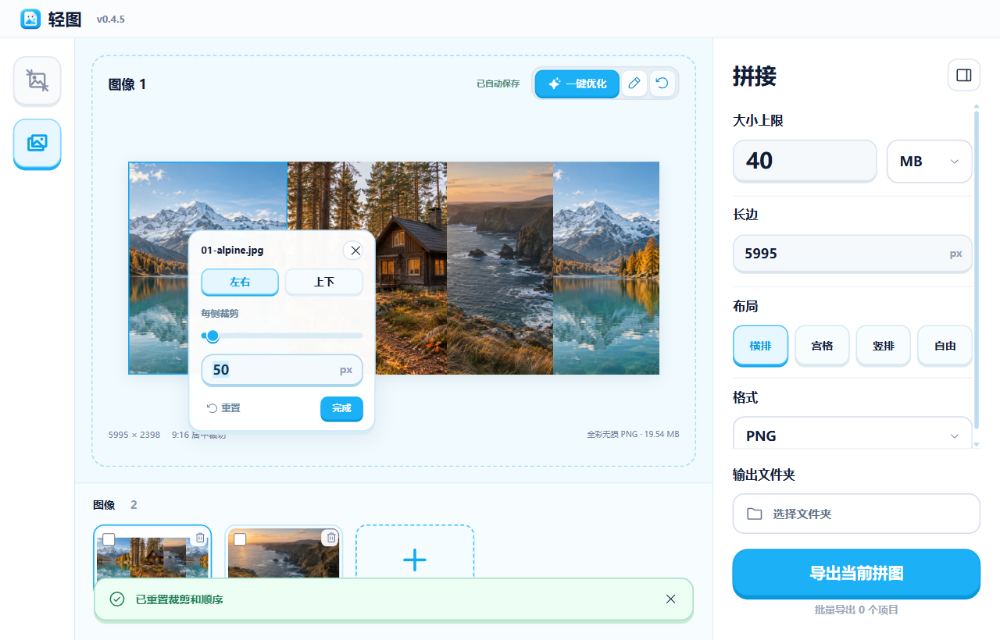

## 2026-10-14 一键裁剪、处理提速与位置统一

横排画布新增蓝色“一键优化”。从完整原图重新计算、每张左右裁掉相同比例，替换所有旧裁剪；原图和顺序不变。四张 3:4、3:4、9:16、9:16 原图各侧裁 1/42（约 2.38%），保存精确百分比，实际输出矩形严格 5995×2398（5:2）。按原图等高缩放后居中提取，整数取整导致左右最多差一个输出像素，每张宽度偏离理论值不到一像素；无透明填充、外边距或图片间隙。该按钮仅横排启用，原图合计比例不足 2.5 时提示无需优化。

点击时将指定长边向下取最近的 5 的倍数（默认 5999→5995）。之后修改严格 2.5:1 项目的分辨率，若不是 5 的倍数则明确提示并阻止导出。按钮一次更新完整项目、自动保存，只生成一次高分辨率预览；再次点击不累积裁剪、不保存或重编码。百分比编辑进入单图编辑器仅显示近似原图像素，未修改就关闭不会量化保存的百分比；修改或重置恢复普通单轴编辑。

压缩与拼接现在共用相同的预览框边界、工具栏高度、画布区域、底部列表、设置标题、大小/格式输入、文件夹和主导出按钮位置。桌面 UI 用真实边界坐标逐项比较。拼接画布中的添加/删除按钮与右上角布局/处理后切换已移除；保留空画布导入、拖入、Ctrl/Cmd+O、Delete、双击编辑和换序。底部标签与默认项目显示为“图像”。预览图片、画布内部透明空隙及卡片用白底展示；实际 PNG 透明度不合成白色。

已完成的拼接预览保留在模块中，切换回相同编辑状态不再合成/编码；浏览器真实请求检查和桌面计数均为 0 次新增处理。仅缓存当前结果的小预览和元数据，不缓存全部项目的大图。

当前实际工作台及导出（仓库测试样片，不冒充附件原图）：

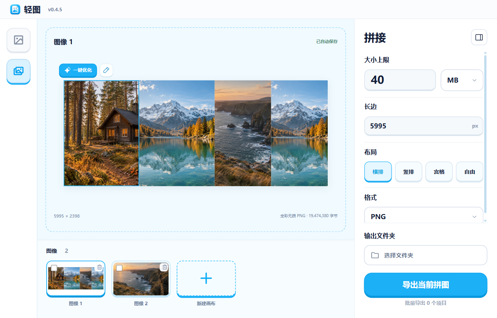

`artifacts/browser-exports/拼图 1-qingtu-6.png`：PNG / 全彩无损，5995×2398，**19,474,380 字节**，上限 40,000,000。实际四角、分界、alpha、原图副本不变及保存恢复另由 4K 像素测试验证；浏览器真实 IDB 保存并重开验证相同百分比和尺寸。

未改尺寸与格式、且原文件已符合体积上限时，直接保留原始字节，不运行任何 PNG/JPG 编码。明确指定尺寸或格式修改仍执行。新 PNG 搜索只计算一次边缘/空间排序，复用最佳无损过滤选择、丢弃较差策略的缓存，并减少编码次数；保留原 RGB 最大误差≤2、alpha 精确、RMSE≤1.5 的质量下限。编码缓存仍有 64 MiB / 256 条限制。压缩与拼接中的过时任务在图片/编码步骤之间停止，真实导出不会被取消。

实际附件在浏览器设置 PNG、原分辨率、40 MB 后，显示“处理后 · 未改动”；真实导出为 5504×3072、27,254,812 字节，与原文件逐字节相同。引擎复用原文件仅约 1.3 ms（不含导入和低分辨率预览生成）。附件及其导出仅保留在本机，未提交到 Git。

对照开发前的 `698127c`，同机首次处理实测如下；这些是指定样片的结果，不是所有图片的速度保证：

| 样片与上限 | 修改前 | 修改后 | 画质/字节结果 |
| --- | ---: | ---: | --- |
| PNG 照片 1536×1024 / 2,504,360 B | 8,748 ms | 4,316 ms | 相同 2,486,137 B；RGB max=2、RMSE=1.1290 |
| PNG 纹理 1600×900 / 2,599,687 B | 7,137 ms | 3,414 ms | 相同 2,593,616 B；RGB max=2、RMSE=1.3547 |
| JPG 照片 / 400,000 B | 1,470 ms | 885 ms | 相同 378,842 B；max=45、RMSE=3.3314 |
| JPG 放大照片 5000×2140 / 10 MB | 1,752 ms | 352 ms | 3,766,361→7,297,503 B；max 14→4、RMSE 0.7623→0.6293 |
| JPG 单像素彩色边缘 / 10 MB | 30 ms | 10 ms | max 154→3、RMSE 106.6877→0.4368；预算内保留颜色细节 |

JPEG 预算充足时使用 4:4:4；预算不足先用快速编码定位范围，比较 4:4:4 / 4:2:0 实际解码差异，再用 mozjpeg 局部细化，并保留误差较小候选。没有仅为提速选择误差更大的低预算照片结果。4:4:4 和 mozjpeg 的能力依据 [Sharp 官方 JPEG 说明](https://sharp.pixelplumbing.com/api-output/#jpeg)，选择同时由以上实际编码/像素数据验证。JPG 仍是有损格式，极低预算可能损失细节；高保真约束严格适用于显式 PNG。

以下 100% 裁片左为修改前、右为修改后，各源像素对应一个输出像素。放大照片山体/树木边缘未见新模糊；细彩色线条恢复清楚的红蓝颜色，旧方案混成紫色。

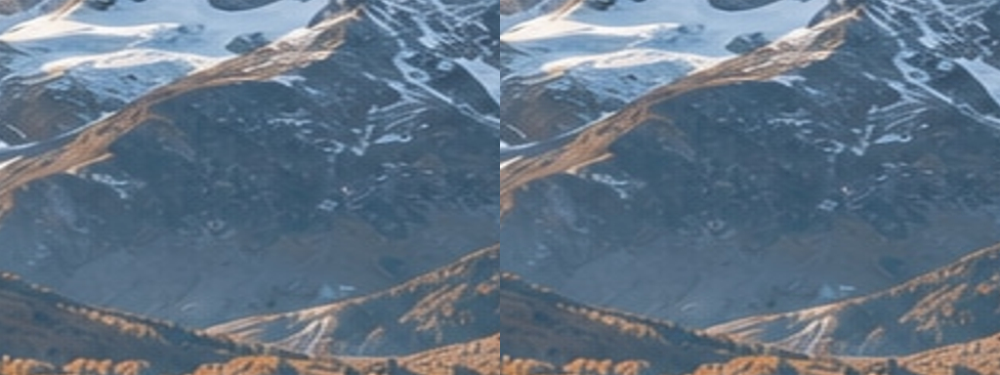

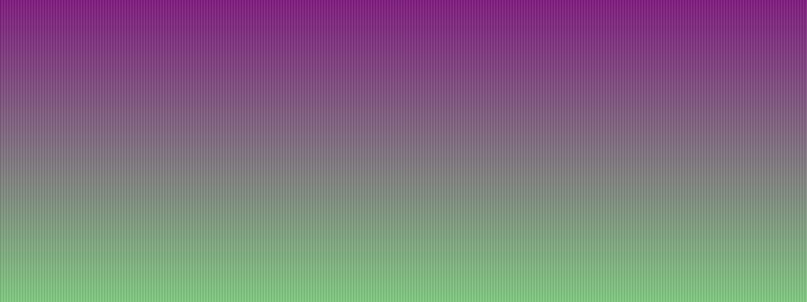

附件 5504×3072 / 27,254,812 B 的第一次 10 MB 尝试仍耗时约 25,037 ms，仍无法满足高保真上限，因此明确提示增加上限；没有用更低画质掩盖失败。相同图片随后改到仍不可行的 11 MB 上限，复用缓存只需 28 ms。第一次复杂大图编码仍是现存限制。

可复现命令：先 `npm run verify:quality` 创建样片，再运行 `node scripts/benchmark-quality.mjs baseline [可选原图路径]`、`node scripts/benchmark-quality.mjs optimized [可选原图路径]` 和 `node scripts/benchmark-jpeg.mjs`。脚本从 Git 提取 `698127c` 的只读基线到忽略目录；原附件不进入 Git。客观对照保存在 [performance-report.json](stitch-validation/performance-report.json)。

## 2026-10-14 界面调整与单图编辑

顶部项目标签及底部单张图片队列已替换为底部画布卡片。卡片显示整个画布，支持切换、新建、删除和批量选择；右侧保留布局及导出设置。图片选择、编辑和自由移动在画布完成，导入/移除按上节的最新方式操作。小缩略图随项目原子保存，使用当前画布的低分辨率预览生成，其他项目原图保持按需加载。以下两张截图记录较早的界面阶段，当前工作台见上节。

选中框改为独立前景覆盖层，其位置、宽高与图片边界一致，拖动和等比缩放时一起更新；保持真实图片叠放顺序。Windows Electron 截图检查确认相邻图片不会遮住右侧蓝色边线；125% 系统缩放也通过检查。

用户确认“不能同时调整，换序”后，已接入双击单图的画布编辑浮层。左右或上下二选一，共用一组滑块和原图像素数值；切换方向时新裁剪量从 0 开始，支持重置。手动裁剪适用于所有布局，源副本不变，修改后的图片不会叠加自动裁切。自由画布裁剪/重置保持原图缩放比例和图片中心；进入自由时恢复自动裁切，保留用户手动裁剪。

横排、竖排和宫格中拖动图片只调整顺序，布局类型保留；自由画布拖动移动位置。实际 Electron 鼠标检查覆盖三种自动布局换序、双击编辑、滑块拖动与数值修改、裁剪方向互斥和重置。按住滑块超过 1 秒没有高分辨率编码或提前保存，松开后只提交最后状态；另验证了由数值框转到滑块时的焦点变化，不会意外启动延迟编码。

浏览器实际滑块检查记录：按住期间高分辨率编码请求 0 次，松开后 1 次。随后直接拖动前两张图片换序，保持横排并真实导出；页面重新加载后，顺序及左右每侧 485 原图像素的裁剪状态均一致恢复。实际文件 `artifacts/browser-exports/拼图 1-qingtu-5.png` 为 5999×2512、20,297,086 字节，全彩无损 PNG，上限 40,000,000 字节。自然比例小于 2.5，没有为满足比例增加透明填充。

新增实际 UI 检查同时覆盖两张画布卡片的创建、缩略图保存、切换、批量导出、选中框几何位置及右侧边线；原有压缩和关闭恢复检查继续执行。

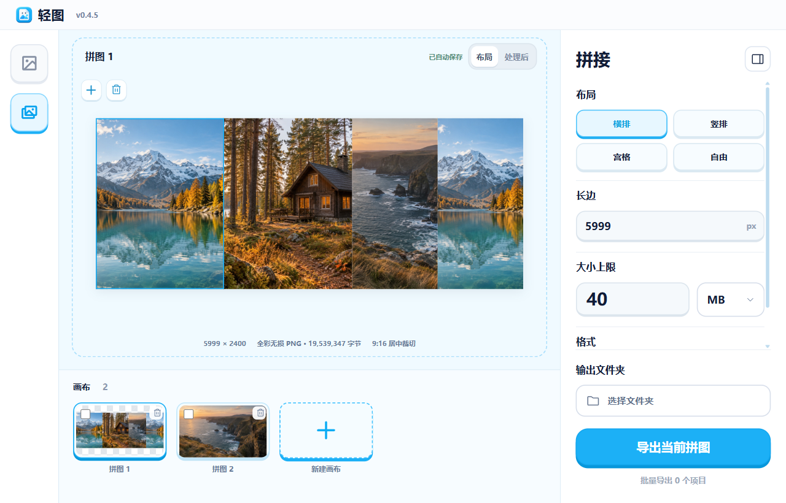

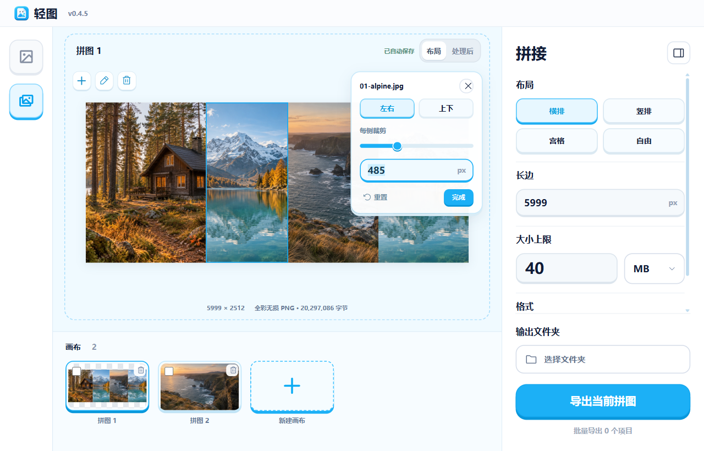

## 已实现行为

已接入真实横排、竖排、紧密宫格、自由画布工作台、画布内顺序拖动及键盘操作、双击单图裁剪、多项目、独立设置、单项目/批量导出、桌面原图副本、原子保存与备份恢复、浏览器 IndexedDB Blob、正常关闭与重启前保存协调。布局、合成、编码、持久化、交互分别位于独立模块；压缩状态与拼接状态互相保留。

用户确认并已验证的布局规则：

1. 宫格采用紧密行布局：指定行数、每行最多列数，每行等高且所有行同宽，没有空格或空洞。末行不足最大列数时也铺满整行；无法满足行列或尺寸限制时提示调整。
2. 自由画布随全部完整图片的外接矩形变化，内部间隙透明。新图按现有图片的基准高度等比缩放，在右侧追加，保留旧图位置。
3. 从已裁切横排进入自由画布时恢复自动裁切、保持高度和中心；用户显式手动裁剪保留。恢复后比例超限时显示全部图片、提示手动调整并禁用导出，不加透明边距、不裁掉越界内容。

自由拖动和等比缩放通过 requestAnimationFrame 更新低分辨率图层，蓝色轻量参考线显示吸附。24 次连续移动的 UI 检查确认手势期间没有高分辨率合成或编码；提交后才保存并计算真实预览。界面选中状态不改变图片叠放顺序。

## 布局和真实导出

四张 4K 验收图来自仓库已有样片的可复现测试副本。生成命令 `npm run fixtures:stitch`；前两张 3072×4096，后两张 2160×3840。输入副本的生成裁切仅用于创建固定比例测试图，应用导入后仅按允许的横排 9:16 裁切。

| 项目 | 格式 | 实际尺寸 | 实际字节数 | 设置上限 |
| --- | --- | --- | ---: | ---: |
| 四张 4K 横排 | PNG / 全彩无损 | 5999×2400 | 19,539,347 | 40,000,000 |
| 独立海岸项目 | PNG / 全彩无损 | 1600×1067 | 3,083,785 | 10,000,000 |
| 移动后的自由画布 | PNG / 全彩无损 | 3620×5999 | 22,781,132 | 40,000,000 |
| 单图裁剪、换序后横排 | PNG / 全彩无损 | 5999×2512 | 20,297,086 | 40,000,000 |
| 一键优化、所有图片左右裁剪 | PNG / 全彩无损 | 5995×2398 | 19,474,380 | 40,000,000 |
| 桌面裁剪中关闭重开样片 | PNG | 2400×2000 | 22,085 | 10,000,000 |

四张横排分配为 1800 / 1800 / 1199 / 1200 像素，坐标 0 / 1800 / 3600 / 4799。测试读取真实输出四角与分界像素，验证矩形、零间距、零外边距、PNG alpha 和没有棋盘格入图。源文件的原尺寸不变。

浏览器实际文件在 `artifacts/browser-exports/`，按独占文件名写入，批量导出不会覆盖上次输出。拼接工作台使用可交互的低分辨率图层并显示真实编码字节数，压缩模块“处理后”使用真实编码结果解码的预览。测试截图在 `output/playwright/`；最新 Electron 工作台截图在 `artifacts/native-one-click-optimize.png`。

以下是运行中的工作台截图，使用仓库样片；图片、操作和状态来自实际应用：

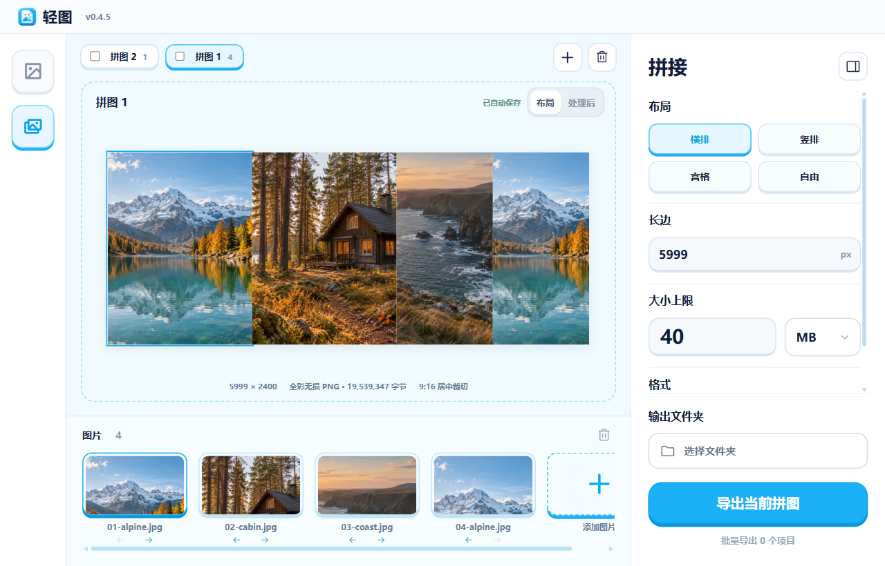

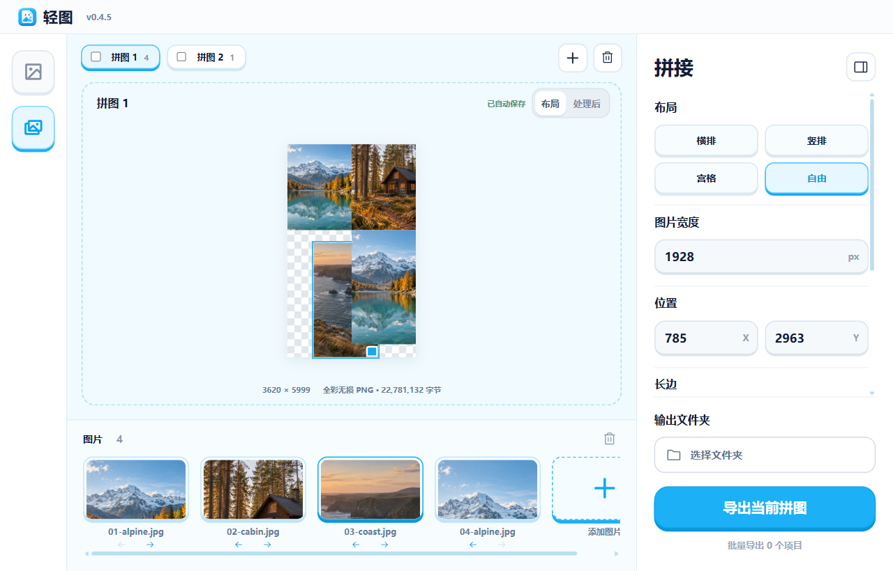

## 原图和保存

桌面 ProjectStore 按 SHA-256 保管独立原图副本，项目 JSON 不记录外部源路径或临时 URL。文件句柄 sync 后原子 rename，上一完整 manifest 留作备份。中断的 `.tmp` 不参与项目恢复；最新 JSON 损坏时恢复上次完整版本并提示。

Windows `npm run smoke:recovery` 实际启动六个独立 Electron 进程：首先验证界面尚未就绪时立即关闭也能完成保存协调；随后验证延迟自动保存期间正常关闭，再移动输入原图；下一进程在图片移动的鼠标尚未松开时退出；再一进程打开未编辑图片，显示每侧 50 px 预填并直接退出，确认未应用；随后在裁剪滑块尚未松开时退出；最后再次打开，验证导入顺序、位置、左右每侧 20 原图像素的手动裁剪、原图副本、PNG 格式、2400 长边与实际导出。关闭等待任务结束，编码失败与保存失败分别处理，保存失败仍阻止丢失状态的关闭。

浏览器用 IndexedDB 事务保存项目与原图 Blob。用真实 IDB `put` 故障注入模拟 QuotaExceededError，界面显示“未保存 / 本地空间不足”，重试后恢复。使用全新、空的隔离引擎缓存重启 Vite，浏览器从 IDB 恢复五个原图副本和两个项目，重新生成 5999×2400 结果。该测试没有删除用户原始文件或旧缓存。

项目列表只有元数据；切换时仅解码选中项目的低分辨率预览。批量处理按项目读取原图，完成一次保存后释放真实导出缓冲区。PNG 编码缓存上限 64 MiB / 256 条；过时排队预览可以丢弃，真实导出始终保留。

## PNG 方案与实测

Sharp PNG 的 `quality` 参数会启用调色板，而非无损质量开关；`colours` 最大只允许 256 项。[Sharp 官方说明](https://sharp.pixelplumbing.com/api-output/#png)。当前使用锁定的 Sharp 0.35.5，无额外编码器安装或依赖更换。

先比较 9 级 deflate 的自适应/非自适应行过滤全彩无损编码，选择更小结果。不能满足上限时，完整 RGB 空间受限量化，保留 alpha、平坦区域、平滑渐变与强边缘；搜索最小必要作用强度，接近预算。编码后解码校验 RGB 最大误差 <=2/255、alpha 误差=0、RMSE<=1.5。PNG 从未启用 palette；所有输出路径都不填充、不隐式改分辨率，显式 PNG 不变 JPG。内部引擎保留旧 Auto 参数兼容，但当前两页菜单只有 JPG/PNG，旧 Auto 项目在处理前明确转换为 PNG。

这是一条保守的画质下限，而非“任意 28 MB 一定可压到 10 MB”的承诺。指标不等于感知保证，仍需要原尺寸目视检查。

命令：`npm run verify:quality -- "D:/download/_文档加工_Web扫描_标注1790758422.png"`。测试照片、纹理、渐变、文字边缘、透明图以及实际附件，保留原分辨率。100% 对比裁片每个源像素对应一个输出像素，依次为原图、全彩候选、旧 256 色结果。

| 样片 | 设置上限 | 新方案实际字节 | RGB 最大误差 | RMSE | PSNR | 结果 |
| --- | ---: | ---: | ---: | ---: | ---: | --- |
| 照片 1536×1024 | 2,504,360 | 2,486,137 | 2 | 1.1290 | 47.08 dB | 高保真，预算使用 99.27% |
| 纹理 1600×900 | 2,599,687 | 2,593,616 | 2 | 1.3547 | 45.49 dB | 高保真，预算使用 99.77% |
| 渐变 1600×900 | 7,665 | 7,665 | 0 | 0 | 无差异 | 无损 |
| 文字 1600×900 | 48,544 | 33,997 | 0 | 0 | 无差异 | 无损，未凑大小 |
| 透明 1600×900 | 245,875 | 182,983 | 0 | 0 | 无差异 | 无损，alpha 精确 |

附件是真实提供的 5504×3072 PNG，27,254,812 字节；不将其他样片的结果冒充它。

- 当前全彩候选：19,651,933 字节、RGB 最大误差 2、RMSE 1.1309、PSNR 47.06 dB、alpha 误差 0。它**没有满足 10,000,000 字节上限**，应用提示增加上限，没有导出超标文件。
- 实际浏览器界面另外导入同一附件，确认仍为 5504×3072、PNG、10 MB，提示增加上限并禁用导出。没有隐藏缩小、改格式或保存超标候选。
- 对照旧调色板：5,801,946 字节、RGB 最大误差 61、RMSE 2.5872、PSNR 39.87 dB。体积较小并不代表保留了近乎无损颜色。
- `attachment-candidate.png` 是超出目标的诊断候选；不是声称成功的 10 MB 导出。完整数据在 `artifacts/quality/report.json`。

原尺寸视觉检查：照片全彩候选保留树木、山体与水面细节，旧调色板可见色阶/色块变化；纹理全彩候选未见明显结构损失；渐变、文字、透明新结果逐像素无差异。附件局部文字与背景的全彩候选接近原图，旧方案存在色阶变化。检查覆盖的是测试图与当前附件，不推广成所有图片的保证。

可审查的 [客观数据 JSON](stitch-validation/quality-report.json) 随源码提交；照片 100% 裁片从左至右为原图、新全彩结果、旧调色板结果。附件的图像副本和完整导出文件仅留在本机验证目录。

本节画质记录最初的预算搜索照片约 8.7 秒、纹理约 6.9 秒；最新提速与对照时延见首节。拖动过程中不运行高分辨率编码，只更新 DOM；真正编码在编辑提交后执行。不同图片和缓存状态下耗时不同。

## 检查与边界

当前 `npm test`：147/147 通过，包括原压缩/更新/传输测试、四种布局、画布边界、指定裁切与恢复中心、单轴手动裁剪及真实逐像素导出、EXIF 裁剪坐标、换序后的实际像素颜色、矩形/透明输出、独立项目与批量编码、原图移动恢复、异常 JSON/保存失败、PNG 像素差异和不填充。新增严格 5:2、相同比例与原图重新计算、重复优化、整数分配、百分比保存恢复、JPEG 彩色边缘、候选像素比较、小文件绕过编码、过时处理停止与真实导出保留检查。真实导出缓冲区保留到保存尝试结束，保存成功或失败均释放；失败后重新导出仍可复用有限的预览缓存。

Windows 已通过构建、`smoke:desktop`、更新后的 `smoke:ui`、独立关闭重开 `smoke:recovery` 和 `smoke:update`。UI 烟测用真实拼接导入、四种布局、拖动/吸附/缩放、计算与保存，保留原有压缩与工具栏检查；没有仅删除“开发中”断言。

附加验证使用 `node scripts/smoke-chunks-fixture.cjs` 创建 65,537 字节的不可执行传输样片，再以该目录运行 `smoke:chunks`。真实 NsisUpdater 完成五个分片下载、全文件 SHA-512 和字节数校验；缓存隔离在临时目录。未触发安装。此验证不等于 Windows 安装或真实新版发布验证。

Mac 没有本次实机验证。没有执行安装包安装、更新包签名或正式发布；未更换嵌入公钥。Mac 权限测试仅在 Windows 跳过无法表达的 POSIX mode 断言，签名/验签逻辑仍执行。
