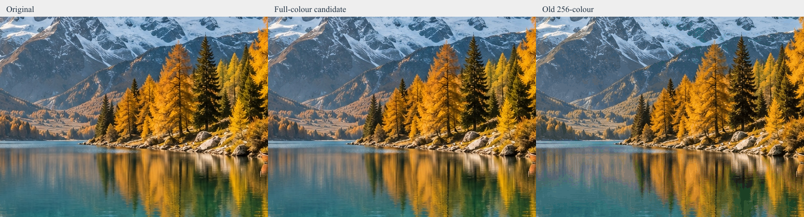

# 拼接与 PNG 高保真：开发验证记录

开发分支 `codex/stitch-and-quality`，基线 `70144d5` / 0.4.5；Node 24.14.0，Windows。本次完成源码开发与下述验证，没有合并 main 或发布安装包。

## 已实现行为

已接入真实横排、竖排、紧密宫格、自由画布工作台、顺序拖动及键盘按钮、多项目、独立设置、单项目/批量导出、桌面原图副本、原子保存与备份恢复、浏览器 IndexedDB Blob、正常关闭与重启前保存协调。布局、合成、编码、持久化、交互分别位于独立模块；压缩状态与拼接状态互相保留。

用户确认并已验证的布局规则：

1. 宫格采用紧密行布局：指定行数、每行最多列数，每行等高且所有行同宽，没有空格或空洞。末行不足最大列数时也铺满整行；无法满足行列或尺寸限制时提示调整。
2. 自由画布随全部完整图片的外接矩形变化，内部间隙透明。新图按现有图片的基准高度等比缩放，在右侧追加，保留旧图位置。
3. 从已裁切横排进入自由画布时恢复完整原图，保持高度和中心。恢复后比例超限时显示全部图片、提示手动调整并禁用导出，不加透明边距、不裁掉越界内容。

自由拖动和等比缩放通过 requestAnimationFrame 更新低分辨率图层，蓝色轻量参考线显示吸附。24 次连续移动的 UI 检查确认手势期间没有高分辨率合成或编码；提交后才保存并计算真实预览。界面选中状态不改变图片叠放顺序。

## 布局和真实导出

四张 4K 验收图来自仓库已有样片的可复现测试副本。生成命令 `npm run fixtures:stitch`；前两张 3072×4096，后两张 2160×3840。输入副本的生成裁切仅用于创建固定比例测试图，应用导入后仅按允许的横排 9:16 裁切。

| 项目 | 格式 | 实际尺寸 | 实际字节数 | 设置上限 |
| --- | --- | --- | ---: | ---: |
| 四张 4K 横排 | PNG / 全彩无损 | 5999×2400 | 19,539,347 | 40,000,000 |
| 独立海岸项目 | PNG / 全彩无损 | 1600×1067 | 3,083,785 | 10,000,000 |
| 移动后的自由画布 | PNG / 全彩无损 | 3620×5999 | 22,781,132 | 40,000,000 |
| 桌面关闭重开样片 | PNG | 2400×1800 | 19,890 | 10,000,000 |

四张横排分配为 1800 / 1800 / 1199 / 1200 像素，坐标 0 / 1800 / 3600 / 4799。测试读取真实输出四角与分界像素，验证矩形、零间距、零外边距、PNG alpha 和没有棋盘格入图。源文件的原尺寸不变。

浏览器实际文件在 `artifacts/browser-exports/`，按独占文件名写入，批量导出不会覆盖上次输出。布局预览使用缩略图；“处理后”使用实际编码结果解码的预览。测试截图在 `output/playwright/`；Electron 真实工作台截图在 `artifacts/native-stitch-workbench.png`。

以下是运行中的工作台截图，使用仓库样片；图片、操作和状态来自实际应用：

## 原图和保存

桌面 ProjectStore 按 SHA-256 保管独立原图副本，项目 JSON 不记录外部源路径或临时 URL。文件句柄 sync 后原子 rename，上一完整 manifest 留作备份。中断的 `.tmp` 不参与项目恢复；最新 JSON 损坏时恢复上次完整版本并提示。

Windows `npm run smoke:recovery` 实际启动四个独立 Electron 进程：首先验证界面尚未就绪时立即关闭也能完成保存协调；随后验证延迟自动保存期间正常关闭，再移动输入原图；下一进程在鼠标尚未松开时退出，验证手势也提交保存；最后再次打开，验证位置、原图、PNG 格式、2400 长边与实际导出。关闭等待任务结束，编码失败与保存失败分别处理，保存失败仍阻止丢失状态的关闭。

浏览器用 IndexedDB 事务保存项目与原图 Blob。用真实 IDB `put` 故障注入模拟 QuotaExceededError，界面显示“未保存 / 本地空间不足”，重试后恢复。使用全新、空的隔离引擎缓存重启 Vite，浏览器从 IDB 恢复五个原图副本和两个项目，重新生成 5999×2400 结果。该测试没有删除用户原始文件或旧缓存。

项目列表只有元数据；切换时仅解码选中项目的低分辨率预览。批量处理按项目读取原图，完成一次保存后释放真实导出缓冲区。PNG 编码缓存上限 64 MiB / 256 条；过时排队预览可以丢弃，真实导出始终保留。

## PNG 方案与实测

Sharp PNG 的 `quality` 参数会启用调色板，而非无损质量开关；`colours` 最大只允许 256 项。[Sharp 官方说明](https://sharp.pixelplumbing.com/api-output/#png)。当前使用锁定的 Sharp 0.35.5，无额外编码器安装或依赖更换。

先比较 9 级 deflate 的自适应/非自适应行过滤全彩无损编码，选择更小结果。不能满足上限时，完整 RGB 空间受限量化，保留 alpha、平坦区域、平滑渐变与强边缘；搜索最小必要作用强度，接近预算。编码后解码校验 RGB 最大误差 <=2/255、alpha 误差=0、RMSE<=1.5。PNG 从未启用 palette；所有输出路径都不填充、不隐式改分辨率，显式 PNG 不变 JPG。自动格式保留现有可对不透明图片使用 JPG 的行为。

这是一条保守的画质下限，而非“任意 28 MB 一定可压到 10 MB”的承诺。指标不等于感知保证，仍需要原尺寸目视检查。

命令：`npm run verify:quality -- "D:/download/_文档加工_Web扫描_标注1790758422.png"`。测试照片、纹理、渐变、文字边缘、透明图以及实际附件，保留原分辨率。100% 对比裁片每个源像素对应一个输出像素，依次为原图、全彩候选、旧 256 色结果。

| 样片 | 设置上限 | 新方案实际字节 | RGB 最大误差 | RMSE | PSNR | 结果 |
| --- | ---: | ---: | ---: | ---: | ---: | --- |
| 照片 1536×1024 | 2,504,360 | 2,486,137 | 2 | 1.1290 | 47.08 dB | 高保真，预算使用 99.27% |
| 纹理 1600×900 | 2,599,687 | 2,593,616 | 2 | 1.3547 | 45.49 dB | 高保真，预算使用 99.77% |
| 渐变 1600×900 | 7,665 | 7,665 | 0 | 0 | 无差异 | 无损 |
| 文字 1600×900 | 48,544 | 33,997 | 0 | 0 | 无差异 | 无损，未凑大小 |
| 透明 1600×900 | 245,875 | 182,983 | 0 | 0 | 无差异 | 无损，alpha 精确 |

附件是真实提供的 5504×3072 PNG，27,254,812 字节；不将其他样片的结果冒充它。

- 当前全彩候选：19,651,933 字节、RGB 最大误差 2、RMSE 1.1309、PSNR 47.06 dB、alpha 误差 0。它**没有满足 10,000,000 字节上限**，应用提示增加上限，没有导出超标文件。
- 实际浏览器界面另外导入同一附件，确认仍为 5504×3072、PNG、10 MB，提示增加上限并禁用导出。没有隐藏缩小、改格式或保存超标候选。
- 对照旧调色板：5,801,946 字节、RGB 最大误差 61、RMSE 2.5872、PSNR 39.87 dB。体积较小并不代表保留了近乎无损颜色。
- `attachment-candidate.png` 是超出目标的诊断候选；不是声称成功的 10 MB 导出。完整数据在 `artifacts/quality/report.json`。

原尺寸视觉检查：照片全彩候选保留树木、山体与水面细节，旧调色板可见色阶/色块变化；纹理全彩候选未见明显结构损失；渐变、文字、透明新结果逐像素无差异。附件局部文字与背景的全彩候选接近原图，旧方案存在色阶变化。检查覆盖的是测试图与当前附件，不推广成所有图片的保证。

可审查的 [客观数据 JSON](stitch-validation/quality-report.json) 随源码提交；照片 100% 裁片从左至右为原图、新全彩结果、旧调色板结果。附件的图像副本和完整导出文件仅留在本机验证目录。

首次预算搜索照片约 8.7 秒、纹理约 6.9 秒；附件保守候选与两种无损尝试约 26 秒（另有旧方案对照编码耗时）。拖动过程中不运行这些高分辨率编码，只更新 DOM；真正编码在编辑提交后执行。不同图片和缓存状态下耗时不同。

## 检查与边界

当前 `npm test`：115/115 通过，包括原压缩/更新/传输测试、四种布局、画布边界、指定裁切与恢复中心、矩形/透明输出、独立项目与批量编码、原图移动恢复、异常 JSON/保存失败、PNG 像素差异和不填充。真实导出缓冲区保留到保存尝试结束，保存成功或失败均释放；失败后重新导出仍可复用有限的预览缓存。

Windows 已通过构建、`smoke:desktop`、更新后的 `smoke:ui`、独立关闭重开 `smoke:recovery` 和 `smoke:update`。UI 烟测用真实拼接导入、四种布局、拖动/吸附/缩放、计算与保存，保留原有压缩与工具栏检查；没有仅删除“开发中”断言。

附加验证使用 `node scripts/smoke-chunks-fixture.cjs` 创建 65,537 字节的不可执行传输样片，再以该目录运行 `smoke:chunks`。真实 NsisUpdater 完成五个分片下载、全文件 SHA-512 和字节数校验；缓存隔离在临时目录。未触发安装。此验证不等于 Windows 安装或真实新版发布验证。

Mac 没有本次实机验证。没有执行安装包安装、更新包签名或正式发布；未更换嵌入公钥。Mac 权限测试仅在 Windows 跳过无法表达的 POSIX mode 断言，签名/验签逻辑仍执行。
